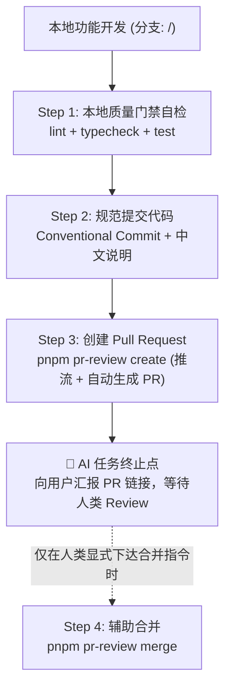

# Snapword CI/CD 与 PR 标准作业程序 (AI SOP)

> 本文档专为协同编程 AI Agent 与开发者编写，定义 Snapword 在代码提交、验证、创建 PR、合并与发版过程中的**硬性规范、权限边界与标准化步骤**。

---

## 🚨 0. AI 行为红线与权限边界 (Safety Guardrails)

1. **“提 PR / 走 PR 流程”严格终止于创建 PR**：
   - 当用户发出“提 PR”、“提交代码并建 PR”、“走 PR 流程”等指令时，AI 的任务**严格终止于成功执行 `pnpm pr-review create` 并向用户提供 PR 网页链接**。
   - 🛑 **严禁擅自执行 `pnpm pr-review merge`**！合并主分支属于不可逆变更，决策权完全属于人类。
2. **合并命令的唯一触发前提**：
   - 只有当用户发出**显式、单独的合并指令**（例如：“确认合并”、“帮我把 PR 合并了”）时，AI 才可以协助执行 `pnpm pr-review merge`。
   - `@app/pr-review` 已内置非交互终端防护与门禁等待校验机制。
3. **严禁擅自发版**：
   - 严禁自主执行 `pnpm release:*` 或向远端推送 release tag。发版必须由人类明确下达指令。
4. **禁止直推主干**：
   - `main` 分支受分支保护锁定（仅允许 squash merge），禁止任何形式的 `git push origin main` 或 bypass 尝试。

---

## 📋 1. AI 标准工作流 SOP (Step-by-Step)



### Step 1: 本地门禁自检（必须全部通过）

提交代码前，必须确保本地检查无任何报错：

```bash
pnpm lint        # Biome 规范与代码格式扫描
pnpm typecheck   # TypeScript 全工作区类型检查
pnpm test        # Vitest 快速单元测试
pnpm test:e2e    # Playwright + Electron 端到端测试（仅 Windows）
```

> Snapword 仅支持 Windows（UIA 取词 / 原生 Addon），e2e 只在 `windows-latest` 或 Windows 本机运行。

### Step 2: 分支管理与规范提交

1. **分支命名规范**：从 `main` 切出，格式为 `<type>/<topic>`（例如 `feat/p4-skeleton`、`fix/tray-flake`）。
2. **提交信息规范**（由 commitlint 校验）：
   - 格式：`<type>(<scope>): <中文说明>`
   - `type` 枚举：`feat` | `fix` | `docs` | `style` | `refactor` | `perf` | `test` | `build` | `ci` | `chore` | `revert`
   - 说明示例：`feat(tray): 增加托盘右键退出菜单`
   - 规则要求：说明部分**必须包含简体中文**，且单行不超过 100 字符。

### Step 3: 创建 Pull Request（AI 终止点 🛑）

```bash
pnpm pr-review create
```

- **该命令行为**：前置状态校验 ➔ 自动推送到远端 ➔ 提取首个提交标题作为 PR 标题 ➔ 按照模板填充正文并创建 GitHub PR。
- **AI 动作要求**：命令执行完成后**立即停步**，将生成的 PR 链接回复给用户，提醒用户审查。**严禁继续执行合并命令！**

### Step 4: 合并 PR（仅当人类显式授权时）

```bash
pnpm pr-review status          # 查看当前 PR 的门禁状态
pnpm pr-review merge           # 等待 CI 门禁全绿后自动 squash 合并，并自动清理远端与本地分支
```

---

## 🛠️ 2. 命令与权限矩阵 (Command & Permissions)

| 命令                               | 作用                                          | AI 权限级别     | 触发前提                         |
| :--------------------------------- | :-------------------------------------------- | :-------------- | :------------------------------- |
| `pnpm lint` / `typecheck` / `test` | 本地质量与单测自检                            | ✅ **自主允许** | 随时自检                         |
| `pnpm test:e2e`                    | 端到端自动化测试（Windows）                   | ✅ **自主允许** | 提交代码前必须验证               |
| `git commit`                       | 规范提交代码                                  | ✅ **自主允许** | 需符合 commitlint 规范           |
| `pnpm pr-review create`            | 推送分支并创建 PR                             | ✅ **自主允许** | 收到用户提 PR / 走 PR 流程意图   |
| `pnpm pr-review status`            | 查看 PR 与门禁状态                            | ✅ **自主允许** | 随时查询状态                     |
| `pnpm pr-review trigger`           | 为当前分支 PR 评论 `/review` 触发 AI 增量复查 | ✅ **自主允许** | 提交修复后触发增量审查           |
| `pnpm pr-review pull`              | 本地拉取 AI Review 多轮看板（保留最近 10 轮） | ✅ **自主允许** | 随时拉取最新审查结论             |
| `pnpm pr-review merge`             | 合并 PR 到 main 分支                          | ⛔ **严格受限** | **必须有用户显式下达的合并指令** |
| `pnpm release:*`                   | 版本升级与打 tag                              | ⛔ **严格受限** | **必须有用户显式下达的发版指令** |

---

## 🔒 3. CI 门禁体系说明

GitHub Actions 流水线（`.github/workflows/ci.yml`）包含四个并行 job：

- **`typecheck`**（**Required**）：TypeScript 全局类型检查（`ubuntu-latest`）。
- **`lint`**（**Required**）：Biome 扫描 + `verify:prebuild` + `i18n:check`（`ubuntu-latest`）。
- **`test`**（**Required**）：Vitest 单元测试（`ubuntu-latest`）。
- **`e2e`**（**Required**）：Playwright + Electron 端到端测试（`windows-latest`，含 `pnpm build` 与 `install-electron`）。

_CodeQL_ 与 _OpenCodeReview_（信息性）：安全漏洞与 AI 增量代码审查（详见 [packages/pr-review/README.md](../packages/pr-review/README.md)）。新开 PR 自动审查；后续提交可在 PR 评论回复 `/review` 手动触发增量复查，不阻塞合入。

分支保护要求所有变更经 PR、squash 合并、以上四个 check 全绿才可合入——`main` 上每个提交都对应一个完整 PR，回滚与 changelog 都以 PR 为单位。

---

## 🚀 4. 发布（Windows-only）

发布流水线（`.github/workflows/release.yml`）：

- **触发**：推送 `v*` tag（由 `pnpm release:*` 产生），或手动 `workflow_dispatch`（仅构建、不发布）。
- **构建**：`windows-latest` 上执行 `pnpm run build:win -- -p never`，产物为 NSIS 安装包与 portable 免安装包。
- **发布**：tag 触发时把 `dist/*.exe`、`*.yml`、`*.blockmap` 上传到 GitHub Releases。
- **不再有 docs 部署**：`packages/docs` 已移除，`.github/workflows/docs-deploy.yml` 不随仓库恢复。

---

## 🔐 5. GitHub Repository Secrets 清单

配置路径：仓库 Settings -> Secrets and variables -> Actions -> New repository secret。

| Secret              | 用途                                  | 缺失时行为                                    |
| :------------------ | :------------------------------------ | :-------------------------------------------- |
| `SENTRY_DSN`        | 构建期注入生产 Sentry DSN             | 生产构建 Sentry 自动关闭，不上报              |
| `SENTRY_AUTH_TOKEN` | 构建期上传 SourceMap 到 Sentry        | Vite 插件自动 disable，跳过上传，构建照常完成 |
| `SENTRY_ORG`        | Sentry 组织标识                       | SourceMap 上传不可用（需与 token 一起配置）   |
| `SENTRY_PROJECT`    | Sentry 项目标识                       | SourceMap 上传不可用（需与 token 一起配置）   |
| `OCR_LLM_URL`       | OpenCodeReview 使用的 OpenAI 兼容端点 | AI 代码审查 job 无法运行                      |
| `OCR_LLM_TOKEN`     | OpenCodeReview 的大模型访问密钥       | AI 代码审查 job 无法运行                      |
| `OCR_LLM_MODEL`     | OpenCodeReview 使用的模型名称         | AI 代码审查 job 无法运行                      |
| `GITHUB_TOKEN`      | 自动注入；用于发布产物上传与 PR 操作  | GitHub 默认注入，无需手动创建                 |

> Windows 代码签名证书（`CSC_LINK` / `CSC_KEY_PASSWORD`）为可选项；不配置时产物未签名，可能触发 SmartScreen 提示。

---

## 📌 6. 与其他文档的关系

- PR 工具链契约唯一真源：[.agents/skills/pr-review/SKILL.md](../.agents/skills/pr-review/SKILL.md)
- 落盘日志规范：[.agents/rules/logging-specification.md](../.agents/rules/logging-specification.md)
- Sentry 生产启用决策：[docs/adr/0004-sentry-production-optin.md](../docs/adr/0004-sentry-production-optin.md)
