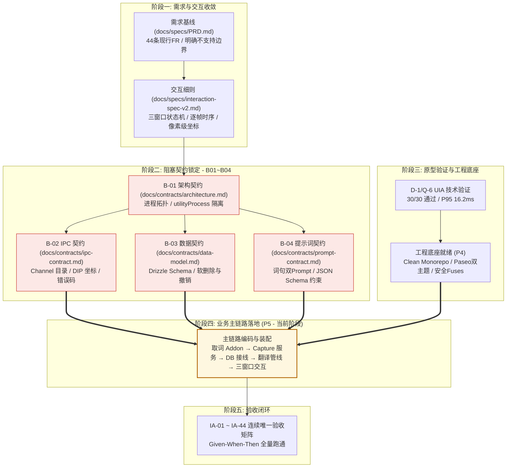
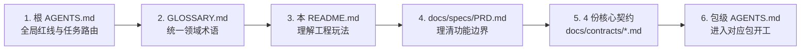

# Snapword 文档体系与工程方法论指南

> 本文档是 `docs/` 目录的总索引，系统阐明 Snapword 项目的**软件开发玩法（工程方法论）**、**文档分层与代号分类依据**以及**研发阅读导航**。

---

## 一、软件工程玩法：契约先行与分层演进

Snapword 是一个高频交互、高可靠性要求的 Windows 桌面工具（纯 Windows UI Automation 取词，不写剪贴板、零服务端）。在研发实践中，本项目彻底摒弃「边写边想、文档滞后于代码」的散装模式，严格遵照**契约驱动（Contract-First）**与**分层推进**的软件工程方法：



### 核心研发守则

1. **门槛纪律：契约没完成，不写业务代码**：
   - 契约文档（B-01～B-04）直接决定了界面的数据结构（例如 `context_snippet` 字段的有无，直接反向决定前端卡片语境块的设计）。没有确定契约前编写业务代码属于无效返工。
2. **单一事实源（Single Source of Truth）**：
   - 会变的事实（如 IPC 消息结构、错误码、表结构）只在一处定义；其他文档与代码只保留引用或指针，杜绝多处复制造成的状态漂移。
3. **文档与代码同 PR 同步**：
   - 严禁「代码已变、文档依然写着旧方案」。修改模块、契约或路由时，同一 PR 内必须同步更新对应的规格与包级 `AGENTS.md`。

---

## 二、文档分类依据与代号速查体系

在项目追踪看板（[progress-checklist.md](progress-checklist.md)）与日常开发中，高频使用了一套严格的字母前缀体系。其分类依据如下：

### 1. P 类：Phase（研发推进阶段）

项目从 0 到 1 的线性生命周期里程碑（Phase 0 ~ Phase 6）：

> **单一事实源原则**：各阶段的实时完成度百分比与当前开工状态统一以 [progress-checklist.md](progress-checklist.md) §1 为唯一真源维护，避免事实多处同步漂移。

| 阶段         | 全称           | 核心目标与交付物                                               | 进入下一阶段的判据                         |
| :----------- | :------------- | :------------------------------------------------------------- | :----------------------------------------- |
| **P0**       | **需求定义**   | 确定产品定位、44 条现行 FR 功能需求、明确 17.2 节不支持项      | PRD 现行需求通过 Given-When-Then 验收审查  |
| **P1 / P1b** | **交互规格**   | 确定三窗口逐帧交互时序、生词本/历史/设置次级页面（IA-01~44）   | 三窗口状态机与像素级坐标算法定稿           |
| **P2**       | **契约锁定**   | 编写并冻结架构、IPC、数据库 Schema、提示词 4 份核心硬契约      | B-01～B-04 阻塞契约完备且通过技术审查      |
| **P3**       | **技术验证**   | 自动化验证 UIA 选区取词可行性（D-1 30/30、Q-6 93.3%）          | 核心取词路径成功率 ≥ 90% 且单次 ≤ 50ms     |
| **P4**       | **工程底座**   | 干净 temp5 基座、Paseo 双主题注入、Electron Fuses、E2E/CI 门禁 | 工程骨架与门禁全绿，窗口底色与主题切换可用 |
| **P5**       | **主链路开发** | 取词 Addon → Capture 守护 → DB 接线 → 翻译 → 三窗口 → 收藏     | 主链路全通（选中 → 圆点 → 卡片 → 收藏）    |
| **P6**       | **打包发布**   | 生成 Windows NSIS 安装包、Portable 便携版与发版 Checklist      | CI 构建成功并产出带校验码的分发包          |

---

### 2. B 类：Baseline & Blocker（契约与质量基线文档）

B 类文档代表研发团队的**交付基线与质量屏障**：
- **B-01 ~ B-04（核心阻塞契约 Blocking Contracts）**：代码实现的硬约束，直接物理收敛在 `docs/contracts/` 目录下。
- **B-05 ~ B-12（质量与发布配套物料）**：测试用例集、错误码表、评测集、隐私与发布说明。

```text
B-01 技术架构契约  ──> docs/contracts/architecture.md    (进程拓扑 / 崩溃恢复)
B-02 IPC 通信契约    ──> docs/contracts/ipc-contract.md    (Channel 目录 / DIP 坐标)
B-03 数据库 Schema   ──> docs/contracts/data-model.md     (Drizzle ORM / 软删除撤销)
B-04 提示词契约      ──> docs/contracts/prompt-contract.md (词句双 Prompt / 占位符保护)
B-05~B-08 质量规格  ──> 测试用例集 / 错误码表 / 50条评测集 / 构建说明
B-09~B-12 发布合规  ──> PRIVACY.md / FAQ / CHANGELOG.md / Issue 模板
```

---

### 3. C 类：Cavity & Gap（规格空洞与细节填补）

在需求到契约落地期间，专门针对模糊地带识别出的 8 项**规格真空（Cavity）**。全部已完成推导并合流关闭：

- `C-01`：生词本页面交互（列表、空态、批量、导出二次确认）➔ _已合入 `interaction-spec-v2.md`_
- `C-02`：「最近」历史入口形式（翻译页前 5 条历史）➔ _已合入 `interaction-spec-v2.md`_
- `C-03`：诊断页规范（8 项系统检查与操作）➔ _已合入 `interaction-spec-v2.md`_
- `C-04`：术语表管理规则（表格导入导出与校验）➔ _已合入 `interaction-spec-v2.md`_
- `C-05`：视觉设计规范（Paseo 双主题令牌表）➔ _已落地 `packages/renderer/docs/DESIGN.md`_
- `C-06`：i18n 国际化布局规则（40 字符超宽门禁）➔ _已合入 `interaction-spec-v2.md`_
- `C-07`：代理与网络链路（跟随系统网络栈，统一 net.fetch）➔ _已落地 `architecture.md`_
- `C-08`：深色主题策略（浅/深/跟随系统）➔ _已合入 `interaction-spec-v2.md`_

---

### 4. 其他核心代号速查

| 代号                  | 全称                             | 作用与示例                                                                                                 |
| :-------------------- | :------------------------------- | :--------------------------------------------------------------------------------------------------------- |
| **A-**                | **Agreements / Action items**    | 顶层架构与业务决策项（如 `A-01` 补齐 `context_snippet` 字段、`A-03` 生词本唯一键）                         |
| **D-**                | **Deliverables / Discovery**     | 前期阶段性交付物（`D-01`～`D-16`）与自动化探针 Demo（`D-1` UIA 可行性实测）                                |
| **FR-**               | **Functional Requirement**       | [docs/specs/PRD.md](specs/PRD.md) 中的功能需求清单（`FR-01` ~ `FR-53`）                                    |
| **IA-**               | **Interaction Acceptance**       | MVP 阶段连续唯一的 44 条交互验收准则（`IA-01` ~ `IA-44`，Given-When-Then）                                 |
| **RD / RC / RM / RX** | **Requirement Window-Specific**  | 按三窗口划分的界面交互细则：`RD-` (Dot 圆点)、`RC-` (Card 卡片)、`RM-` (Main 主窗口)、`RX-` (Cross 跨窗口) |
| **ADR**               | **Architecture Decision Record** | 固化且不可逆的技术架构决策存档（见 `docs/adr/`）                                                           |

---

## 三、`docs/` 目录物理结构与文件索引

当前 `docs/` 目录已全面完成物理子目录结构重构，形成**规格（specs）、契约（contracts）、决策（adr）、预研（research）**四维一体的文件拓扑：

```text
docs/
├── README.md                          # [本文件] 文档体系、工程玩法与分类总索引
├── progress-checklist.md              # [开发看板] P0~P6 进度度量、技术欠账与待办总表
│
├── specs/                             # 需求与交互规格 (What & How it behaves)
│   ├── PRD.md                         # 产品需求文档 v3.0 (功能需求、边界、验收大纲)
│   └── interaction-spec-v2.md         # 交互规格细则 v2.1 (三窗口状态机、逐帧时序、坐标算法)
│
├── contracts/                         # 核心技术契约 (Single Source of Truth for Code)
│   ├── architecture.md                # B-01 技术架构契约 (进程拓扑、utilityProcess、崩溃恢复)
│   ├── ipc-contract.md                # B-02 IPC 通信契约 (通道目录、DIP 物理坐标系、错误处理)
│   ├── data-model.md                  # B-03 数据库契约 (Drizzle ORM、软删除/撤销、迁移约定)
│   └── prompt-contract.md             # B-04 提示词契约 (词/句双 Prompt 模板、JSON Schema 约束)
│
├── adr/                               # 架构决策记录 (Architecture Decision Records)
│   ├── 0001-placeholder-token-format.md  # 占位符 Token 采用 Unicode 私有区 (PUA)
│   ├── 0002-temperature-default-zero.md  # 翻译请求默认锁定 temperature=0
│   ├── 0003-use-drizzle-orm.md            # 数据库访问改用 Drizzle ORM + node:sqlite
│   └── 0004-sentry-production-optin.md   # Sentry 仅在生产构建中按 DSN 显式启用
│
├── research/                          # 技术探针与预研数据 (Spikes & Feasibility Reports)
│   ├── uia-validation-2026-11.md          # Windows UIA 自动化选区取词验证报告 (30/30)
│   └── immersive-translate-interaction-2026-11.md # 本机沉浸式翻译 1.34.4 交互实测剖析
│
└── agents/                            # 代理协作规则 (Issue 映射与标签体系)
    ├── domain.md                      # 领域文档导读指引
    ├── issue-tracker.md               # GitHub Issue 跟踪与协作规范
    └── triage-labels.md               # 任务分类与分流标签映射表
```

---

## 四、新人与协作者最佳阅读路线

进入仓库工作或接手模块时，推荐遵循以下顺序阅读：



1. **第 1 步**：通读根目录 [AGENTS.md](../AGENTS.md)，建立工程全局红线（零桶文件、依赖所有权原则、代码与文档同步纪律）。
2. **第 2 步**：查阅根目录 [GLOSSARY.md](../GLOSSARY.md)，校准项目专有词汇（划词/取词、三窗口模型、语境义等），杜绝术语漂移。
3. **第 3 步**：查阅 [docs/specs/PRD.md](specs/PRD.md) 第 17.2 节，牢记产品**明确不支持**的边界（暂不做跨域 iframe / 全屏应用 / canvas / 管理员权限窗口）。
4. **第 4 步**：根据所要实现的任务，精读 `docs/contracts/` 下对应的契约文件（编写 IPC 读 `ipc-contract.md`，编写 DB 读 `data-model.md`）。
5. **第 5 步**：进入 `packages/<target>/AGENTS.md` 开展对应包的开发与测试。
