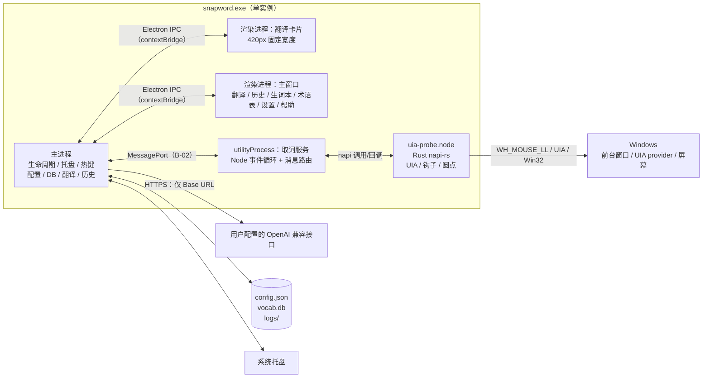
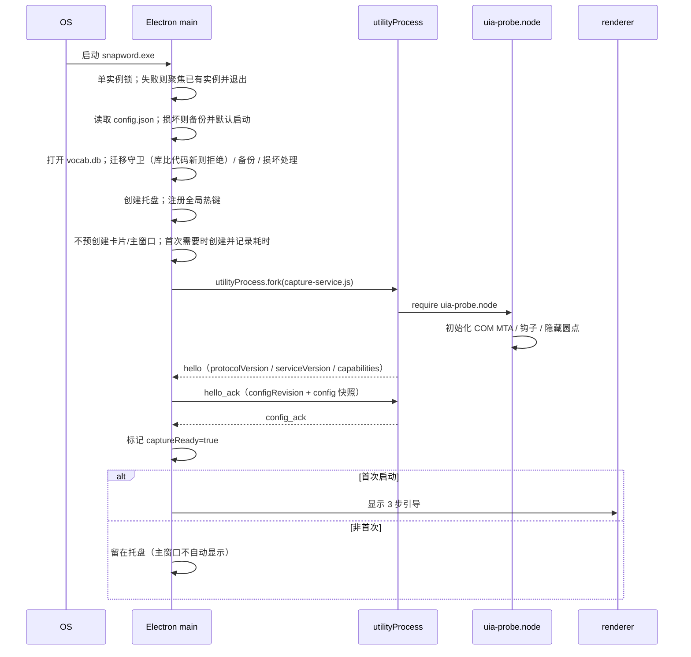

# Snapword 技术架构契约 v1.2（B-01，utilityProcess + Native Addon）

> 文档状态：**已定稿，可直接据此搭工程骨架**
> 变更：v1.2（2026-11-04）数据库访问改为 **Drizzle ORM + Node 内置 `node:sqlite`**；删除改为软删除 + 墓碑；同步（v1.1）预留每设备快照。详见 `docs/adr/0003-use-drizzle-orm.md`。
> 变更：v1.1 按 2026-11-03 决策，从「独立 Rust exe + 命名管道」改为 **Electron `utilityProcess` + Node 原生插件**。
> 适用范围：Windows 10 1809+ / Windows 11 x64；Chrome / Edge 138+
> 上游依据：`docs/PRD.md` v3.0（功能需求与交互摘要）、`docs/interaction-spec-v2.md`（交互需求条目、时序与状态）
> 下游契约：`docs/ipc-contract.md`（B-02）、`docs/data-model.md`（B-03）、`docs/prompt-contract.md`（B-04）
> 本契约解决：进程拓扑、职责边界、Native Addon 拆分、线程模型、启动/退出顺序、崩溃恢复、窗口与数据所有权、安全边界。

---

## 1. 架构结论

采用 **Electron 主进程 + 两个渲染窗口 + 一个取词 utilityProcess + 一个 Native Addon**：

| 进程/模块    | 形态                     | 语言/运行时           | 核心职责                                                                           |
| ------------ | ------------------------ | --------------------- | ---------------------------------------------------------------------------------- |
| 主进程       | `snapword.exe`           | Electron / Node.js    | 生命周期、托盘、热键、卡片/主窗口、配置、SQLite、翻译请求、历史、TTS、utility 守护 |
| 渲染进程 ×2  | 同 `snapword.exe`        | Chromium / TypeScript | 卡片 UI、主窗口 UI；sandbox，不接触 Node/文件/Key                                  |
| 取词服务     | `utilityProcess`（Node） | Node.js               | 加载 Native Addon、消息路由、生命周期、错误上报                                    |
| Native Addon | `uia-probe.node`         | Rust / napi-rs        | 全局鼠标钩子、UIA 取词、选区坐标、原生圆点、前台窗口事件                           |

**为什么选 B（utilityProcess + addon）而不是 A（主进程内 addon）或 C（独立 exe）**：

- 相对 A：UIA/COM 崩溃只杀 utilityProcess，主进程可重启它；主窗口、托盘、翻译页继续可用。
- 相对 C：不需要单独 exe、命名管道、独立签名；复用 Electron 的 `utilityProcess` 生命周期与 MessagePort，打包/调试更简单。
- 代价：Native Addon 仍绑定 Electron/Node ABI；utilityProcess 是 Node，Key/网络隔离不如独立 exe 硬；需要自己实现 utility 守护与消息协议。

> **关键边界**：Key 只在主进程；取词服务不接收 Key，也不发起网络请求。取词服务只加载 addon 和 `parentPort`，代码审查禁止引入 `http`/`https`/`net`/`tls` 等模块。

---

## 2. 进程拓扑



### 2.1 部署形态

```
安装目录/
├── snapword.exe                 # Electron 主程序
├── resources/
│   ├── app.asar                 # 主进程 / preload / 渲染资源 / capture-service.js
│   ├── app.asar.unpacked/
│   │   └── native/
│   │       └── uia-probe.node   # Rust napi-rs 原生插件
│   └── drizzle/                 # Drizzle 迁移（migrate() 运行时读盘）
│       └── 20261104120000_init/
│           ├── migration.sql
│           └── snapshot.json
└── ...
%APPDATA%/Snapword/
├── config.json                  # 配置（API Key 为 safeStorage 密文；设备本地项）
├── vocab.db                     # SQLite（生词本 + 术语表 + 可同步设置）
├── logs/                        # 脱敏日志，保留 7 天
└── temp/                        # 云 TTS 临时音频，退出清理
```

`uia-probe.node` 必须放在 `asar.unpacked`；utilityProcess 通过绝对路径 `require`，**禁止**从用户可写目录或 PATH 加载同名插件。

`drizzle/` 随包分发（建议 `extraResources`）；开发期用 `app.getAppPath()` 定位，打包后用 `process.resourcesPath`。`migrate()` 用 `fs` 读盘，不读 snapshot，但 journal 在 v1 RC 中已取消，整个目录都要在。

---

## 3. 职责边界

| 能力                     | 取词服务（utilityProcess） | Native Addon   | 主进程                  | 渲染进程      |
| ------------------------ | -------------------------- | -------------- | ----------------------- | ------------- |
| 全局鼠标钩子 / UIA 取词  | 调用 addon                 | **拥有**       | 不接触                  | 不接触        |
| 原生圆点窗口             | 调用 addon                 | **拥有**       | 只发 `hide_dot`         | 不接触        |
| 前台窗口 / 全屏检测      | 路由事件                   | **拥有**       | 消费事件                | 不接触        |
| 翻译请求 / 流式解析      | 不做                       | 不做           | **拥有**                | 只渲染        |
| API Key / Base URL       | **不可见**                 | **不可见**     | **拥有**（safeStorage） | **不可见**    |
| 配置持久化               | 只接收快照                 | 只接收配置     | **拥有**                | 只提交变更    |
| SQLite / 生词本 / 术语表 | 不接触                     | 不接触         | **拥有**                | 通过 IPC 查询 |
| 会话历史（20 条，内存）  | 不接触                     | 不接触         | **拥有**                | 只读视图      |
| 卡片窗口 / 主窗口        | 不接触                     | 不接触         | **拥有**                | 渲染内容      |
| 托盘 / 热键 / 单实例     | 不接触                     | 不接触         | **拥有**                | 不接触        |
| TTS                      | 不接触                     | 不接触         | **拥有**                | 只触发        |
| 日志落盘                 | 只上报错误码/耗时          | 只返回诊断字段 | **拥有** 统一日志       | 只显示        |

**硬边界**：

1. 取词服务**禁止**接收 API Key、Base URL 或任何翻译结果。
2. 取词服务**禁止**引入网络模块（`http`/`https`/`net`/`tls`/`dns`）或发起网络请求；代码审查 + ESLint `no-restricted-imports`。
3. 渲染进程**禁止** `require`、`fs`、`child_process`、`process.env`；只能通过 preload 暴露的白名单 API。
4. 任何进程都**禁止**使用剪贴板 API 读取选区，**禁止** `SendInput` / `keybd_event` 模拟 `Ctrl+C`。
5. Native Addon 只在 utilityProcess 中加载；**禁止**在主进程或 renderer 中 `require` 它。

---

## 4. Native Addon 拆分

**结论：一个 `.node`，内部两个 Rust crate/module。**

```
native/
├── Cargo.toml          # workspace
├── uia-probe/          # crate: UIA 取词、段落、RangeFromPoint
├── dot-window/         # crate: Win32 分层窗口、鼠标钩子
└── src/lib.rs          # napi 导出：probeSelection / startDot / stopDot / diagnose
```

### 4.1 为什么不是一个 addon 拆两个 `.node`

- 两个 `.node` 仍加载在**同一个 utilityProcess**，原生崩溃照样带走整个 utility；没有隔离收益。
- 两个 addon 各自初始化 COM/worker/钩子，或互相调用，状态重复；圆点位置依赖 UIA rect，点击时又要读实时选区，耦合很紧。
- 两个 addon = 两套构建、两套 ABI、两套打包/签名；N-API 缓解 ABI，但不消除平台构建与加载路径问题。
- 一个 addon 内用 Rust crate/module 分层，已经能得到清晰的职责边界和独立单元测试。

### 4.2 什么时候才拆两个 `.node`

只有在**两个不同进程**里使用时才有意义，例如：

- 圆点窗口独立成另一个 utilityProcess；
- UIA 取词服务独立成另一个 utilityProcess。

那需要跨进程 IPC，且圆点点击时要读实时选区，延迟/状态同步更复杂。MVP 不做。

### 4.3 Addon 对外 API（napi 导出）

| 导出                                                  | 用途                                               |
| ----------------------------------------------------- | -------------------------------------------------- |
| `probeSelection(timeoutMs?)`                          | 产品接口：`text / rects / errorCode / processName` |
| `probeSelectionDetailed(timeoutMs?, windowTitle?)`    | 审计接口                                           |
| `probeExpandUnits(timeoutMs?, windowTitle?)`          | Q-1 审计                                           |
| `probeRangeFromPoint(x, y, timeoutMs?, windowTitle?)` | Q-6 审计/兜底                                      |
| `startDot(callback)` / `stopDot()`                    | 原生圆点线程                                       |
| `diagnose()`                                          | 钩子/COM/圆点状态                                  |

`capture-service.js` 只负责把这些 API 包装成 B-02 消息；不把 addon 对象透传给主进程。

---

## 5. 线程模型

### 5.1 utilityProcess

| 线程/机制                | 职责                                                         | 阻塞约束                                |
| ------------------------ | ------------------------------------------------------------ | --------------------------------------- |
| Node 事件循环            | `process.parentPort` 消息、生命周期、调用 addon              | 不执行 UIA                              |
| Native Addon `host-com`  | 专用 COM MTA 线程；UIA 取词/段落/RangeFromPoint              | 单次硬超时 500ms；超时放弃线程并换新    |
| Native Addon `host-hook` | `WH_MOUSE_LL` 鼠标钩子；mouse-up 只做进程名/白名单判定并入队 | 钩子回调 ≤5ms，**禁止**在钩子里直接 UIA |
| Native Addon `host-dot`  | 原生圆点窗口消息循环；显示/隐藏/点击                         | 不执行 UIA；点击后把请求交给 `host-com` |

**COM 规则**：

- 每个 `host-com` 线程启动时 `CoInitializeEx(COINIT_MULTITHREADED)`。
- 同一时刻只允许一个 UIA 探测在飞；新请求在队列中最多保留 1 个，旧的候选请求被丢弃。
- 超时后放弃孤儿线程，下次请求创建新线程；utilityProcess 不因单次超时退出。
- 圆点在 `mouse-up` 后出现延迟预算 ≤120ms；UIA 探测必须在 `host-com` 上完成后再显示圆点。

### 5.2 Electron 主进程

| 机制                                 | 职责                                                |
| ------------------------------------ | --------------------------------------------------- |
| Electron main event loop             | 窗口、托盘、热键、IPC、配置、请求编排、utility 守护 |
| `worker_threads`（导出/批量删除）    | 超过 50ms 的 DB 批量操作、CSV/JSON 导出             |
| Electron `net.fetch`（跟随系统代理） | 翻译请求与流式读取；不阻塞主线程                    |
| `safeStorage`                        | API Key 加解密（Windows DPAPI）                     |

数据库使用 **Drizzle ORM**（`drizzle-orm@1.0.0-rc.5`）+ Node 内置 **`node:sqlite`**（`DatabaseSync`）同步 API；`src/main/db/schema.ts` 是 schema 唯一事实源，迁移 SQL 由 `drizzle-kit generate` 生成并提交。单条查询必须在 5ms 内完成。批量操作/导出走 worker，避免阻塞 UI。

**Electron 版本**：MVP 锁 **42.11.18 或 45.2.2**（Node 24.19/24.22，SQLite 3.53.3/3.53.4，`node:sqlite` 无 experimental warning）。38/39 可用但会打 Node 22 的 experimental warning；**禁止 37.2.0–37.2.2**（`node:sqlite` 缺失）；34 及更早没有 `node:sqlite`。

**迁移连接与运行时连接分离**：迁移连接以 `enableForeignKeyConstraints: false` 打开，`migrate()` + 版本守卫后关闭；运行时连接再开 `foreign_keys=ON`。原因：rc.5 的整批迁移在一个事务里，`PRAGMA foreign_keys=OFF` 在事务内是 no-op，表重建 + `ON DELETE CASCADE` 会静默删子表（#5782/#6621）。

若 P4 复现发现不可用，回退 `better-sqlite3`；schema、迁移、软删除与同步设计不变，只换驱动。

### 5.3 渲染进程

- `sandbox: true`、`contextIsolation: true`、`nodeIntegration: false`。
- 卡片窗口与主窗口各自独立 renderer；崩溃互不影响。
- 所有跨进程调用经 preload 白名单；preload 不暴露任意 channel。

---

## 6. 状态所有权

| 状态                             | 所有者                | 生命周期                     | 说明                                            |
| -------------------------------- | --------------------- | ---------------------------- | ----------------------------------------------- |
| 白名单、圆点开关、全屏抑制       | 主进程（配置）        | 持久                         | 变更后通过 `config_update` 下发取词服务         |
| 当前前台窗口 / 是否全屏          | Native Addon          | utilityProcess 内            | 变化时上报 `foreground_changed`                 |
| 当前圆点候选（文本、rects、seq） | Native Addon          | 单次候选                     | 点击后随 `dot_clicked` 交给主进程；隐藏即丢弃   |
| 卡片当前结果 / 展示会话          | 主进程                | 卡片展示会话                 | 卡片关闭即结束；主窗口请求独立                  |
| 会话历史 20 条                   | 主进程                | 应用运行期                   | 退出清空；卡片与翻译页共用                      |
| 翻译页输入与最近结果             | 主进程 + renderer     | 应用运行期                   | renderer 崩溃后由主进程快照恢复                 |
| 生词本 / 术语表 / 可同步设置     | 主进程（SQLite）      | 持久                         | 单写者；软删除墓碑供 5 秒撤销与同步删除传播     |
| 配置                             | 主进程（config.json） | 持久                         | 原子写：临时文件 + rename；只存密钥与设备本地项 |
| 同步快照（v1.1）                 | 主进程                | 持久（用户选择的云盘文件夹） | 每设备一份 JSON；不直接同步 `vocab.db`          |
| 日志                             | 主进程                | 7 天滚动                     | 取词服务只上报脱敏错误码/耗时                   |
| 卡片窗口位置                     | 主进程                | 应用运行期                   | 重启恢复「跟随选区」                            |
| 主窗口大小/位置                  | 主进程（配置）        | 持久                         | 关闭到托盘不丢                                  |

---

## 7. 启动顺序



**启动失败处理**：

| 失败点                     | 处理                                                                          |
| -------------------------- | ----------------------------------------------------------------------------- |
| 单实例锁被占用             | 聚焦已有主窗口；不启动第二个实例                                              |
| config.json 损坏           | 备份 `config.bak`；默认配置启动；托盘提示                                     |
| vocab.db 损坏              | 重命名 `vocab.corrupt.db`；新建空库；托盘提示                                 |
| vocab.db 来自更新版本      | 迁移名集合有本地不存在的记录；拒绝写入；提示「数据库来自更新版本」，只读/退出 |
| 迁移未完整应用             | 本地迁移名未全部出现在 `__drizzle_migrations`；恢复迁移前备份；提示           |
| utilityProcess fork 失败   | 托盘提示「取词服务未启动」；主窗口翻译页仍可用；每 3s 重试，最多 3 次         |
| addon 加载失败（路径/ABI） | 取词服务上报 `AddonLoadFailed`；主进程提示诊断；不重试到死循环                |
| utility 5s 内未 hello      | 终止并重启；连续 3 次失败进入 degraded，不再自动重试                          |
| 热键注册失败               | 设置页提示冲突；不阻塞启动；旧热键若仍可用则保留                              |
| 首次创建卡片窗口失败       | 托盘提示；主窗口翻译页仍可用                                                  |

---

## 8. 退出顺序

**托盘「退出」**：

1. 停止接受新取词（`captureEnabled=false`）。
2. 注销全局热键。
3. 向取词服务发送 `shutdown`，等待 `shutdown_ack` ≤1s；超时则 `utilityProcess.kill()`。
4. 中止所有进行中的翻译请求（卡片与主窗口）。
5. 关闭卡片/主窗口；销毁托盘。
6. 关闭 SQLite（`PRAGMA wal_checkpoint(TRUNCATE)`）。
7. 清理 `temp/` 下的云 TTS 音频。
8. 退出 Electron。

**关闭主窗口**：只隐藏到托盘，不触发上述流程；取词服务与卡片继续工作。

**Windows 注销/关机**：Electron `session-end` / `before-quit` 走同一退出流程；utilityProcess 随主进程退出，避免孤儿进程。

---

## 9. 崩溃恢复

### 9.1 恢复矩阵

| 崩溃/故障                        | 检测                       | 恢复                                                    | 用户可见                                               |
| -------------------------------- | -------------------------- | ------------------------------------------------------- | ------------------------------------------------------ |
| utilityProcess 退出              | `exit` 事件 / 心跳缺失 12s | 3s 内重新 fork；重新 hello + config；重装钩子；隐藏圆点 | 前 2 次静默；第 3 次托盘提示「取词服务异常」+ 诊断入口 |
| utilityProcess 连续 3 次启动失败 | 重启计数                   | 停止自动重启；`captureReady=false`                      | 托盘提示；主窗口翻译页仍可用                           |
| Native Addon 崩溃                | utilityProcess 退出        | 同 utilityProcess 退出                                  | 同上一行                                               |
| UIA 单次超时                     | `host-com` 500ms           | 放弃孤儿线程；下次请求换新线程                          | 本次取词失败；卡片显示超时/重试                        |
| 渲染进程崩溃（卡片）             | `render-process-gone`      | 重建卡片窗口；从主进程快照恢复当前结果；不新增历史      | 卡片短暂消失后恢复；进行中的卡片请求中止               |
| 渲染进程崩溃（主窗口）           | 同上                       | 重建主窗口；恢复上次页面、搜索词、翻译页输入与结果      | 页面恢复；不丢历史/生词本                              |
| 主进程崩溃                       | 进程消失                   | 应用退出；utilityProcess 随父进程退出                   | 下次启动单实例恢复；未完成请求不落历史                 |
| SQLite 写失败                    | `SQLITE_BUSY` / IO         | 重试 1 次；仍失败内联错误                               | 收藏/术语保存失败可重试                                |
| SQLite 损坏                      | `SQLITE_CORRUPT`           | 重命名损坏文件；新建空库；提示                          | 生词本清空；可从备份恢复                               |
| 数据库来自更新版本               | 迁移名集合含本地未知记录   | 拒绝写入；只读/退出                                     | 提示「数据库来自更新版本」                             |
| 迁移未完整应用                   | 本地迁移名未全部落库       | 恢复迁移前备份；保留损坏副本                            | 提示；不带着半迁移的库运行                             |
| config.json 损坏                 | JSON 解析失败              | 备份 `config.bak`；默认配置                             | 设置页提示重新配置                                     |
| 云 TTS 失败                      | HTTP/超时                  | 回落系统 TTS；清理临时文件                              | 一次性提示                                             |

### 9.2 utilityProcess 重启后必须重建的状态

1. MessagePort 连接与协议握手。
2. Native Addon 的 COM MTA 线程、鼠标钩子、隐藏圆点窗口。
3. 白名单、圆点开关、全屏抑制、超时配置。
4. 前台窗口快照与 `captureReady=true`。
5. **不重建**：卡片当前结果、会话历史、进行中的翻译请求——这些归主进程，utility 重启不影响。

### 9.3 主进程重启后的恢复

- 单实例锁确保只有一个主进程。
- utilityProcess 随主进程退出，不会留下孤儿；启动时若发现残留 utility，按 PID 清理。
- 会话历史不恢复（内存）；生词本/术语表/配置从磁盘恢复。
- 卡片与主窗口位置：主窗口恢复上次；卡片恢复「跟随选区」。

---

## 10. 窗口模型

### 10.1 翻译卡片（Electron BrowserWindow）

| 属性 | 值                                                   |
| ---- | ---------------------------------------------------- |
| 尺寸 | 固定 420px 宽；高度随内容，最大 70% 工作区；不可缩放 |
| 框架 | `frame: false`；自绘头部                             |
| 显示 | `showInactive()`；不抢键盘焦点                       |
| 层级 | `alwaysOnTop: true`；`skipTaskbar: true`             |
| 焦点 | 点击后获焦；未获焦时鼠标操作仍可用                   |
| 位置 | 屏幕 DIP 坐标；默认选区右下，越界回退；仅主显示器    |
| 全屏 | 不保证显示；失败托盘提示 + 主窗口（Q-2 暂不支持）    |
| 关闭 | 关闭按钮 / 外部点击 / 切换应用；防误关只阻止外部点击 |

卡片窗口**按需创建**：首次打开时创建，记录 `card.createMs` 与 `card.firstPaintMs` 到诊断日志；关闭只隐藏并复用同一实例。**不预创建**，首次创建允许超过 200ms，后续再优化预热/预创建。

### 10.2 主窗口（Electron BrowserWindow）

| 属性     | 值                                                    |
| -------- | ----------------------------------------------------- |
| 默认尺寸 | 1200 × 800；最小 960 × 640                            |
| 位置     | 居中主屏；记住大小/位置                               |
| 关闭     | 隐藏到托盘；首次提示一次                              |
| 单实例   | 第二次启动聚焦已有窗口                                |
| 页面     | 翻译 / 翻译历史 / 生词本 / 术语表 / 设置 / 帮助与诊断 |

### 10.3 圆点（Native Addon 的 Win32 窗口）

| 属性     | 值                                                     |
| -------- | ------------------------------------------------------ |
| 视觉     | 10 × 10 px 正圆；1px 白描边；轻微阴影                  |
| 热区     | ≥24 × 24 px                                            |
| 样式     | `WS_EX_LAYERED                                         | WS_EX_TOOLWINDOW | WS_EX_TOPMOST | WS_EX_NOACTIVATE` |
| 生命周期 | utilityProcess 启动时创建并隐藏；复用；不重复创建/销毁 |
| 交互     | 点击打开卡片；悬停只做微弱提示；不拖拽、不缩放         |
| 全屏     | 不显示；热键仍可用                                     |

---

## 11. 数据与文件所有权

| 数据                                    | 所有者     | 写入方式                  | 备注                                                  |
| --------------------------------------- | ---------- | ------------------------- | ----------------------------------------------------- |
| `config.json`                           | 主进程     | 原子写（`.tmp` + rename） | Key 为 safeStorage 密文；设备本地项；损坏备份         |
| `vocab.db`                              | 主进程     | WAL；单写者；Drizzle 迁移 | schema 见 B-03；软删除墓碑；可同步设置在 `setting` 表 |
| `sync/snapword-<deviceId>.json`（v1.1） | 主进程     | 原子写；每设备一份        | 用户选择的云盘文件夹；明文；不含 Key/Base URL/日志    |
| `logs/`                                 | 主进程     | 追加写；7 天滚动          | 脱敏；禁止原文/译文/Key                               |
| `temp/`                                 | 主进程     | 云 TTS 临时音频           | 退出清理                                              |
| 会话历史                                | 主进程内存 | 环形 20 条                | 退出清空                                              |
| 卡片当前结果                            | 主进程内存 | 单条                      | 关闭丢弃                                              |

**禁止**：utilityProcess/Addon 写 `config.json`/`vocab.db`；渲染进程直接读写任何文件。

---

## 12. 安全边界

1. **Key**：只存在主进程；`safeStorage` 加密；utilityProcess、Addon、renderer 均不可见；日志/导出/崩溃报告不包含。
2. **选区文本**：Addon 只在内存中持有当前候选；`dot_hidden` 后丢弃；不写日志；主进程只在内存历史/用户主动收藏时保留。
3. **utilityProcess 网络**：取词服务代码只允许 `require` addon 与 `parentPort`；ESLint `no-restricted-imports` 禁止 `http`/`https`/`net`/`tls`/`dns`；构建时扫描依赖。
4. **消息校验**：主进程与取词服务都校验 `type`、`protocolVersion`、字段类型/长度；拒绝未知/超限消息。
5. **渲染隔离**：`sandbox`、`contextIsolation`、CSP；preload 白名单；禁止 `eval`/远程模块。
6. **权限**：不申请管理员、不写 HKLM、不注入进程、不修改他人窗口。
7. **Addon 路径**：只从 `app.asar.unpacked/native/uia-probe.node` 加载；校验文件存在与版本。
8. **Sentry**：仅生产构建（`app.isPackaged`）且构建期显式配置 DSN 时初始化并上报；开发/测试构建不初始化、不上报；初始化位置在单实例锁之后。开启时抓包可见 Sentry 上报域名，这是「仅 Base URL」验收的唯一例外（ADR-0004）。
9. **telemetry**：仅进程内/IPC trace context，不远程导出、不落盘。

---

## 13. 性能预算

| 指标                              |                                         预算 | 归属              |
| --------------------------------- | -------------------------------------------: | ----------------- |
| 鼠标抬起 → 圆点首帧               |                                   P95 ≤120ms | Addon             |
| 点击圆点 → 卡片骨架首帧（稳定态） |                                   P95 ≤200ms | 主进程 + 渲染     |
| 首次创建卡片窗口                  | 记录 `createMs` / `firstPaintMs`，不设硬门槛 | 主进程；后续优化  |
| 单次 UIA 取词                     |            P95 ≤50ms（D-1 实测 16.2/24.2ms） | Addon             |
| utilityProcess 空闲 CPU           |                                        <0.5% | 取词服务          |
| 主进程 + utilityProcess 空闲内存  |                                       ≤250MB | 主进程 + 取词服务 |
| utilityProcess 崩溃恢复           |                                          ≤3s | 主进程守护        |
| 页面切换                          |                                       ≤100ms | 渲染              |

---

## 14. 暂不支持（不再验证）

- Q-2：全屏应用下卡片置顶。
- Q-7：Chrome <138、企业 `UiAutomationProviderEnabled` 策略回退。
- 多显示器第二屏。
- 跨域 iframe（仅同源 iframe）。
- canvas / PDF 阅读器。
- 管理员权限窗口。

这些场景不进入架构承诺；实现不得为了覆盖它们引入模拟复制、注入、管理员权限或额外常驻进程。

---

## 15. 架构决策记录（ADR-lite）

| 决策               | 选择                                                 | 理由                                                                                                               |
| ------------------ | ---------------------------------------------------- | ------------------------------------------------------------------------------------------------------------------ |
| 取词进程           | `utilityProcess` + Native Addon                      | 进程隔离（崩溃可重启）；比独立 exe 少一套 IPC/打包；复用 Electron 生命周期                                         |
| 不选主进程内 addon | —                                                    | 原生崩溃会带走整个应用；Key 与 UIA 同进程，安全边界差                                                              |
| 不选独立 exe       | —                                                    | 需要自建命名管道、独立签名、两套日志；MVP 复杂度更高                                                               |
| Addon 拆分         | 一个 `.node`，两个 Rust crate                        | 同进程拆分无隔离收益；crate 层已能分离职责                                                                         |
| 窗口技术           | Electron BrowserWindow + 原生圆点                    | 卡片/主窗口复用 Web 技术；圆点需要 Win32 无激活置顶                                                                |
| 通信               | Electron MessagePort                                 | 无需自建管道/帧格式；structured clone；主进程可直接守护 utility                                                    |
| 数据库             | SQLite（Drizzle ORM + node:sqlite）                  | schema-as-code 单一事实源；迁移可 review；内置驱动少一个原生依赖；已实测可用，rc.5 缺陷有规避；回退 better-sqlite3 |
| Electron 版本      | 42.11.18 / 45.2.2                                    | Node 24.19+，`node:sqlite` 无 experimental warning；37.2.0–37.2.2 禁用；38/39 可用但会告警                         |
| 删除               | 软删除 + 墓碑                                        | 5 秒真实撤销；同步可传播删除；硬删除无法跨设备                                                                     |
| 同步（v1.1）       | 每设备快照 JSON + 按记录 LWW                         | 无服务器/账号/云盘 API；不把 DB 文件放进云盘                                                                       |
| 配置               | config.json + safeStorage + setting 表               | 密钥加密；可同步设置共用 DB 合并路径；损坏可恢复                                                                   |
| 历史               | 内存 20 条                                           | 隐私；退出清空；两入口共用                                                                                         |
| 翻译               | 主进程异步 fetch（Electron net.fetch，见「网络」行） | Key 只在主进程；流式转发给渲染                                                                                     |
| 网络               | Electron net.fetch                                   | Chromium 网络栈自动跟随系统代理；不提供应用内代理设置，中转用户改 Base URL                                         |
| 渲染安全           | sandbox + contextIsolation                           | 最小权限；不暴露 Node                                                                                              |

---

## 16. 验收

- [ ] `utilityProcess` 能加载 `uia-probe.node` 并完成 hello/hello_ack/config_ack。
- [ ] 首次打开卡片记录 `createMs` / `firstPaintMs`；第二次打开复用同一窗口。
- [ ] 杀死 utilityProcess 后 3s 内重启并恢复取词。
- [ ] utilityProcess 重启后卡片当前结果与历史不丢。
- [ ] 渲染进程崩溃后卡片/主窗口可重建，翻译页输入不丢。
- [ ] 主进程退出时 utilityProcess 随之退出，无孤儿进程。
- [ ] 关闭主窗口只隐藏到托盘；托盘退出按第 8 节顺序清理。
- [ ] 渲染进程无法访问 `fs`/`child_process`/`process.env`。
- [ ] 取词服务无网络请求；主进程抓包只访问 Base URL（生产构建显式配置 Sentry DSN 时，另有 Sentry 上报域名）。
- [ ] Addon 只在 utilityProcess 加载，主进程/renderer 无法 `require` 它。
- [ ] 日志中无原文、译文、Key。
