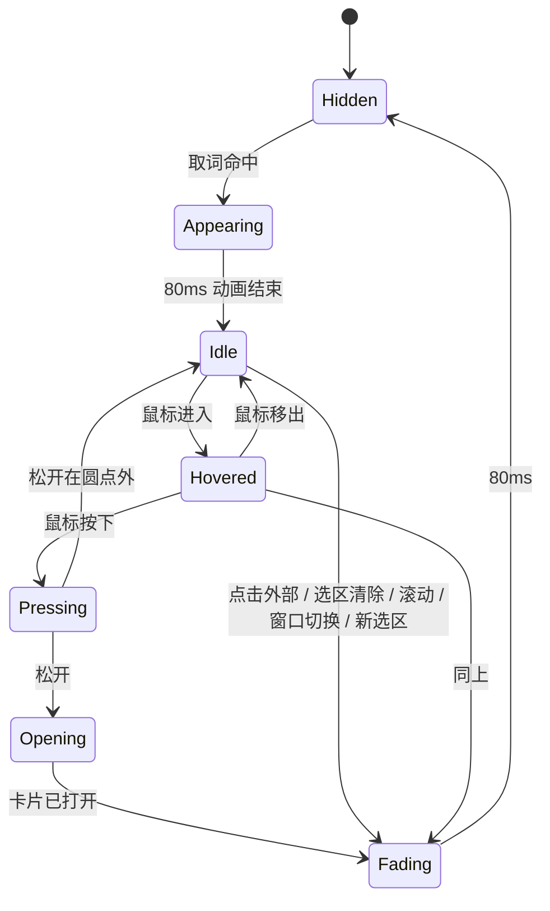
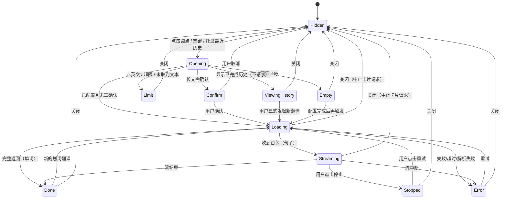
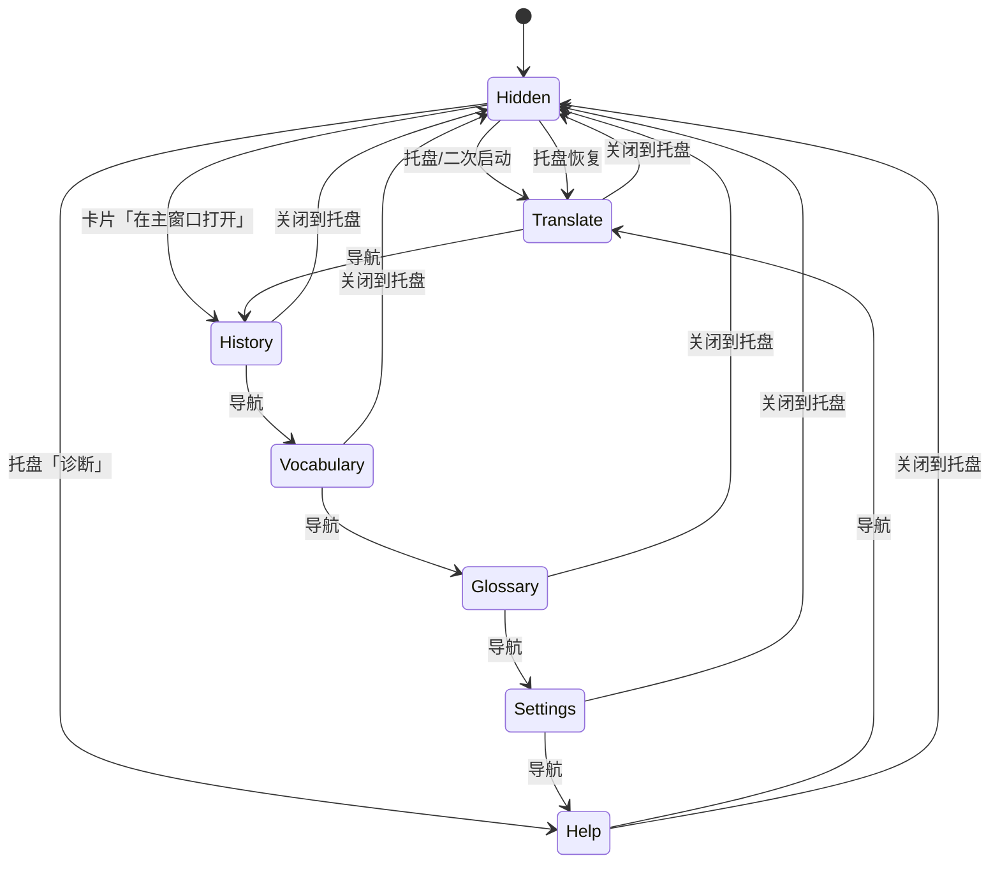

# Snapword 三窗口交互规格说明书 v2.0

> 配套文档：`docs/PRD-v2.md`（三窗口交互需求 v2.0.0）
> 本文档解决：PRD 说「要什么」，本文档说「每一毫秒发生什么、出问题时变成什么」。
> 参考基线：本机沉浸式翻译 1.34.4 的本地安装包（见 `docs/research/immersive-translate-interaction-2026-11.md`）。
> 所有时长、阈值均为**建议值**，集中登记在第 10 节参数表中；开发时全部走配置。

---

## 一、本版变化

| 旧版（v1.0） | 新版（v2.0） |
|---|---|
| 气泡 + 覆盖式侧边栏 | 圆点 + 翻译卡片 + 主窗口 |
| 气泡 96×32，点击后出侧边栏 | 圆点 10×10，点击后出卡片 |
| 侧边栏固定右侧、宽度自适应 | 卡片贴选区、固定宽度、可拖拽/保持打开 |
| 侧边栏底部「最近」 | 翻译页最近 5（共享）+ 主窗口翻译历史 |
| 设置页是独立窗口 | 主窗口包含翻译/历史/生词本/术语表/设置/诊断 |
| 生词本、历史散落在侧边栏/设置 | 主窗口统一管理 |

> 2026-11-03 决策已确认：卡片不做历史、缩放、ESC、双语/仅译文切换、赞/踩/问题反馈；翻译页最近 5 条来自共享主历史；主窗口去重；保持打开只拦外部点击；仅移除会话 token 累计展示，长文发送前预估保留。验收编号 IA-01～IA-41 与 PRD-v2 对齐；云盘同步为 v1.1，单独用 SY-01～SY-06。

---

## 二、三窗口总览

### 2.1 职责边界

| 窗口 | 只做 | 不做 |
|---|---|---|
| 圆点 | 告诉用户「这里可以翻译」；点击时承接显式翻译触发 | 不展示译文、不放多个按钮、不做加载态；悬停只作微弱视觉提示，不翻译 |
| 翻译卡片 | 展示当前一次翻译、承接复制/朗读/收藏 | 不做历史管理、不做赞踩或问题反馈、不做完整设置、不做账号/升级 |
| 主窗口 | 翻译输入、历史、生词本、术语表、配置、诊断 | 不抢划词当下注意力、不自动弹出 |

> 圆点与翻译卡片是独立的置顶窗口，不嵌入浏览器页面；主窗口是常规应用窗口。三者共享同一应用实例。

### 2.2 主流程

```
拖选英文
  → 圆点（≤120ms）
  → 点击圆点 / Alt+D
  → 卡片（≤200ms，骨架先行）
  → 结果 / 操作
  → 关闭卡片
  → 结果进入会话历史；收藏进入生词本
  → 需要管理时打开主窗口
```

### 2.3 窗口层级

| 元素 | 层级 | 全屏应用时 |
|---|---|---|
| 圆点 | 最高，置顶 | 不显示 |
| 卡片 | 置顶于普通窗口 | 全屏不保证显示；失败则托盘提示并打开主窗口 |
| 主窗口 | 普通窗口 | 正常 |
| 托盘通知 | 系统层 | 正常 |

---

## 三、全局交互约定

### 3.1 焦点规则

| 元素 | 出现时是否获焦 | 能否点击获焦 | 说明 |
|---|---|---|---|
| 圆点 | **否** | 否 | 纯点击入口，不接收键盘输入 |
| 翻译卡片 | **否** | 是 | 出现时用户可继续在原窗口打字；点击卡片后才可用键盘 |
| 主窗口 | 是 | — | 常规窗口 |

> 推论：卡片未获焦时，方向键、Tab 都无效。所以关闭按钮、复制、收藏、朗读必须是鼠标可点的实体按钮（PRD RC-15）。

### 3.2 消失与关闭规则

| 元素 | 出现条件 | 自动消失 | 手动关闭 | 关闭后恢复 |
|---|---|---|---|---|
| 圆点 | UIA 取词命中且通过 FR-11 英文占比校验 | 点击外部 / 选区清除 / 页面滚动 / 窗口切换 / 新选区 / 卡片打开 | — | 重新选区 |
| 卡片 | 点击圆点 / 热键 / 托盘重开最近结果 | 普通状态下外部点击关闭；保持打开状态下外部点击保留；切换到其他应用均关闭 | 关闭按钮 | 从主窗口历史恢复 |
| 主窗口 | 托盘 / 卡片入口 / 二次启动 | 否 | 关闭按钮 → 隐藏到托盘 | 托盘 / 二次启动 |

**关键区分**：

- 选区消失 → **圆点**消失；卡片不因选区消失而关闭。
- 点击页面空白（包括主窗口）→ 普通状态卡片关闭；保持打开状态卡片保留。
- 切换到其他应用 → 卡片关闭；保持打开状态也不例外。
- 卡片关闭会中止当前卡片展示会话的请求；已完成结果保留在主窗口历史。

### 3.3 动效规范

| 动作 | 时长 | 曲线 | 属性 |
|---|---|---|---|
| 圆点淡入 | 80ms | ease-out | opacity 0→1，scale 0.8→1 |
| 圆点淡出 | 80ms | ease-in | opacity 1→0 |
| 圆点悬停 | 100ms | ease-out | 仅微弱视觉提示；不触发翻译 |
| 圆点按下 | 60ms | linear | scale 0.9 |
| 卡片出现 | 160ms | cubic-bezier(.2,.8,.2,1) | opacity 0→1，scale 0.96→1 |
| 卡片关闭 | 80ms | ease-in | opacity 1→0，scale 1→0.98 |
| 内容替换 | 120ms | ease-out | 交叉淡入，不做位移动画 |
| 卡片回弹 | 240ms | cubic-bezier(.2,.8,.2,1) | 位置回到可用区域 |
| 按钮按压 | 60ms | linear | scale 0.96 |

**禁止**：骨架屏 shimmer、超过 300ms 的动画、弹跳曲线（bounce）、持续呼吸动画。

### 3.4 文案规范

| 规则 | 正确 | 错误 |
|---|---|---|
| 三段式：发生了什么 + 为什么 + 怎么办 | 「无法连接接口 · 检查网络或 Base URL · [诊断]」 | 「请求失败，请稍后重试」 |
| 动词开头，不用「请」 | 「检查网络」 | 「请您检查一下网络」 |
| 给具体数字 | 「已选 6,240 字，将分 4 次请求」 | 「内容较长」 |
| 不确定要说明 | 「本句含义 · 由 AI 结合上下文判断」 | 把 AI 推断当词典释义 |
| 不用「系统繁忙」 | 「接口额度不足或被限流」 | 「系统繁忙」 |

### 3.5 快捷键

| 键 | 作用 | 生效条件 |
|---|---|---|
| `Alt+D` | 翻译当前选中文本 | 全局（可自定义） |
| `Tab` | 在卡片/主窗口内遍历 | 元素已获焦 |
| `Ctrl+Enter` | 主窗口翻译页执行翻译 | 翻译页输入框获焦 |
| `Ctrl+1` ~ `Ctrl+6` | 主窗口切换页面 | 主窗口获焦 |
| `Ctrl+F` | 聚焦当前页搜索 | 主窗口获焦 |

> **不做**：卡片 ESC 关闭。理由：卡片出现时不夺焦，ESC 在未获焦时无效，时灵时不灵；关闭按钮 + 点击外部已覆盖鼠标路径。

### 3.6 主题与字号

- 卡片与主窗口共享同一套颜色令牌；跟随系统，可手动浅色/深色。
- 正文字号基准 14px；卡片单词 24px、音标 16px、语境义 15px、义项 14px、例句 13px。
- 对比度 ≥4.5:1；焦点环 ≥3:1。
- 主题切换立即生效；卡片不因换主题改变位置/尺寸。

---

## 四、圆点逐帧交互

### 4.1 出现时序（预算表）

| 相对时间 | 环节 | 具体动作 | 预算 | 失败时 |
|---|---|---|---|---|
| T+0 | 鼠标抬起 | 应用收到鼠标释放 | — | — |
| T+5 | 白名单判定 | 取前台进程名，比对列表 | ≤5ms | 不匹配 → 静默终止 |
| T+10 | UIA 取词 | 读取选区文本 | ≤30ms | 无可用取词接口 → 终止 |
| T+40 | 密码框检查 | 检查是否为密码控件 | ≤2ms | 是 → 终止，不写日志 |
| T+42 | 结果校验 | trim、非空、通过 FR-11 英文占比校验、非全屏 | ≤1ms | 不满足 → 终止 |
| T+45 | 汇总取词结果 | 发送文本、选区矩形、进程名 | ≤5ms | 超时 200ms → 丢弃 |
| T+55 | 定位与显示 | 定位圆点并显示 | ≤40ms | 记录错误，不弹 |
| T+95 | 首帧 | 圆点开始绘制 | — | — |
| T+120 | 完成 | 淡入动画结束，完全可见 | — | — |

**两条手感约束**：

1. 圆点**必须**做到即取即显；任何可感知的创建延迟都算不合格。
2. 位置**必须**基于选区矩形，不是鼠标坐标；用户拖选后鼠标常在选区末尾甚至选区外。

### 4.2 位置算法（按优先级）

```
1. 选区右下： (rect.right + 8, rect.bottom + 8)        ← 默认
2. 选区左上： (rect.left - 8 - w, rect.top - 8 - h)    ← 右下越界
3. 选区右侧： (rect.right + 8, rect.verticalCenter)    ← 上下都放不下、水平有空间
4. 鼠标右下： (pointer.x + 8, pointer.y + 8)           ← 选区矩形无效
5. 屏幕中央： 最后兜底，保证一定能看到
```

**为什么默认右下**：Chrome 的选区浮动菜单（复制/搜索）出现在选区上方，默认放右下可以避开它。这是 PRD RK-03 风险的交互解法。

**边界约束**：

- 圆点必须完整落在选区所在显示器的可用区域内，四周至少 8px。
- 圆点不得覆盖选中的文本；若候选位置覆盖选区，跳到下一优先级。
- 仅保证主显示器；多显示器第二屏暂不支持。主屏混合 DPI 下按选区所在显示器的缩放换算；偏差 ≤4px。

### 4.3 圆点状态机



**迁移禁令**：

- `Hidden → Hovered`：禁止（不可见时不能悬停）。
- `Opening → Idle`：禁止（点击后必须进入卡片流程）。
- 任意状态 → `Hidden` 时，**禁止**保留旧选区快照供后续点击。

### 4.4 圆点自身状态

| 状态 | 视觉 | 进入条件 | 退出 |
|---|---|---|---|
| Hidden | 不可见 | 初始 / 已消失 | 取词命中 |
| Appearing | 80ms 淡入 + scale 0.8→1 | 取词命中 | 动画结束 → Idle |
| Idle | 静态，10px 圆点 | 动画结束 | 悬停 / 按下 / 消失 |
| Hovered | 仅微弱视觉提示；不触发翻译 | 鼠标进入 | 鼠标移出 / 按下 |
| Pressing | scale 0.9 | 鼠标按下 | 松开 → 打开卡片 |
| Fading | 80ms 淡出 | 触发消失 | 动画结束 → Hidden |

**消失规则**：MVP 不设自动隐藏计时器；圆点持续显示到上列消失条件。自动隐藏设置、位置偏好、首次出现引导均不进 MVP，列入 v1.1 规划。

### 4.5 圆点形态约束

| 项 | 值 | 理由 |
|---|---|---|
| 视觉尺寸 | 10 × 10 px | 足够小，不遮字 |
| 点击热区 | ≥24 × 24 px | 桌面鼠标精度 |
| 内容 | 无文字、无图标 | 入口不需要二次决策 |
| 圆角 | 50% | 正圆 |
| 描边 | 1px 白色 | 任何背景上可识别 |
| 阴影 | 0 1px 3px rgba(0,0,0,.18) | 轻微浮起 |
| 不透明度 | 100% | 小尺寸下透明会降低可发现性 |

### 4.6 点击行为时序

| 相对时间 | 事件 |
|---|---|
| T+0 | 用户松开鼠标 |
| T+0 | 圆点进入 Pressing → 触发点击 |
| T+8 | 圆点开始 Fading（80ms，并行） |
| T+10 | 卡片窗口显示骨架屏 |
| T+10 | 请求发出（若已配置 Key） |
| T+200 | 卡片出现动画完成 |
| T+≥160 | 内容最早开始渲染（不早于出现动画 80% 进度） |

**去重**：300ms 内的重复点击只处理第一次；第二次点击落在已隐藏的圆点上，不产生事件。

### 4.7 边界三问

| 问题 | 答案 |
|---|---|
| **中断了怎么办** | 选区被程序清除 → 圆点立即淡出（无延迟）；点击时选区已失效 → 卡片显示「未获取到选中文本」，不发请求 |
| **失败了怎么办** | UIA 取不到 → 静默不弹圆点；热键触发 → 托盘提示「未获取到选中文本」 |
| **重复了怎么办** | 连续选中 → 旧圆点立即消失，只保留最新一个；连续点击 → 300ms 去重 |

---

## 五、翻译卡片逐帧交互

### 5.1 出现时序

| 相对时间 | 事件 |
|---|---|
| T+0 | 用户点击圆点 / 按 Alt+D |
| T+0 | 圆点开始 80ms 淡出（并行） |
| T+8 | 应用收到触发，创建或复用卡片窗口，启动请求 |
| T+10 | 卡片以不夺焦方式显示 + 骨架屏渲染 |
| T+160 | 卡片出现动画完成 |
| T+≥160 | 内容开始渲染（不早于动画 80% 进度，避免途中闪烁） |

**如果请求在 200ms 内就返回**：内容等到 T+160 再淡入，不抢跑。

> 卡片窗口**不预创建**。首次打开时创建，记录 `createMs` / `firstPaintMs`；首次允许超过 200ms，不作为 MVP 阻塞。稳定态（复用窗口）按上表 ≤200ms。

### 5.2 位置算法

```
1. 选区右下：     (rect.right + 8, rect.bottom + 8)     ← 默认
2. 选区下方居中： (rect.centerX - w/2, rect.bottom + 8)
3. 选区上方居中： (rect.centerX - w/2, rect.top - 8 - h)
4. 选区右侧：     (rect.right + 8, rect.centerY - h/2)
5. 屏幕右侧固定： (screen.right - w - 16, screen.centerY - h/2)
6. 屏幕底部居中： (screen.centerX - w/2, screen.bottom - h - 24)
```

**约束**：

- 卡片完整落在选区所在显示器的可用区域内，四周至少 8px。
- 卡片是独立窗口，**不随源页面滚动**；源页面滚动时卡片保持屏幕位置，圆点消失。
- 卡片不得遮挡选区中心；若候选位置覆盖选区，跳到下一优先级。
- 卡片不得超出屏幕；高度超过 70% 工作区时，内部结果区滚动。
- 用户拖拽后，位置在本次运行内记住；重启恢复「跟随选区」。
- 仅主屏：按主显示器计算；第二屏暂不支持；显示器移除后回主屏。

### 5.3 尺寸计算

| 项 | 规则 |
|---|---|
| 宽度 | 固定 420px；仅屏幕可用空间不足时夹限至屏幕可用宽度；不提供缩放手柄 |
| 高度 | 随内容自适应，最大 70% 工作区；超出时结果区内部滚动 |
| 位置 | 默认靠近选区；仅可拖动位置，本次运行记住；重启恢复跟随选区 |

**宽度规则**：宽度固定 420px；只有屏幕可用空间不足时才夹限到该屏可用宽度，不按内容或屏幕比例动态缩放，不提供用户缩放手柄。

### 5.4 卡片布局

#### 单词模式

```
┌─────────────────────────────────────────┐
│ ⠿  thread          保持打开  ⋯  ✕ │  ← 头部 48px，可拖拽
├─────────────────────────────────────────┤
│ ┌─────────────────────────────────────┐ │
│ │ Use the useEffect hook to fetch...  │ │  ← 原文卡，默认 3 行
│ │ [🔊] [复制]              [显示全部] │ │
│ └─────────────────────────────────────┘ │
│                                         │
│  thread                    🔊美  🔊英    │  ← 词头 24px
│  /θred/  · AI 生成                       │
│                                         │
│  ▎本句含义                               │  ← 语境义置顶
│  在本句中指「讨论串」，即一段连续的       │
│  消息/评论记录（技术语境）                │
│  原句：...a long thread about...         │
│                                         │
│  全部义项                                │
│  n.  线；细丝                            │
│  n.  线索；思路                          │
│  v.  穿线；穿过                          │
│  ... [展开剩余 2 条]                     │
├─────────────────────────────────────────┤
│ ⧉ 复制   🔊 朗读   ☆ 收藏              │  ← 底部操作，始终可见
└─────────────────────────────────────────┘
```

#### 句子模式

```
┌─────────────────────────────────────────┐
│ ⠿  翻译          保持打开  ⋯  ✕ │
├─────────────────────────────────────────┤
│ ┌─────────────────────────────────────┐ │
│ │ The quick brown fox jumps over...    │ │  ← 原文卡，默认 3 行
│ │ [🔊] [复制]              [显示全部] │ │
│ └─────────────────────────────────────┘ │
│                                         │
│ 快速棕色狐狸跳过了懒狗。▌                │  ← 流式译文 16px
│                                         │
│ 第 1 段  [原文 ▸]                        │
│ 译文……                                  │
│                                         │
│ 第 2 段  [原文 ▸]                        │
│ ▓▓▓▓▓▓▓▓░░░░░  骨架                      │
│                                         │
│ 第 3 段  [原文 ▸]                        │
│ ⚠ 本次失败  [重试]                       │
├─────────────────────────────────────────┤
│ ⧉ 复制译文  🔊 朗读  ☆ 收藏            │
└─────────────────────────────────────────┘
```

### 5.5 头部交互

| 元素 | 点击 | 悬停 | 禁用态 |
|---|---|---|---|
| 拖拽区 | 按住拖动卡片 | `move` 光标 | — |
| 保持打开 | 切换保持打开/普通状态；只阻止外部点击关闭，不阻止切换应用关闭 | tooltip「保持打开（内容会更新）」；已保持打开时「取消保持打开（内容会更新）」 | — |
| 更多 | 打开菜单 | 背景高亮 | — |
| 关闭 | 关闭卡片并中止卡片展示会话请求 | 背景高亮 + tooltip | — |

**更多菜单**：

| 菜单项 | 行为 |
|---|---|
| 在主窗口打开 | 关闭卡片 → 打开主窗口对应详情；未完成的卡片展示会话请求随关闭中止 |
| 设置 | 打开主窗口设置页 |

MVP 不提供卡片赞/踩或问题反馈入口；反馈功能列入 v1.1 规划。帮助与诊断页仍保留 GitHub issue 链接。

### 5.6 原文区交互

| 状态 | 行为 |
|---|---|
| 折叠（默认） | 最多 3 行；超出显示渐隐 +「显示全部」 |
| 展开 | 显示全部；原文区内部滚动，最大 300px；按钮变「折叠内容」 |
| 加载中 | 原文区显示 1–2 行骨架 |
| 复制 | 点击复制原文；图标变对勾 +「已复制」1.5s |
| 朗读 | 播放/停止；无语音包置灰 |

**注意**：展开/折叠只改变原文区高度，不重置译文滚动位置；卡片高度变化时保持卡片顶部位置不变。

### 5.7 结果区交互

#### 单词模式

| 元素 | 行为 |
|---|---|
| 词头 | 可选中复制（但卡片整体不进入文本选择模式，避免拖拽冲突） |
| 音标 | 美式必出；英式有则出；AI 生成时标「AI 生成」 |
| 朗读按钮 | 美式/英式分别播放；播放态波形；再点停止 |
| 语境义 | 置顶；无语境时显示「未结合语境」灰字 + 解释 tooltip |
| 义项 | 最多 5 条；超出「展开剩余 N 条」；展开后不新开页面 |
| 例句 | 弱化；可选 |
| 底部 | 复制/朗读/收藏 |

#### 句子模式

| 元素 | 行为 |
|---|---|
| 译文 | 流式逐字；显示光标；可复制已输出部分 |
| 显示模式 | 固定显示折叠原文 + 译文；完整原文可展开；MVP 不提供双语/仅译文切换 |
| 分段 | 按原顺序；每段有独立状态 |
| 每段原文 | 折叠；点击展开该段原文 |
| 失败段 | 「⚠ 本次失败」+ [重试]；只重发该段 |
| 滚动跟随 | 见 5.8 |
| 停止 | 流式时底部左侧显示「停止」；点击后保留已输出内容，按钮变「已停止 · 重试」 |

### 5.8 滚动跟随

| 用户行为 | 期望表现 |
|---|---|
| 没碰过滚动条 | 新内容到达时自动跟随到底部 |
| 用户手动向上滚动 | 立即停止跟随，右下角出现「↓ 回到最新」浮动按钮 |
| 点击「回到最新」 | 滚到底部，恢复自动跟随 |
| 用户滚回底部 | 自动恢复跟随（无需点按钮） |

**判据**：内容追加后，`scrollTop + clientHeight >= scrollHeight - 24px` 视为「在底部」，否则视为「用户主动离开」。

### 5.9 卡片显示状态与请求状态

卡片当前显示内容和后台请求是两个独立状态。用户从主窗口历史选择「在卡片中查看」时，卡片显示历史结果；这不会自动中止正在运行的主窗口请求，也不会让其结果覆盖当前历史显示。



- 历史查看状态下，后台请求完成只更新会话历史，不改变卡片当前显示。
- 卡片被关闭或切换应用隐藏时，中止该卡片展示会话拥有的进行中请求；主窗口翻译页请求与卡片请求分离，切换主窗口页面或在卡片中查看历史都不取消它。
- 「在卡片中查看」只切换卡片当前展示；不新发卡片请求、不新增历史、不取消独立主窗口请求。主窗口请求完成后写入共享历史，但不得覆盖正在展示的历史条目。
- 「在卡片中查看」可发生在卡片任意可见状态；卡片展示会话的进行中请求不被该动作取消，完成后只写入共享历史，不覆盖历史展示。
- 用户从 ViewingHistory 显式发起新的划词翻译时，转为 Loading，卡片显示最新划词内容。

**迁移禁令**：

- `Done → Streaming`：禁止（新请求必须先清空，防串台）。
- `Streaming → Confirm`：禁止（确认只能在请求发出前）。
- `Limit → Loading`：禁止（超限不重试，用户需重新选择）。

### 5.10 加载与流式

| 状态 | 视觉 |
|---|---|
| 卡片打开 | 骨架屏；不白屏 |
| 单词骨架 | 4–6 行灰条：词头、音标、语境义、2 条义项 |
| 句子骨架 | 按段数生成；每段 2–3 行 |
| 3s 无首包 | 骨架上方一行小字「接口响应较慢，仍在请求中…」 |
| 流式中 | 光标 + 顶部细进度条；操作栏半透明但可点；显示「停止」 |
| 用户停止 | 中止当前请求；保留已输出文本；显示「已停止 · 重试」；不自动重发 |
| 流结束 | 光标消失；操作栏点亮 |
| 解析降级 | 纯文本展示 +「结果格式异常，已按文本展示」 |

### 5.11 错误态

| 场景 | 卡片表现 | 主操作 |
|---|---|---|
| 未配置 Key | 图标 +「还没有配置翻译接口」+ 一句解释 | [去配置] [看说明] |
| Key 无效 | 「认证失败 · Key 可能已失效」+ 错误码 | [改 Key] [诊断] |
| 网络不可达 | 「无法连接接口 · 检查网络或 Base URL」 | [诊断] [重试] |
| 超时 | 「请求超时（30s）· 接口未响应」 | [重试] |
| 流中断 | 保留已输出内容 +「已中断」 | [重试] |
| 非英文 | 「当前仅支持英文翻译」+ 识别语言 | [关闭] |
| 超长 | 「已选 24,000 字，超过 20,000 上限」 | [重新选择] |
| 未取到文本 | 「未获取到选中文本」 | [关闭] [重试] |
| 占位符还原失败 | 展示译文 +「代码保护还原失败」 | [复制原文] |

所有错误态**必须**同时提供「复制原文」入口——用户可能只是想快速把内容粘到别处。

> 圆点路径已在入口通过 FR-11 校验；热键路径绕过圆点，发送请求前必须补做同一校验；<30% 时显示「当前仅支持英文翻译」，不发送请求。

### 5.12 长文分段

#### 前置确认（卡片内，不是系统对话框）

```
┌─────────────────────────────────┐
│  这段内容共 6,240 字              │
│  将分 4 次请求，预估消耗约         │
│  1,560 tokens（估算）             │
│                                 │
│  ☐ 本次会话不再提示              │
│                                 │
│        [取消]      [继续]        │
└─────────────────────────────────┘
```

- 遮罩：卡片内部半透明黑 30%，**不遮挡外部窗口**。
- 「不再提示」仅在本次会话内有效。
- 取消 = 无任何请求发出；继续 = 按并发 3 开始。

#### 执行期

| 段状态 | 视觉 |
|---|---|
| 等待中 | 仅段头「第 N 段」+ 灰色占位 |
| 请求中 | 骨架条 + 段头右侧小转圈 |
| 已完成 | 正常内容 |
| 失败 | 段内 `⚠ 本次失败` + `重试`；段头标红 |
| 已取消 | 保留已完成段；未开始段灰字「已取消」 |

**顺序约束**：并发 3，但渲染严格按 index 顺序；第 2 段先返回也要等第 1 段占位完成后才能上移。**禁止**「先到先排」。

### 5.13 当前结果与历史

| 事件 | 行为 |
|---|---|
| 新翻译完成 | 直接替换卡片当前内容；不追加卡内历史 |
| 卡片打开时又划新词 | 直接替换为最新结果；旧结果已在主窗口历史 |
| 关闭卡片 | 卡片不保留当前结果；主窗口历史保留 |
| 收藏/复制 | 对当前显示的结果生效；状态与主窗口同步 |

**历史**：只有一份会话历史，20 条，卡片与主窗口翻译页共用；翻译页的「最近 5 条」只是该历史的前 5 条视图。

### 5.14 拖拽

| 操作 | 细节 |
|---|---|
| 开始拖拽 | 头部非控件区域按下；记录起始位置；`cursor: grabbing` |
| 拖动 | 卡片跟随鼠标；不触发文本选择/页面滚动 |
| 松手 | 若超出可用区域，240ms 回弹到 16px 边距内 |
| 结束 | 记住位置（本次运行）；不改变宽度 |

### 5.15 保持打开与关闭

| 触发 | 普通状态（默认） | 保持打开状态 |
|---|---|---|
| 点击卡片外部（含主窗口） | 关闭 | 保持打开 |
| 切换到其他应用 | 关闭 | 关闭 |
| 关闭按钮 | 关闭 | 关闭 |
| 新的划词翻译到达 | 替换当前内容 | 替换当前内容 |
| 主窗口历史「在卡片中查看」 | 只切换显示；不发卡片请求/新增历史 | 只切换显示；不发卡片请求/新增历史 |

- 「保持打开」只阻止点击卡片外部关闭，不阻止切换到其他应用，也不锁定内容。
- 本版不提供 ESC 关闭；关闭按钮、点击外部、切换应用是关闭路径。
- 保持打开状态仅本次运行记住；重启默认关闭。
- 关闭卡片时中止卡片展示会话请求；历史查看切换不取消独立运行的主窗口翻译请求。
- 切换到其他应用使卡片关闭时，也中止该卡片展示会话请求。
- 关闭动画 80ms；关闭后不恢复圆点。

### 5.16 边界三问

| 交互 | 中断了怎么办 | 失败了怎么办 | 重复了怎么办 |
|---|---|---|---|
| **点击圆点** | 圆点已消失 → 点击落在页面上，不响应 | 卡片创建失败 → 托盘提示「卡片打开失败」 | 300ms 内连点 → 只处理第一次 |
| **Alt+D** | 选中文本在按键前变化 → 以按键时刻的选中为准 | 未取到文本 → 托盘提示，不发请求 | 长按连续触发 → 300ms 去重 |
| **触发翻译** | 请求中又选别的词 → 直接替换卡片当前结果 | 见 5.11 | 同一文本 5s 内重复触发 → 复用上次结果 |
| **流式输出中关闭** | 关闭即中止请求 | — | — |
| **长文分段** | 中途关闭 → 已完成段入历史 | 单段失败 → 仅该段可重试 | 再次触发同类长文 → 重新确认消耗 |
| **收藏** | 收藏中关闭卡片 → 后台完成并落库 | DB 失败 → 内联红字 + 可重试 | 重复收藏 →「已收藏 · 更新/取消」 |
| **朗读** | 播放中触发新翻译 → 停止前一条 | 无语音包 → 置灰 | 连点 → toggle（停止/播放） |
| **复制译文** | — | 剪贴板被占用 → 「复制失败，请重试」 | 连点 → 每次给「已复制」，不叠加 |
| **关闭卡片** | — | — | 已关闭时再触发 → 无操作 |

---

## 六、主窗口逐页交互

### 6.1 窗口打开与关闭

| 事件 | 行为 |
|---|---|
| 托盘「显示主窗口」 | 打开/置前主窗口；恢复上次页面 |
| 托盘「用最近一条已完成历史重开卡片」 | 用最近已完成结果缓存恢复卡片展示；不请求、不新增历史、不抢焦；无历史时菜单项置灰 |
| 卡片「在主窗口打开」 | 关闭卡片；打开主窗口并定位到历史条目；请求中则中止并带入原文 |
| 二次启动应用 | 聚焦主窗口；若从未打开则打开翻译页 |
| 点击关闭按钮 | 隐藏到托盘；首次提示「应用仍在托盘运行」 |
| 托盘「退出」 | 关闭所有窗口、中止请求、清理临时资源 |
| 主窗口已打开时再次打开 | 置前 + 定位，不新开第二个窗口 |

### 6.2 布局

```
┌──────────────────────────────────────────────────────────────┐
│ Snapword                                           ─  □  ✕  │
├──────────────┬───────────────────────────────────────────────┤
│              │  翻译                                         │
│  ▸ 翻译      │  ┌─────────────────────────────────────────┐  │
│    翻译历史  │  │ 粘贴或输入英文，Ctrl+Enter 翻译          │  │
│    生词本    │  │                                         │  │
│    术语表    │  └─────────────────────────────────────────┘  │
│    设置      │  0 字                    [清空]  [翻译]       │
│              │                                               │
│              │  结果                                         │
│              │  ┌─────────────────────────────────────────┐  │
│              │  │ 原文 / 译文 / 操作                       │  │
│              │  └─────────────────────────────────────────┘  │
│              │                                               │
│  帮助与诊断  │  最近                                         │
│              │  · thread · 2 分钟前                         │
└──────────────┴───────────────────────────────────────────────┘
```

- 左侧导航 200px；内容区自适应，最大宽度 1100px（宽屏时居中）。
- 主窗口最小 960×640；窄于此宽度时左侧导航收为图标 + tooltip。
- 页面切换不做整页位移动画；120ms 交叉淡入。

### 6.3 翻译页

| 区域 | 交互 |
|---|---|
| 输入框 | 多行；占位「粘贴或输入英文，Ctrl+Enter 翻译」；自动聚焦（页面打开时） |
| 语言对 | 右上角「英语 → 简体中文」；固定，不可切换 |
| 字符数 | 实时显示；>20000 变红并禁用翻译 |
| 清空 | 清空输入与结果；不弹确认（输入为空时禁用） |
| 翻译 | 空输入禁用；点击后加载态；Ctrl+Enter 等效 |
| 结果 | 复用卡片渲染；复制/朗读/收藏 |
| 在卡片中查看 | 可选；点击打开卡片并显示同一结果（不重新请求） |
| 最近 | 共享历史前 5 条；点击恢复；不重新请求 |
| 空态 | 未配置 Key → 「还没有配置翻译接口」+ [去配置]；已配置无输入 → 提示选中网页英文或粘贴 |
| 错误 | 与卡片相同；内联在结果区 |
| 页面切换 | 保留输入与最近一次结果（本次运行内）；「清空」按钮才重置 |

**翻译页与卡片的关系**：

- 两个入口共用同一条翻译链路、同一份会话历史（20 条）。
- 翻译页「最近」只是该历史的前 5 条视图，不单独存储、不重复写入。
- 翻译页不自动弹卡片；用户主动点「在卡片中查看」才弹。
- 从翻译页「在卡片中查看」打开的卡片只展示该条结果，不写入历史。

### 6.4 翻译历史页

| 区域 | 交互 |
|---|---|
| 顶部说明 | 「仅保留本次运行，退出后清空」 |
| 搜索 | 匹配原文与译文；防抖 200ms；Ctrl+F 聚焦 |
| 筛选 | 全部 / 单词 / 句子；可组合搜索 |
| 列表 | 时间倒序；类型图标、原文预览、时间、来源、收藏状态 |
| 选中 | 右侧/下方显示完整结果；高亮选中项 |
| 条目操作 | 复制、朗读、收藏、删除 |
| 清空 | 二次确认；只清历史，不清生词本 |
| 新记录 | 若用户在看顶部，实时插入；若在滚动旧条目，显示「有 N 条新记录」 |
| 空态 | 「还没有翻译记录」+ [去翻译] |
| 详情 | 与卡片渲染一致；不重新请求 |

### 6.5 生词本页

| 区域 | 交互 |
|---|---|
| 顶部 | 总数、搜索、排序（时间/字母）、标签筛选、导出 |
| 列表 | 单词、音标、语境义预览、标签、时间；支持多选 |
| 批量 | 全选/反选；批量删除需确认 |
| 详情 | 单词、音标、语境义、原句、义项、例句、标签、来源、时间 |
| 编辑 | 标签（≤5）；失焦/Enter 保存；保存失败内联重试 |
| 删除 | 单条确认；批量确认；清空输入 `delete`；确认后 5 秒内可撤销 |
| 撤销条 | 删除成功后主窗口底部内嵌显示「已删除 N 个单词 · 撤销」5 秒；只保留最近一次；新删除替换旧撤销条；不跨窗口、不抢焦点、不使用浮动 toast |
| 撤销 | 点击后条目、标签、收藏时间原样恢复；总数恢复；列表回到原排序位置；撤销条立即消失 |
| 撤销失效 | 超过 5 秒、删除后重新收藏同一词、远端同步已改写该条 → 撤销条收起或点击无变化；**禁止**假成功 |
| 清空 | 输入 `delete` 确认；确认后清空并给 5 秒撤销；超时不可撤销 |
| 导出 | CSV（UTF-8 BOM）/ JSON；系统保存对话框；不含 Key |
| 空态 | 「还没有收藏的单词」+ 指引 |
| 重复收藏 | 「已存在」→ [更新] [取消]；更新覆盖释义/来源，不新增 |
| 搜索无结果 | 「没有匹配结果」+ [清除搜索] |

### 6.6 术语表页

| 区域 | 交互 |
|---|---|
| 顶部 | 总数、搜索、导入 JSON、导出 JSON、添加术语 |
| 表格 | 词条、匹配方式、处理方式、译文、启用、操作 |
| 添加/编辑 | 行内或侧边面板；保存即生效 |
| 校验 | 词条非空；正则可编译；固定译法必须有译文；完全重复提示 |
| 启用开关 | 即时生效；不影响进行中的请求 |
| 导入 | 文件选择 → 冲突预览 → 合并/替换/取消 |
| 删除 | 单条即时；批量需确认；删除后 5 秒内可撤销（恢复术语、译文、启用状态） |
| 空态 | 「还没有术语」+ [添加术语] [导入 JSON] |
| 提示 | 「修改后对新的翻译生效」 |

### 6.7 设置页

| 分组 | 交互要点 |
|---|---|
| API | Base URL、Key、模型、超时、温度即时自动保存；Base URL 旁放小型次级「测试连接」按钮，就地显示连接中/成功/失败且不改变保存状态；清除 Key 需确认 |
| 取词与触发 | 热键录制；白名单添加；圆点开关；全屏抑制 |
| 卡片 | 字号、主题；默认位置跟随选区，仅拖动位置并在本次运行内记住 |
| 数据 | 路径展示；语境片段开关；导出配置；清空全部数据；打开目录；v1.1 增加云盘同步 |
| 系统 | 开机自启；托盘提示；界面语言；更新检查 |
| 朗读 | 系统/云 TTS；语速；试听 |

**设置去重**：术语表、诊断、关于只通过顶层页面进入；清空历史与清空生词本分别留在各自页面，设置页只保留「清空全部数据」。

**自动保存反馈**：API/Base URL/Key/模型及其他设置在编辑时即时自动保存，分组标题右侧显示「已保存」2s；失败显示「保存失败 · 重试」；不弹 toast。测试连接结果独立显示在 Base URL 旁，不改变保存状态。

#### 6.7.1 云盘同步（v1.1，MVP 不显示）

| 区域 | 交互 |
|---|---|
| 入口 | 「数据」组内「云盘同步」卡片；MVP 不渲染 |
| 开关 | 关闭时不读写同步文件；关闭需确认，说明本地数据不受影响 |
| 文件夹 | 系统目录选择；显示路径；不存在/不可写时内联错误 |
| 状态 | 空闲 / 同步中 / 成功 / 失败；显示上次同步时间、设备数；失败显示原因 + 重试 |
| 立即同步 | 同步中禁用；完成显示「已同步」弱提示；不弹窗 |
| 打开文件夹 | 资源管理器打开同步文件夹 |
| 隐私 | 启用前提示云盘明文；同步语境片段开关默认关（设备本地，独立于「语境片段是否入库」）；API Key、Base URL、日志不写入同步文件 |
| 冲突 | 按记录最后写入优先；不提供手动冲突 UI |
| 阻塞 | 同步不阻塞设置页、收藏、翻译；失败不影响本地数据 |

### 6.8 帮助与诊断页

| 区域 | 交互 |
|---|---|
| 快捷问题 | 圆点不出现 / 取不到词 / 认证失败 / 卡片不显示 / 全屏无反应 |
| 诊断 | 「运行诊断」→ 8 项检查；状态点 + 人话 + 下一步 |
| 复制 | 「复制诊断信息」；不包含 Key/原文 |
| 日志 | 打开目录、清空；最近 50 条错误 |
| 关于 | 版本、构建、License、GitHub、第三方许可、检查更新 |
| 反馈 | 打开 GitHub issue 模板；提示附诊断信息 |

### 6.9 主窗口状态机



**规则**：

- 页面切换不重置页面状态（搜索词、滚动位置、选中项、翻译页输入与结果）。
- 关闭到托盘后再次打开，恢复上次页面与滚动位置。
- 退出应用时，所有页面状态丢弃。

### 6.10 边界三问（主窗口）

| 交互 | 中断了怎么办 | 失败了怎么办 | 重复了怎么办 |
|---|---|---|---|
| **打开主窗口** | 已打开 → 置前 | 打开失败 → 托盘提示 | 二次启动 → 聚焦，不新开 |
| **翻译页翻译** | 导航离开 → 请求继续；结果仍入历史 | 见卡片错误态 | 连续点击 → 按钮禁用直到完成 |
| **历史删除** | — | 删除失败 → 内联错误 + 重试 | 已删除 → 无操作 |
| **删除撤销** | 切换页面 → 撤销条继续计时；关闭主窗口 → 超时后失效 | 撤销失败 → 内联错误 + 重试；条目保持删除 | 连续删除 → 只保留最近一次撤销条 |
| **云盘同步（v1.1）** | 同步中关闭窗口 → 后台完成或下次启动续传 | 文件夹/权限/解析失败 → 状态错误 + 重试；本地不受影响 | 重复点击 → 只跑一次；重复合并幂等 |
| **生词本收藏** | 关闭主窗口 → 后台完成 | DB 失败 → 内联重试 | 重复 → 更新/取消 |
| **导出** | 关闭主窗口 → 继续后台导出 | 失败 → 提示路径/权限 | 连续点击 → 只处理第一次 |
| **清空数据** | 输入 `delete` 前取消 → 无变化 | 失败 → 保留原数据 + 错误 | 重复确认 → 幂等 |
| **术语导入** | 预览阶段取消 → 无变化 | 解析失败 → 错误行号 | 重复导入 → 冲突预览 |

---

## 七、跨窗口联动

### 7.1 生命周期

```
应用启动
  → 托盘常驻
  → 首次启动：主窗口引导
  → 划词：圆点 → 卡片
  → 卡片/托盘 → 主窗口
  → 关闭主窗口 → 托盘
  → 退出 → 清理
```

### 7.2 事件流

| 事件 | 来源 | 影响 |
|---|---|---|
| 翻译完成 | 卡片/翻译页 | 会话历史 +1（两个入口共用同一份 20 条） |
| 托盘重开卡片 | 托盘 | 用最近一条已完成历史的缓存恢复展示；不请求、不新增历史、不抢焦；无历史时置灰 |
| 收藏 | 卡片/历史/生词本 | 生词本新增/更新；所有界面同步星标 |
| 取消收藏 | 生词本/卡片 | 生词本删除；卡片星标变空心 |
| 设置变更 | 主窗口 | 卡片/下一次请求生效 |
| 打开主窗口 | 卡片/托盘/二次启动 | 关闭卡片（卡片入口）或置前 |
| 关闭主窗口 | 用户 | 隐藏到托盘；卡片/圆点不受影响 |
| 退出 | 托盘 | 中止请求；清空内存历史；保留生词本/设置 |

### 7.3 焦点与层级

- 圆点不获焦；卡片出现不获焦；主窗口正常获焦。
- 主窗口与卡片同时存在时，卡片保持置顶；主窗口可通过任务栏切换。
- 从卡片打开主窗口：卡片关闭，主窗口获焦。
- 从托盘打开主窗口：视为点击卡片外部；保持打开的卡片保留，普通卡片关闭。
- 托盘「用最近一条已完成历史重开卡片」仅恢复展示，不抢焦点。

### 7.4 请求生命周期

| 事件 | 请求 | 卡片 | 历史 |
|---|---|---|---|
| 关闭卡片（进行中） | 中止卡片展示会话拥有的请求 | 隐藏 | 未完成请求不记录 |
| 关闭卡片（已完成） | — | 隐藏 | 保留 |
| 主窗口翻译页请求中切换页面 | 主窗口请求继续；与卡片请求分离 | 卡片状态不因该请求变化 | 完成后记录 |
| 主窗口历史「在卡片中查看」 | 不发卡片请求；不取消独立主窗口请求，后者继续完成 | 显示历史；后台结果不得覆盖当前显示 | 主窗口请求完成后写入历史；查看历史不新增 |
| 保持打开卡片点击外部（含主窗口） | 卡片请求继续 | 保持显示；内容仍可更新 | 完成后记录 |
| 切换到其他应用 | 中止当前卡片展示会话拥有的请求 | 隐藏 | 未完成卡片请求不记录；主窗口独立请求继续 |
| 连续触发 3 次 | 只保留最后一次 | 显示最后一次 | 前两次完成则记录 |
| 应用退出 | 全部中止 | 关闭 | 清空 |

---

## 八、状态机汇总

### 8.1 圆点

见 4.3。

### 8.2 卡片

见 5.9。

### 8.3 主窗口

见 6.9。

### 8.4 迁移禁令汇总

| 禁令 | 理由 |
|---|---|
| 卡片 `Done → Streaming` | 新请求必须先清空，防串台 |
| 卡片 `Streaming → Confirm` | 确认只能在请求发出前 |
| 卡片 `Limit → Loading` | 超限不重试，用户需重新选择 |
| 圆点 `Hidden → Hovered` | 不可见时不能悬停 |
| 主窗口 `Hidden → Hidden` 重复打开 | 单实例，只置前 |
| 翻译卡片关闭时保留进行中请求 | 关闭即中止，避免继续消耗额度 |

---

## 九、交互验收清单（IA-01 ~ IA-41）

| 编号 | 场景 | 期望 |
|---|---|---|
| IA-01 | Chrome 中选中 `thread` | 圆点 ≤120ms 出现；点击后卡片 ≤200ms 显示骨架；结果含音标、语境义、义项 |
| IA-02 | 选中整句 | 圆点出现；点击后卡片显示原文 3 行 + 流式译文；流式中可停止，停止后保留已输出并提供手动重试 |
| IA-03 | 选中后 1 秒点击页面空白 | 圆点消失；无请求 |
| IA-04 | 圆点出现后滚动页面 | 圆点消失；无错位 |
| IA-05 | 圆点出现后切换应用 | 圆点消失；卡片按关闭规则处理 |
| IA-06 | 300ms 内连点圆点两次 | 只打开一次卡片，只发一次请求 |
| IA-07 | 普通状态卡片点击外部 | 卡片关闭；卡片展示会话的进行中请求中止 |
| IA-08 | 保持打开状态卡片点击外部（含主窗口） | 卡片保持；内容不锁定，相关卡片请求继续 |
| IA-09 | 保持打开状态卡片切换到其他应用 | 卡片关闭；卡片展示会话的进行中请求中止 |
| IA-10 | 卡片获焦按 Tab | 焦点按视觉顺序遍历，所有按钮可读 |
| IA-11 | 卡片未获焦点击关闭按钮 | 卡片关闭；卡片展示会话的进行中请求中止 |
| IA-12 | 拖动卡片到屏幕边缘 | 松手回弹到 16px 边距 |
| IA-13 | 拖动卡片到屏幕另一侧 | 仅位置改变；宽度固定 420px（空间不足时夹限）；重启恢复跟随选区 |
| IA-14 | 连续查 5 个词 | 卡片始终只显示最新结果；不新开卡片；完成结果均进入共享历史 |
| IA-15 | 卡片打开时又选中新词 | 新划词结果替换当前卡片内容；旧结果在翻译历史可查 |
| IA-16 | 卡片收藏 | 星标实心；主窗口生词本 +1；无 toast |
| IA-17 | 重复收藏 | 「已收藏 · 更新/取消」；不新增 |
| IA-18 | 复制译文 | 图标变对勾 +「已复制」1.5s；失败在按钮旁提示 |
| IA-19 | 朗读 | 播放/停止 toggle；无语音包置灰；失败状态就地提示 |
| IA-20 | 未配置 Key 点击圆点 | 卡片空态；[去配置] 打开主窗口并高亮 Key |
| IA-21 | 6000 字符 | 卡片内显示长文发送前消耗预估；取消不发请求；继续按顺序 |
| IA-22 | 第 2 段失败 | 仅第 2 段重试；其他段正常 |
| IA-23 | 非英文选区 | 不出现圆点；热键显示「当前仅支持英文翻译」 |
| IA-24 | 未选中按 Alt+D | 托盘提示；不发请求 |
| IA-25 | 卡片「在主窗口打开」 | 卡片关闭；主窗口定位历史条目；未完成卡片请求按卡片关闭规则中止 |
| IA-26 | 主窗口翻译页 Ctrl+Enter，随后切换页面 | 结果渲染并进入共享历史；页面切换不取消请求并保留输入/最近结果 |
| IA-27 | 历史页点击条目 | 恢复结果；不重新请求；搜索/筛选正常 |
| IA-28 | 生词本搜索/导出 CSV | 搜索匹配；Excel 不乱码；不含 Key |
| IA-29 | 术语表非法正则 | 即时提示；合法规则下次生效 |
| IA-30 | 清空生词本 | 输入 `delete`；错误禁用；清空后空态 |
| IA-31 | 关闭主窗口后托盘恢复 | 应用不退出；托盘双击恢复主窗口；圆点/卡片仍可用 |
| IA-32 | 托盘用最近一条已完成历史重开卡片 | 仅从缓存恢复展示；不请求、不新增历史、不抢焦；无历史时菜单项置灰 |
| IA-33 | 主窗口翻译请求进行中时，从历史打开另一条卡片结果 | 只切换卡片展示；不发卡片请求/新增历史/取消主窗口请求；独立请求继续并记入历史，任何后台结果不得覆盖卡片当前展示 |
| IA-34 | 打开卡片「更多」菜单并查看显示模式 | 菜单只有「在主窗口打开」「设置」；卡片始终显示折叠原文与译文，完整原文可展开；无双语/仅译文切换 |
| IA-35 | 设置页修改 Base URL 并点「测试连接」 | 配置仍即时自动保存；按钮旁内联显示连接中/成功/失败；不跳页、不弹窗、不改变保存状态 |
| IA-36 | 检查设置页与各页面的清空入口 | 清空历史只在翻译历史页，清空生词本只在生词本页，设置页只有「清空全部数据」；术语表/诊断/关于无重复入口 |
| IA-37 | 删除单个单词后 5 秒内点「撤销」 | 条目恢复；标签、收藏时间不变；总数恢复；撤销条消失 |
| IA-38 | 删除后等待超过 5 秒 | 撤销条消失；条目不可见；撤销入口不可用 |
| IA-39 | 清空生词本并确认后 5 秒内撤销 | 全部条目恢复；总数恢复；超时后不可撤销 |
| IA-40 | 删除后 5 秒内重新收藏同一词 | 撤销条自动收起；点击撤销不产生变化；条目不重复 |
| IA-41 | 清空全部数据 | 输入 `delete` 后执行；清空前生成完整备份；不提供 5 秒撤销 |

### 9.1 v1.1 规划验收（云盘同步，MVP 不执行）

| 编号 | 场景 | 期望 |
|---|---|---|
| SY-01 | 开启同步并选择云盘文件夹 | 生成本设备快照；`vocab.db` 仍在 `%APPDATA%`，不在云盘文件夹内 |
| SY-02 | 两台设备各自添加同一个词 | 同步后合并为一条；较新的内容覆盖较旧内容，不产生重复 |
| SY-03 | 设备 A 删除一个词，设备 B 同步 | B 隐藏该条；A 在 5 秒内撤销后，B 下次同步恢复该条 |
| SY-04 | 远端快照缺少某条本地记录 | 本地记录**不**被删除；只有显式墓碑才删除 |
| SY-05 | 另一台设备的快照 schemaVersion 更高 | 跳过该文件并提示；不写入半截数据、不损坏本地库 |
| SY-06 | 检查同步文件内容 | 不含 API Key、Base URL、日志；语境片段默认不出现；墓碑不含被删词内容 |

---

## 十、参数表

| 参数 | 建议值 | 含义 |
|---|---|---|
| `dot.visualSize` | 10px | 圆点视觉尺寸 |
| `dot.hitArea` | 24px | 圆点点击热区 |
| `dot.offset` | 8px | 相对选区偏移 |
| `dot.appear` | 80ms | 圆点淡入 |
| `dot.fadeOut` | 80ms | 圆点淡出 |
| `dot.hoverHint` | 微弱视觉提示 | 悬停不放大、不发起翻译 |
| `card.width` | 420px | 固定宽度；仅屏幕空间不足时夹限，不提供缩放 |
| `card.heightMax` | 70% 工作区 | 最大高度 |
| `card.offset` | 8px | 相对选区偏移 |
| `card.appear` | 160ms | 出现动画 |
| `card.close` | 80ms | 关闭动画 |
| `card.sourceLines` | 3 | 原文折叠行数 |
| `card.sourceMax` | 300px | 原文区展开最大高度 |
| `card.visibleTarget` | 200ms | 卡片首屏可见上限（含骨架） |
| `fetch.timeout` | 30s | 单请求超时 |
| `fetch.slowWarn` | 3s | 无首包提示 |
| `fetch.dedupeWindow` | 5s | 同文本去重 |
| `trigger.debounce` | 300ms | 重复触发去重 |
| `segment.threshold` | 3000 | 进入分段字符数 |
| `segment.maxChars` | 20000 | 总字符上限 |
| `segment.maxCount` | 15 | 段数上限 |
| `segment.chunkChars` | 1500 | 单段目标长度 |
| `segment.concurrency` | 3 | 分段并发 |
| `context.readLimit` | 2000 | 段落读取上限 |
| `context.maxChars` | 300 | 语境界送模型上限 |
| `history.size` | 20 | 会话历史条数 |
| `snippet.maxChars` | 300 | 收藏语境片段上限 |
| `main.width` | 1200px | 主窗口默认宽 |
| `main.height` | 800px | 主窗口默认高 |
| `main.minWidth` | 960px | 主窗口最小宽 |
| `main.minHeight` | 640px | 主窗口最小高 |

---

## 十一、反模式清单（明确不做）

| 不做 | 理由 |
|---|---|
| 悬停自动翻译 | 鼠标路过就发请求，烧钱且不可控；必须显式点击或按键 |
| 圆点放多个按钮 | 目标太小易误点，且入口只负责打开 |
| 成功 toast | 遮挡阅读；按钮状态变化已足够 |
| 模态遮罩盖住原窗口 | 打断阅读；长文确认只在卡片内部做 |
| 自动播放朗读 | 突然出声是灾难性体验 |
| 「智能」猜用户想翻译什么 | 所有翻译都必须由用户显式发起 |
| 关闭确认弹窗（「确认关闭？」） | 卡片关掉毫无损失，加确认是骚扰 |
| 记住「不再提示」跨会话 | 用户会忘记自己在花钱 |
| 卡片内放服务下拉/升级入口 | 增加决策负担，与产品定位冲突 |
| 新建多个卡片叠在一起 | 遮挡阅读；同一时刻只允许一个卡片 |
| 卡片出现时抢键盘焦点 | 会打断用户在原窗口的输入 |

---

## 十二、已定默认与暂不支持项

| 项 | 决定 |
|---|---|
| 卡内历史 | 不做；卡片只显示当前结果 |
| 双语/仅译文 | **不做 MVP**；卡片始终显示折叠原文与译文，完整原文可展开 |
| 卡片反馈 | 卡片内不做赞/踩/问题反馈；v1.1 规划，帮助页 issue 入口保留 |
| 翻译页最近 | 共享历史前 5 条 |
| 翻译页状态 | 切页保留输入与最近结果；「清空」才重置 |
| 圆点附加项 | 自动隐藏、位置偏好、首次引导均不进 MVP；v1.1 规划 |
| 圆点触发 | 仅点击；悬停只做视觉反馈，不发起翻译 |
| 会话历史 | 仅内存，20 条，两个入口共用 |
| 主窗口默认页 | 翻译 |
| API 设置 | 即时自动保存；Base URL 旁提供次级测试连接按钮与状态 |
| 流式停止 | 流式中可停止并保留已输出内容；重试需主动点击 |
| 托盘重开卡片 | 最近一条已完成历史重开；不请求、不新增历史 |
| 成本信息（会话 token 展示） | 不进 MVP；v1.1 规划；长文分段的发送前预估保留 |
| 删除撤销 | MVP 做 5 秒真实撤销（单条/批量/清空生词本）；清空全部数据不撤销 |
| 云盘同步 | v1.1 规划，MVP 不显示入口；同步语境片段默认关 |
| 全屏卡片置顶 | 暂不支持；不再验证；失败时托盘提示 + 打开主窗口 |

---

## 十三、参考测量（沉浸式翻译 1.34.4）

| 项 | 参考值 | Snapword 取值 |
|---|---|---|
| 圆点视觉 | 9 × 9 px | 10 × 10 px |
| 圆点边框 | 1px 白 | 1px 白 |
| 圆点填充 | #F1548E | 品牌强调色 |
| 圆点阴影 | 0 1px 3px rgba(38,16,27,.18) | 同量级 |
| 圆点层级 | 2147483647 | 置顶 |
| 卡片默认宽 | 450px | 420px |
| 卡片宽度 | — | 固定 420px（仅屏幕空间不足时夹限） |
| 卡片圆角 | 16px | 16px |
| 卡片偏移 | 10px | 8px |
| 卡片兜底 | 底部居中 24px | 右侧/底部兜底 |
| 原文折叠 | 2 行 | 3 行 |
| 原文最大高 | 300px | 300px |
| 卡片缩放手柄 | 20×20 | 不做 MVP；仅拖动位置 |
| 卡内历史 | 1/N | 不做（历史统一主窗口） |

> 参考值来自本地安装包 CSS/组件代码；完整调研见 `docs/research/immersive-translate-interaction-2026-11.md`。

---

**文档结束**
