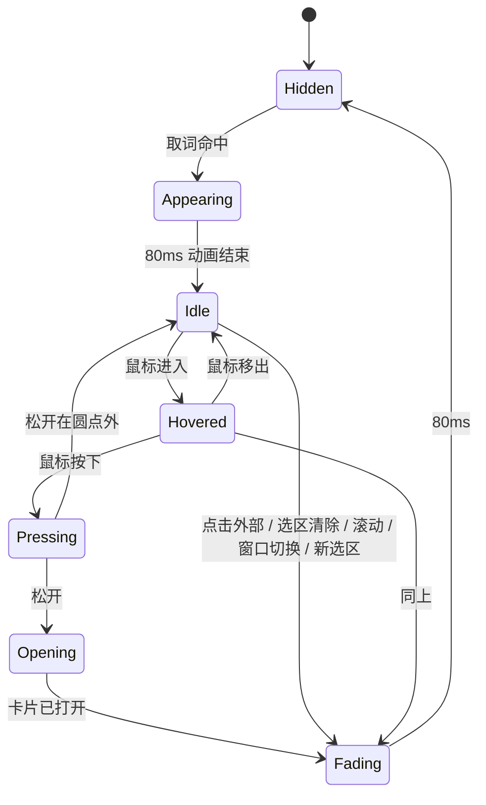
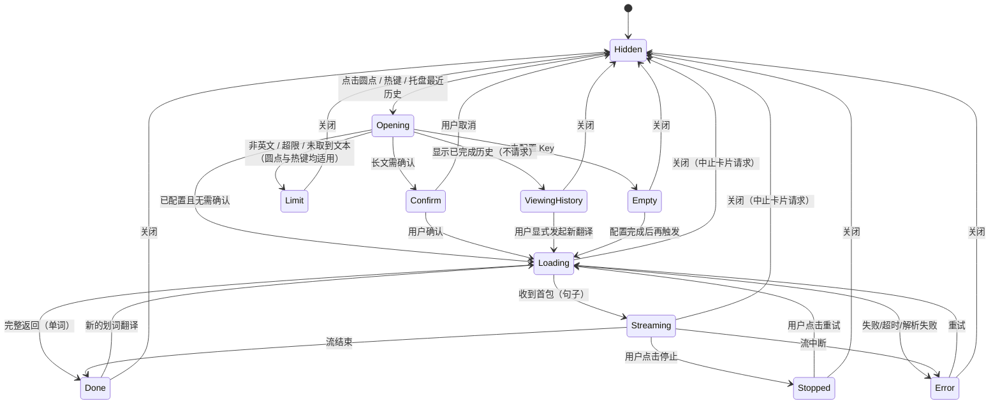
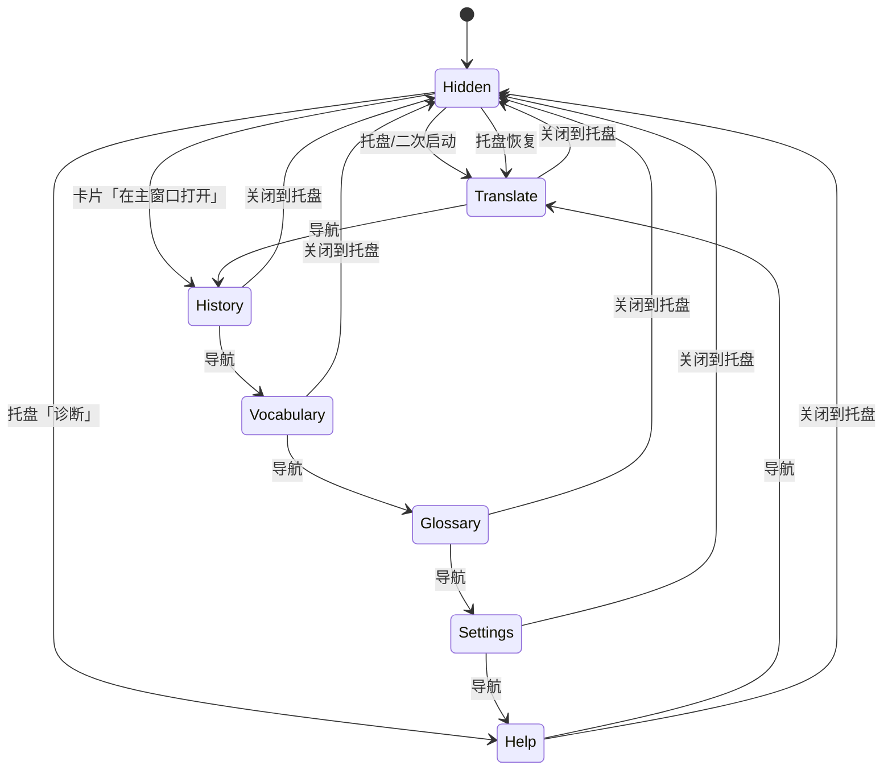

# Snapword 三窗口交互规格说明书 v2.1

> 配套文档：`docs/PRD.md`（产品需求；7.4 为交互摘要，完整条目见本文件第十三章）
> 2026-11-11：新增第十三章交互需求条目（承接原 PRD 7.4）；验收与已定默认改为指向 PRD。
> 本文档解决：PRD 说「要什么」，本文档说「每一毫秒发生什么、出问题时变成什么」。
> 参考基线：本机沉浸式翻译 1.34.4 的本地安装包（见 `docs/research/immersive-translate-interaction-2026-11.md`）。
> 所有时长、阈值均为**建议值**，集中登记在第 10 节参数表中；开发时全部走配置。

---

## 一、本版变化

| 旧版（v1.0）                  | 新版（v2.0）                                |
| ----------------------------- | ------------------------------------------- |
| 气泡 + 覆盖式侧边栏           | 圆点 + 翻译卡片 + 主窗口                    |
| 气泡 96×32，点击后出侧边栏    | 圆点 10×10，点击后出卡片                    |
| 侧边栏固定右侧、宽度自适应    | 卡片贴选区、固定宽度、可拖拽/防误关         |
| 侧边栏底部「最近」            | 翻译页最近 5（共享）+ 主窗口翻译历史        |
| 设置页是独立窗口              | 主窗口包含翻译/历史/生词本/术语表/设置/诊断 |
| 生词本、历史散落在侧边栏/设置 | 主窗口统一管理                              |

> 2026-11-03 决策已确认：卡片不做历史、缩放、ESC、双语/仅译文切换、赞/踩/问题反馈；翻译页最近 5 条来自共享主历史；主窗口去重；防误关只拦外部点击；仅移除本次运行用量 累计展示，长文发送前预估保留。验收编号 IA-01～IA-44 与 PRD.md 对齐；云盘同步为 v1.1，单独用 SY-01～SY-06。

---

## 二、三窗口总览

### 2.1 职责边界

| 窗口     | 只做                                               | 不做                                                               |
| -------- | -------------------------------------------------- | ------------------------------------------------------------------ |
| 圆点     | 告诉用户「这里可以翻译」；点击时承接显式翻译触发   | 不展示译文、不放多个按钮、不做加载态；悬停只作微弱视觉提示，不翻译 |
| 翻译卡片 | 展示当前一次翻译、承接复制/朗读/收藏（收藏仅单词） | 不做历史管理、不做赞踩或问题反馈、不做完整设置、不做账号/升级      |
| 主窗口   | 翻译输入、历史、生词本、术语表、配置、诊断         | 不抢划词当下注意力、不自动弹出                                     |

> 圆点与翻译卡片是独立的置顶窗口，不嵌入浏览器页面；主窗口是常规应用窗口。三者共享同一应用实例。

### 2.2 主流程

```
拖选英文
  → 圆点（≤120ms）
  → 点击圆点 / Alt+W
  → 卡片（≤200ms，骨架先行）
  → 结果 / 操作
  → 关闭卡片
  → 结果进入会话历史；单词可收藏进入生词本
  → 需要管理时打开主窗口
```

### 2.3 窗口层级

| 元素     | 层级           | 全屏应用时                                 |
| -------- | -------------- | ------------------------------------------ |
| 圆点     | 最高，置顶     | 不显示                                     |
| 卡片     | 置顶于普通窗口 | 全屏不保证显示；失败则托盘提示并打开主窗口 |
| 主窗口   | 普通窗口       | 正常                                       |
| 托盘通知 | 系统层         | 正常                                       |

---

## 三、全局交互约定

### 3.1 焦点规则

| 元素     | 出现时是否获焦 | 能否点击获焦 | 说明                                               |
| -------- | -------------- | ------------ | -------------------------------------------------- |
| 圆点     | **否**         | 否           | 纯点击入口，不接收键盘输入                         |
| 翻译卡片 | **否**         | 是           | 出现时用户可继续在原窗口打字；点击卡片后才可用键盘 |
| 主窗口   | 是             | —            | 常规窗口                                           |

> 推论：卡片未获焦时，方向键、Tab 都无效。所以关闭按钮、复制、收藏、朗读必须是鼠标可点的实体按钮（PRD RC-15）。
> 首次获焦提示：卡片首次获得焦点时，给一次轻提示「卡片未获焦时，Ctrl+C 复制的是网页内容」；本次运行只出现一次。

### 3.2 消失与关闭规则

| 元素   | 出现条件                              | 自动消失                                                               | 手动关闭              | 关闭后恢复       |
| ------ | ------------------------------------- | ---------------------------------------------------------------------- | --------------------- | ---------------- |
| 圆点   | UIA 取词命中且通过 FR-11 英文占比校验 | 点击外部 / 选区清除 / 页面滚动 / 窗口切换 / 新选区 / 卡片打开          | —                     | 重新选区         |
| 卡片   | 点击圆点 / 热键 / 托盘重开最近结果    | 普通状态下外部点击关闭；防误关状态下外部点击保留；切换到其他应用均关闭 | 关闭按钮              | 从主窗口历史恢复 |
| 主窗口 | 托盘 / 卡片入口 / 二次启动            | 否                                                                     | 关闭按钮 → 隐藏到托盘 | 托盘 / 二次启动  |

**关键区分**：

- 选区消失 → **圆点**消失；卡片不因选区消失而关闭。
- 点击页面空白（包括主窗口）→ 普通状态卡片关闭；防误关状态卡片保留。
- 切换到其他应用 → 卡片关闭；防误关状态也不例外。
- 卡片关闭会中止当前卡片展示会话的请求；已完成结果保留在主窗口历史。

### 3.3 动效规范

| 动作     | 时长  | 曲线                     | 属性                       |
| -------- | ----- | ------------------------ | -------------------------- |
| 圆点淡入 | 80ms  | ease-out                 | opacity 0→1，scale 0.8→1   |
| 圆点淡出 | 80ms  | ease-in                  | opacity 1→0                |
| 圆点悬停 | 100ms | ease-out                 | 仅微弱视觉提示；不触发翻译 |
| 圆点按下 | 60ms  | linear                   | scale 0.9                  |
| 卡片出现 | 160ms | cubic-bezier(.2,.8,.2,1) | opacity 0→1，scale 0.96→1  |
| 卡片关闭 | 80ms  | ease-in                  | opacity 1→0，scale 1→0.98  |
| 内容替换 | 120ms | ease-out                 | 交叉淡入，不做位移动画     |
| 卡片回弹 | 240ms | cubic-bezier(.2,.8,.2,1) | 位置回到可用区域           |
| 按钮按压 | 60ms  | linear                   | scale 0.96                 |

**禁止**：骨架屏 shimmer、超过 300ms 的动画、弹跳曲线（bounce）、持续呼吸动画。

### 3.4 文案规范

| 规则                                 | 正确                                            | 错误                     |
| ------------------------------------ | ----------------------------------------------- | ------------------------ |
| 三段式：发生了什么 + 为什么 + 怎么办 | 「无法连接接口 · 检查网络或 Base URL · [诊断]」 | 「请求失败，请稍后重试」 |
| 动词开头，不用「请」                 | 「检查网络」                                    | 「请您检查一下网络」     |
| 给具体数字                           | 「已选 6,240 字，将分 4 次请求」                | 「内容较长」             |
| 不确定要说明                         | 「本句含义 · 由 AI 结合上下文判断」             | 把 AI 推断当词典释义     |
| 不用「系统繁忙」                     | 「接口额度不足或被限流」                        | 「系统繁忙」             |

### 3.5 快捷键

| 键                  | 作用                 | 生效条件         |
| ------------------- | -------------------- | ---------------- |
| `Alt+W`             | 翻译当前选中文本     | 全局（可自定义） |
| `Tab`               | 在卡片/主窗口内遍历  | 元素已获焦       |
| `Ctrl+Enter`        | 主窗口翻译页执行翻译 | 翻译页输入框获焦 |
| `Ctrl+1` ~ `Ctrl+6` | 主窗口切换页面       | 主窗口获焦       |
| `Ctrl+F`            | 聚焦当前页搜索       | 主窗口获焦       |

> **不做**：卡片 ESC 关闭。理由：卡片出现时不夺焦，ESC 在未获焦时无效，时灵时不灵；关闭按钮 + 点击外部已覆盖鼠标路径。

### 3.6 主题与字号

- 卡片与主窗口共享同一套颜色令牌；跟随系统，可手动浅色/深色。
- 正文字号基准 14px；卡片单词 24px、音标 16px、语境义 15px、义项 14px、例句 13px。
- 对比度 ≥4.5:1；焦点环 ≥3:1。
- 主题切换立即生效；卡片不因换主题改变位置/尺寸。

---

## 四、圆点逐帧交互

### 4.1 出现时序（预算表）

| 相对时间 | 环节         | 具体动作                           | 预算  | 失败时                |
| -------- | ------------ | ---------------------------------- | ----- | --------------------- |
| T+0      | 鼠标抬起     | 应用收到鼠标释放                   | —     | —                     |
| T+5      | 白名单判定   | 取前台进程名，比对列表             | ≤5ms  | 不匹配 → 静默终止     |
| T+10     | UIA 取词     | 读取选区文本                       | ≤30ms | 无可用取词接口 → 终止 |
| T+40     | 密码框检查   | 检查是否为密码控件                 | ≤2ms  | 是 → 终止，不写日志   |
| T+42     | 文本校验     | trim、非空                         | ≤1ms  | 不满足 → 终止         |
| T+43     | 语言校验     | FR-11 英文占比 ≥30%                | ≤1ms  | 未通过 → 终止         |
| T+44     | 全屏校验     | 前台应用是否全屏（全屏抑制开启时） | ≤1ms  | 全屏 → 终止           |
| T+45     | 汇总取词结果 | 发送文本、选区矩形、进程名         | ≤5ms  | 超时 200ms → 丢弃     |
| T+55     | 定位与显示   | 定位圆点并显示                     | ≤40ms | 记录错误，不弹        |
| T+95     | 首帧         | 圆点开始绘制                       | —     | —                     |
| T+120    | 完成         | 淡入动画结束，完全可见             | —     | —                     |

**两条手感约束**：

1. 圆点**必须**做到即取即显；任何可感知的创建延迟都算不合格。
2. 位置**必须**基于选区矩形，不是鼠标坐标；用户拖选后鼠标常在选区末尾甚至选区外。

### 4.2 位置算法（按优先级）

```
1. 选区右下： (rect.right + 8, rect.bottom + 8)        ← 默认
2. 选区左上： (rect.left - 8 - w, rect.top - 8 - h)    ← 右下越界
3. 选区右侧： (rect.right + 8, rect.verticalCenter)    ← 上下都放不下、水平有空间
4. 鼠标右下： (pointer.x + 8, pointer.y + 8)           ← 选区矩形无效
5. 屏幕中央： 最后兜底，保证一定能看到
```

**为什么默认右下**：Chrome 的选区浮动菜单（复制/搜索）出现在选区上方，默认放右下可以避开它。这是 PRD RK-03 风险的交互解法。

**边界约束**：

- 圆点必须完整落在选区所在显示器的可用区域内，四周至少 8px。
- 圆点不得覆盖选中的文本；若候选位置覆盖选区，跳到下一优先级。
- 仅保证主显示器；多显示器第二屏暂不支持。主屏混合 DPI 下按选区所在显示器的缩放换算；偏差 ≤4px。

### 4.3 圆点状态机



**迁移禁令**：

- `Hidden → Hovered`：禁止（不可见时不能悬停）。
- `Opening → Idle`：禁止（点击后必须进入卡片流程）。
- 任意状态 → `Hidden` 时，**禁止**保留旧选区快照供后续点击。

### 4.4 圆点自身状态

| 状态      | 视觉                       | 进入条件      | 退出               |
| --------- | -------------------------- | ------------- | ------------------ |
| Hidden    | 不可见                     | 初始 / 已消失 | 取词命中           |
| Appearing | 80ms 淡入 + scale 0.8→1    | 取词命中      | 动画结束 → Idle    |
| Idle      | 静态，10px 圆点            | 动画结束      | 悬停 / 按下 / 消失 |
| Hovered   | 仅微弱视觉提示；不触发翻译 | 鼠标进入      | 鼠标移出 / 按下    |
| Pressing  | scale 0.9                  | 鼠标按下      | 松开 → 打开卡片    |
| Fading    | 80ms 淡出                  | 触发消失      | 动画结束 → Hidden  |

**消失规则**：MVP 不设自动隐藏计时器；圆点持续显示到上列消失条件。自动隐藏设置、位置偏好、首次出现引导均不进 MVP，列入 v1.1 规划。

### 4.5 圆点形态约束

| 项       | 值                        | 理由                       |
| -------- | ------------------------- | -------------------------- |
| 视觉尺寸 | 10 × 10 px                | 足够小，不遮字             |
| 点击热区 | ≥24 × 24 px               | 桌面鼠标精度               |
| 内容     | 无文字、无图标            | 入口不需要二次决策         |
| 圆角     | 50%                       | 正圆                       |
| 描边     | 1px 白色                  | 任何背景上可识别           |
| 阴影     | 0 1px 3px rgba(0,0,0,.18) | 轻微浮起                   |
| 不透明度 | 100%                      | 小尺寸下透明会降低可发现性 |

### 4.6 点击行为时序

| 相对时间 | 事件                                        |
| -------- | ------------------------------------------- |
| T+0      | 用户松开鼠标                                |
| T+0      | 圆点进入 Pressing → 触发点击                |
| T+8      | 圆点开始 Fading（80ms，并行）               |
| T+10     | 卡片窗口显示骨架屏                          |
| T+10     | 请求发出（若已配置 Key）                    |
| T+200    | 卡片出现动画完成                            |
| T+≥160   | 内容最早开始渲染（不早于出现动画 80% 进度） |

**去重**：300ms 内的重复点击只处理第一次；第二次点击落在已隐藏的圆点上，不产生事件。

### 4.7 边界三问

| 问题             | 答案                                                                                               |
| ---------------- | -------------------------------------------------------------------------------------------------- |
| **中断了怎么办** | 选区被程序清除 → 圆点立即淡出（无延迟）；点击时选区已失效 → 卡片显示「未获取到选中文本」，不发请求 |
| **失败了怎么办** | UIA 取不到 → 静默不弹圆点；热键触发 → 打开卡片并显示「未获取到选中文本」                           |
| **重复了怎么办** | 连续选中 → 旧圆点立即消失，只保留最新一个；连续点击 → 300ms 去重                                   |

---

## 五、翻译卡片逐帧交互

### 5.1 出现时序

| 相对时间 | 事件                                       |
| -------- | ------------------------------------------ |
| T+0      | 用户点击圆点 / 按 Alt+W                    |
| T+0      | 圆点开始 80ms 淡出（并行）                 |
| T+8      | 应用收到触发，创建或复用卡片窗口，启动请求 |
| T+10     | 卡片以不夺焦方式显示 + 骨架屏渲染          |
| T+160    | 卡片出现动画完成                           |
| T+结果   | 结果到达即替换骨架，不等待动画进度         |

**结果到达即替换骨架**：不为了等待出现动画而延迟内容；骨架是占位，不是延迟器。禁止「骨架 → 空白 → 内容」或「骨架 → 内容 → 再次跳变」。

> 卡片窗口**不预创建**。首次打开时创建，记录 `createMs` / `firstPaintMs`；首次允许超过 200ms，不作为 MVP 阻塞。稳定态（复用窗口）按上表 ≤200ms。

### 5.2 位置算法

```
1. 选区右下：     (rect.right + 8, rect.bottom + 8)     ← 默认
2. 选区下方居中： (rect.centerX - w/2, rect.bottom + 8)
3. 选区上方居中： (rect.centerX - w/2, rect.top - 8 - h)
4. 选区右侧：     (rect.right + 8, rect.centerY - h/2)
5. 屏幕右侧固定： (screen.right - w - 16, screen.centerY - h/2)
6. 屏幕底部居中： (screen.centerX - w/2, screen.bottom - h - 24)
```

**约束**：

- 卡片完整落在选区所在显示器的可用区域内，四周至少 8px。
- 卡片是独立窗口，**不随源页面滚动**；源页面滚动时卡片保持屏幕位置，圆点消失。
- 卡片不得遮挡选区中心；若候选位置覆盖选区，跳到下一优先级。
- 卡片不得超出屏幕；高度超过 70% 工作区时，内部结果区滚动。
- 用户拖拽后，位置在本次运行内记住；重启恢复「跟随选区」。
- 仅主屏：按主显示器计算；第二屏暂不支持；显示器移除后回主屏。

### 5.3 尺寸计算

| 项   | 规则                                                               |
| ---- | ------------------------------------------------------------------ |
| 宽度 | 固定 420px；仅屏幕可用空间不足时夹限至屏幕可用宽度；不提供缩放手柄 |
| 高度 | 随内容自适应，最大 70% 工作区；超出时结果区内部滚动                |
| 位置 | 默认靠近选区；仅可拖动位置，本次运行记住；重启恢复跟随选区         |

**宽度规则**：宽度固定 420px；只有屏幕可用空间不足时才夹限到该屏可用宽度，不按内容或屏幕比例动态缩放，不提供用户缩放手柄。

### 5.4 卡片布局

#### 单词模式

```
┌─────────────────────────────────────────┐
│ ⠿  词典          防误关  ⋯  ✕ │  ← 头部 48px，可拖拽
├─────────────────────────────────────────┤
│ ┌─────────────────────────────────────┐ │
│ │ Use the useEffect hook to fetch...  │ │  ← 原文卡，默认 3 行
│ │ [🔊] [复制]              [显示全部] │ │
│ └─────────────────────────────────────┘ │
│                                         │
│  thread                    🔊美  🔊英    │  ← 词头 24px
│  /θred/  · AI 生成                       │
│                                         │
│  ▎本句含义                               │  ← 语境义置顶
│  在本句中指「讨论串」，即一段连续的       │
│  消息/评论记录（技术语境）                │
│  原句：...a long thread about...         │
│                                         │
│  全部义项                                │
│  n.  线；细丝                            │
│  n.  线索；思路                          │
│  v.  穿线；穿过                          │
│  ... [展开剩余 2 条]                     │
├─────────────────────────────────────────┤
│ ⧉ 点击复制   🔊 朗读   ☆ 收藏          │  ← 底部操作，始终可见
└─────────────────────────────────────────┘
```

#### 句子模式

```
┌─────────────────────────────────────────┐
│ ⠿  翻译          防误关  ⋯  ✕ │
├─────────────────────────────────────────┤
│ ┌─────────────────────────────────────┐ │
│ │ The quick brown fox jumps over...    │ │  ← 原文卡，默认 3 行
│ │ [🔊] [复制]              [显示全部] │ │
│ └─────────────────────────────────────┘ │
│                                         │
│ 快速棕色狐狸跳过了懒狗。▌                │  ← 流式译文 16px
│                                         │
│ 第 1 段  [原文 ▸]                        │
│ 译文……                                  │
│                                         │
│ 第 2 段  [原文 ▸]                        │
│ ▓▓▓▓▓▓▓▓░░░░░  骨架                      │
│                                         │
│ 第 3 段  [原文 ▸]                        │
│ ⚠ 本次失败  [重试]                       │
├─────────────────────────────────────────┤
│ ⧉ 点击复制译文  🔊 朗读                │
└─────────────────────────────────────────┘
```

### 5.5 头部交互

| 元素   | 点击                                                        | 悬停                                                                                      | 禁用态 |
| ------ | ----------------------------------------------------------- | ----------------------------------------------------------------------------------------- | ------ |
| 拖拽区 | 按住拖动卡片                                                | `move` 光标                                                                               | —      |
| 防误关 | 切换防误关/普通状态；只阻止外部点击关闭，不阻止切换应用关闭 | tooltip「只防止点击外部关闭；切换应用仍会关闭，新划词会替换内容」；已开启时「取消防误关」 | —      |
| 更多   | 打开菜单                                                    | 背景高亮                                                                                  | —      |
| 关闭   | 关闭卡片并中止卡片展示会话请求                              | 背景高亮 + tooltip                                                                        | —      |

**更多菜单**：

| 菜单项       | 行为                                                              |
| ------------ | ----------------------------------------------------------------- |
| 在主窗口打开 | 关闭卡片 → 打开主窗口对应详情；未完成的卡片展示会话请求随关闭中止 |
| 设置         | 打开主窗口设置页                                                  |

MVP 不提供卡片赞/踩或问题反馈入口；反馈功能列入 v1.1 规划。帮助与诊断页仍保留 GitHub issue 链接。

### 5.6 原文区交互

| 状态         | 行为                                                     |
| ------------ | -------------------------------------------------------- |
| 折叠（默认） | 最多 3 行；超出显示渐隐 +「显示全部」                    |
| 展开         | 显示全部；原文区内部滚动，最大 300px；按钮变「折叠内容」 |
| 加载中       | 原文区显示 1–2 行骨架                                    |
| 复制         | 点击复制原文；图标变对勾 +「已复制」1.5s                 |
| 朗读         | 播放/停止；无语音包置灰                                  |

**注意**：展开/折叠只改变原文区高度，不重置译文滚动位置；卡片高度变化时保持卡片顶部位置不变。

### 5.7 结果区交互

#### 单词模式

| 元素     | 行为                                                     |
| -------- | -------------------------------------------------------- |
| 词头     | 可选中复制（但卡片整体不进入文本选择模式，避免拖拽冲突） |
| 音标     | 美式必出；英式有则出；AI 生成时标「AI 生成」             |
| 朗读按钮 | 美式/英式分别播放；播放态波形；再点停止                  |
| 语境义   | 置顶；无语境时显示「未结合语境」灰字 + 解释 tooltip      |
| 义项     | 最多 5 条；超出「展开剩余 N 条」；展开后不新开页面       |
| 例句     | 弱化；可选                                               |
| 底部     | 点击复制/朗读/收藏；收藏仅单词模式提供                   |

#### 句子模式

| 元素               | 行为                                                                      |
| ------------------ | ------------------------------------------------------------------------- |
| 译文               | 流式逐字；显示光标；可复制已输出部分                                      |
| 显示模式           | 固定显示折叠原文 + 译文；完整原文可展开；MVP 不提供双语/仅译文切换        |
| 分段               | 按原顺序；每个请求分段有独立状态                                          |
| 每个请求分段的原文 | 折叠；点击展开该请求分段的原文                                            |
| 失败段             | 「⚠ 本次失败」+ [重试]；只重发该段                                        |
| 滚动跟随           | 见 5.8                                                                    |
| 停止               | 流式时底部左侧显示「停止」；点击后保留已输出内容，按钮变「已停止 · 重试」 |
| 底部               | 点击复制译文/朗读；**不提供收藏**（生词本只收单词）                       |

### 5.8 滚动跟随

| 用户行为         | 期望表现                                       |
| ---------------- | ---------------------------------------------- |
| 没碰过滚动条     | 新内容到达时自动跟随到底部                     |
| 用户手动向上滚动 | 立即停止跟随，右下角出现「↓ 回到最新」浮动按钮 |
| 点击「回到最新」 | 滚到底部，恢复自动跟随                         |
| 用户滚回底部     | 自动恢复跟随（无需点按钮）                     |

**判据**：内容追加后，`scrollTop + clientHeight >= scrollHeight - 24px` 视为「在底部」，否则视为「用户主动离开」。

### 5.9 卡片显示状态与请求状态

卡片当前显示内容和后台请求是两个独立状态。用户从主窗口历史选择「在卡片中查看」时，卡片显示历史结果；这不会自动中止正在运行的主窗口请求，也不会让其结果覆盖当前历史显示。



- 热键路径不经过圆点：未取到文本、非英文、超限、未配置 Key 一律进入 `Limit` / `Empty`，由卡片显示原因，**不使用**托盘提示。
- 历史查看状态下，后台请求完成只更新会话历史，不改变卡片当前显示。
- 卡片被关闭或切换应用隐藏时，中止该卡片展示会话拥有的进行中请求；主窗口翻译页请求与卡片请求分离，切换主窗口页面或在卡片中查看历史都不取消它。
- 「在卡片中查看」只切换卡片当前展示；不新发卡片请求、不新增历史、不取消独立主窗口请求。主窗口请求完成后写入共享历史，但不得覆盖正在展示的历史条目。
- 「在卡片中查看」可发生在卡片任意可见状态；卡片展示会话的进行中请求不被该动作取消，完成后只写入共享历史，不覆盖历史展示。
- 用户从 ViewingHistory 显式发起新的划词翻译时，转为 Loading，卡片显示最新划词内容。

**迁移禁令**：

- `Done → Streaming`：禁止（新请求必须先清空，防串台）。
- `Streaming → Confirm`：禁止（确认只能在请求发出前）。
- `Limit → Loading`：禁止（超限不重试，用户需重新选择）。

### 5.10 加载与流式

| 状态      | 视觉                                                            |
| --------- | --------------------------------------------------------------- |
| 卡片打开  | 骨架屏；不白屏                                                  |
| 单词骨架  | 4–6 行灰条：词头、音标、语境义、2 条义项                        |
| 句子骨架  | 按请求分段数生成；每个请求分段 2–3 行                           |
| 首包到达  | 骨架立即替换为真实内容，不等待出现动画进度                      |
| 3s 无首包 | 骨架上方一行小字「接口响应较慢，仍在请求中…」                   |
| 流式中    | 光标 + 顶部细进度条；操作栏半透明但可点；显示「停止」           |
| 用户停止  | 中止当前请求；保留已输出文本；显示「已停止 · 重试」；不自动重发 |
| 流结束    | 光标消失；操作栏点亮                                            |
| 解析降级  | 纯文本展示 +「结果格式异常，已按文本展示」                      |

### 5.11 错误态

| 场景           | 卡片表现                               | 主操作            |
| -------------- | -------------------------------------- | ----------------- |
| 未配置 Key     | 图标 +「还没有配置翻译接口」+ 一句解释 | [去配置] [看说明] |
| Key 无效       | 「认证失败 · Key 可能已失效」+ 错误码  | [改 Key] [诊断]   |
| 网络不可达     | 「无法连接接口 · 检查网络或 Base URL」 | [诊断] [重试]     |
| 超时           | 「请求超时（30s）· 接口未响应」        | [重试]            |
| 流中断         | 保留已输出内容 +「已中断」             | [重试]            |
| 非英文         | 「当前仅支持英文翻译」+ 识别语言       | [关闭]            |
| 超长           | 「已选 24,000 字，超过 20,000 上限」   | [重新选择]        |
| 未取到文本     | 「未获取到选中文本」                   | [关闭] [重试]     |
| 占位符还原失败 | 展示译文 +「代码保护还原失败」         | [复制原文]        |

所有错误态**必须**同时提供「复制原文」入口——用户可能只是想快速把内容粘到别处。

> 圆点路径已在入口通过 FR-11 校验；热键路径绕过圆点，**一律打开卡片**，由卡片按实际原因显示失败态（未取到文本 / 非英文 / 超限 / 未配置 Key），不发送请求。热键路径**不使用**托盘提示。

### 5.12 长文分段

#### 前置确认（卡片内，不是系统对话框）

```
┌─────────────────────────────────┐
│  这段内容共 6,240 字              │
│  将分 4 次请求，预估消耗约         │
│  1,560 tokens（估算）             │
│                                 │
│  ☐ 本次运行不再提示              │
│                                 │
│        [取消]      [继续]        │
└─────────────────────────────────┘
```

- 遮罩：卡片内部半透明黑 30%，**不遮挡外部窗口**。
- 「不再提示」仅在本次运行内有效。
- 取消 = 无任何请求发出；继续 = 按并发 3 开始。

#### 执行期

| 段状态 | 视觉                                 |
| ------ | ------------------------------------ |
| 等待中 | 仅段头「第 N 段」+ 灰色占位          |
| 请求中 | 骨架条 + 段头右侧小转圈              |
| 已完成 | 正常内容                             |
| 失败   | 段内 `⚠ 本次失败` + `重试`；段头标红 |
| 已取消 | 保留已完成段；未开始段灰字「已取消」 |

**顺序约束**：并发 3，但渲染严格按 index 顺序；第 2 个请求分段先返回也要等第 1 个请求分段占位完成后才能上移。**禁止**「先到先排」。

**进度**：请求分段进行时，结果区顶部显示「已完成 N / M 段」；中止或关闭后该数字保留至卡片关闭，并随历史记录写入。单个请求分段时不显示。

### 5.13 当前结果与历史

| 事件               | 行为                                                                                           |
| ------------------ | ---------------------------------------------------------------------------------------------- |
| 新翻译完成         | 直接替换卡片当前内容；不追加卡内历史                                                           |
| 卡片打开时又划新词 | 拖选只产生新圆点：不关闭卡片、不自动发请求；点击新圆点后才替换为最新结果；旧结果已在主窗口历史 |
| 关闭卡片           | 卡片不保留当前结果；主窗口历史保留                                                             |
| 收藏/复制          | 对当前显示的结果生效；收藏仅单词模式提供，句子模式只有复制与朗读                               |

**历史**：只有一份会话历史，20 条，卡片与主窗口翻译页共用；翻译页的「最近 5 条」只是该历史的前 5 条视图。

### 5.14 拖拽

| 操作     | 细节                                                 |
| -------- | ---------------------------------------------------- |
| 开始拖拽 | 头部非控件区域按下；记录起始位置；`cursor: grabbing` |
| 拖动     | 卡片跟随鼠标；不触发文本选择/页面滚动                |
| 松手     | 若超出可用区域，240ms 回弹到 16px 边距内             |
| 结束     | 记住位置（本次运行）；不改变宽度                     |

### 5.15 防误关与关闭

| 触发                       | 普通状态（默认）                  | 防误关状态                        |
| -------------------------- | --------------------------------- | --------------------------------- |
| 点击卡片外部（含主窗口）   | 关闭                              | 防误关                            |
| 切换到其他应用             | 关闭                              | 关闭                              |
| 关闭按钮                   | 关闭                              | 关闭                              |
| 新的划词翻译到达           | 替换当前内容                      | 替换当前内容                      |
| 主窗口历史「在卡片中查看」 | 只切换显示；不发卡片请求/新增历史 | 只切换显示；不发卡片请求/新增历史 |

- 「防误关」只阻止点击卡片外部关闭，不阻止切换到其他应用，也不锁定内容。
- 在页面中拖选并产生新选区**不算**「点击卡片外部」：普通状态下卡片保持不关，新圆点出现；点击新圆点后才替换内容。
- 未产生选区的普通点击（点页面空白、点链接）仍按普通状态关闭卡片。
- 本版不提供 ESC 关闭；关闭按钮、点击外部、切换应用是关闭路径。
- 防误关状态仅本次运行记住；重启默认关闭。
- 关闭卡片时中止卡片展示会话请求；历史查看切换不取消独立运行的主窗口翻译请求。
- 切换到其他应用使卡片关闭时，也中止该卡片展示会话请求。
- 关闭动画 80ms；关闭后不恢复圆点。

### 5.16 边界三问

| 交互               | 中断了怎么办                                | 失败了怎么办                            | 重复了怎么办                          |
| ------------------ | ------------------------------------------- | --------------------------------------- | ------------------------------------- |
| **点击圆点**       | 圆点已消失 → 点击落在页面上，不响应         | 卡片创建失败 → 托盘提示「卡片打开失败」 | 300ms 内连点 → 只处理第一次           |
| **Alt+W**          | 选中文本在按键前变化 → 以按键时刻的选中为准 | 未取到文本 → 打开卡片显示原因，不发请求 | 长按连续触发 → 300ms 去重             |
| **触发翻译**       | 请求中又选别的词 → 直接替换卡片当前结果     | 见 5.11                                 | 同一文本 5s 内重复触发 → 复用上次结果 |
| **流式输出中关闭** | 关闭即中止请求                              | —                                       | —                                     |
| **长文分段**       | 中途关闭 → 已完成段入历史                   | 单个请求分段失败 → 仅该请求分段可重试   | 再次触发同类长文 → 重新确认消耗       |
| **收藏**           | 收藏中关闭卡片 → 后台完成并落库             | DB 失败 → 内联红字 + 可重试             | 重复收藏 →「已收藏 · 更新/取消」      |
| **朗读**           | 播放中触发新翻译 → 停止前一条               | 无语音包 → 置灰                         | 连点 → toggle（停止/播放）            |
| **复制译文**       | —                                           | 剪贴板被占用 → 「复制失败，请重试」     | 连点 → 每次给「已复制」，不叠加       |
| **关闭卡片**       | —                                           | —                                       | 已关闭时再触发 → 无操作               |

---

## 六、主窗口逐页交互

### 6.1 窗口打开与关闭

| 事件                                 | 行为                                                                                                                    |
| ------------------------------------ | ----------------------------------------------------------------------------------------------------------------------- |
| 托盘「显示主窗口」                   | 打开/置前主窗口；恢复上次页面                                                                                           |
| 托盘「用最近一条已完成历史重开卡片」 | 用最近已完成结果缓存恢复卡片展示；不请求、不新增历史、不抢焦；无历史时菜单项置灰，tooltip「本次运行还没有已完成的结果」 |
| 卡片「在主窗口打开」                 | 关闭卡片；打开主窗口并定位到历史条目；请求中则中止并带入原文                                                            |
| 二次启动应用                         | 聚焦主窗口；若从未打开则打开翻译页                                                                                      |
| 点击关闭按钮                         | 隐藏到托盘；首次提示「应用仍在托盘运行」                                                                                |
| 托盘「退出」                         | 关闭所有窗口、中止请求、清理临时资源                                                                                    |
| 主窗口已打开时再次打开               | 置前 + 定位，不新开第二个窗口                                                                                           |

### 6.2 布局

```
┌──────────────────────────────────────────────────────────────┐
│ Snapword                                           ─  □  ✕  │
├──────────────┬───────────────────────────────────────────────┤
│              │  翻译                                         │
│  ▸ 翻译      │  ┌─────────────────────────────────────────┐  │
│    翻译历史  │  │ 粘贴或输入英文，Ctrl+Enter 翻译          │  │
│    生词本    │  │                                         │  │
│    术语表    │  └─────────────────────────────────────────┘  │
│    设置      │  0 字                    [清空]  [翻译]       │
│              │                                               │
│              │  结果                                         │
│              │  ┌─────────────────────────────────────────┐  │
│              │  │ 原文 / 译文 / 操作                       │  │
│              │  └─────────────────────────────────────────┘  │
│              │                                               │
│  帮助与诊断  │  最近                                         │
│              │  · thread · 2 分钟前                         │
└──────────────┴───────────────────────────────────────────────┘
```

- 左侧导航 200px；内容区自适应，最大宽度 1100px（宽屏时居中）。
- 主窗口最小 960×640；窄于此宽度时左侧导航收为图标 + tooltip。
- 页面切换不做整页位移动画；120ms 交叉淡入。

### 6.3 翻译页

| 区域         | 交互                                                                                 |
| ------------ | ------------------------------------------------------------------------------------ |
| 输入框       | 多行；占位「粘贴或输入英文，Ctrl+Enter 翻译」；自动聚焦（页面打开时）                |
| 语言对       | 右上角「英语 → 简体中文」；固定，不可切换                                            |
| 字符数       | 实时显示；>20000 变红并禁用翻译                                                      |
| 清空         | 清空输入与结果；不弹确认（输入为空时禁用）                                           |
| 翻译         | 空输入禁用；点击后加载态；Ctrl+Enter 等效                                            |
| 结果         | 复用卡片渲染；复制/朗读；单词模式另有收藏                                            |
| 在卡片中查看 | 可选；点击打开卡片并显示同一结果（不重新请求）                                       |
| 最近         | 共享历史前 5 条；点击恢复；不重新请求                                                |
| 空态         | 未配置 Key → 「还没有配置翻译接口」+ [去配置]；已配置无输入 → 提示选中网页英文或粘贴 |
| 错误         | 与卡片相同；内联在结果区                                                             |
| 页面切换     | 保留输入与最近一次结果（本次运行内）；「清空」按钮才重置                             |

**翻译页与卡片的关系**：

- 两个入口共用同一条翻译链路、同一份会话历史（20 条）。
- 翻译页「最近」只是该历史的前 5 条视图，不单独存储、不重复写入。
- 翻译页不自动弹卡片；用户主动点「在卡片中查看」才弹。
- 从翻译页「在卡片中查看」打开的卡片只展示该条结果，不写入历史。

### 6.4 翻译历史页

| 区域     | 交互                                                             |
| -------- | ---------------------------------------------------------------- |
| 顶部提示 | 常驻提示条「仅保留本次运行，退出后清空」，不随滚动消失           |
| 搜索     | 匹配原文与译文；防抖 200ms；Ctrl+F 聚焦                          |
| 筛选     | 全部 / 单词 / 句子；可组合搜索                                   |
| 列表     | 时间倒序；类型图标、原文预览、时间、来源；收藏状态仅单词条目显示 |
| 选中     | 右侧/下方显示完整结果；高亮选中项                                |
| 条目操作 | 复制、朗读、删除；收藏仅对单词条目提供                           |
| 清空     | 二次确认；只清历史，不清生词本                                   |
| 新记录   | 若用户在看顶部，实时插入；若在滚动旧条目，显示「有 N 条新记录」  |
| 空态     | 「还没有翻译记录」+ [去翻译]                                     |
| 详情     | 与卡片渲染一致；不重新请求                                       |

### 6.5 生词本页

| 区域       | 交互                                                                                                                                 |
| ---------- | ------------------------------------------------------------------------------------------------------------------------------------ |
| 顶部       | 总数、搜索、排序（时间/字母）、标签筛选、导出                                                                                        |
| 列表       | 单词、音标、语境义预览、标签、时间；支持多选                                                                                         |
| 批量       | 全选/反选；批量删除需确认                                                                                                            |
| 详情       | 单词、音标、语境义、原句、义项、例句、标签、来源、时间                                                                               |
| 编辑       | 标签（≤5）；失焦/Enter 保存；保存失败内联重试                                                                                        |
| 删除       | 单条确认；批量确认；清空输入 `delete`；确认后 5 秒内可撤销                                                                           |
| 撤销条     | 删除成功后主窗口底部内嵌显示「已删除 N 个单词 · 撤销」5 秒；只保留最近一次；新删除替换旧撤销条；不跨窗口、不抢焦点、不使用浮动 toast |
| 撤销       | 点击后条目、标签、收藏时间原样恢复；总数恢复；列表回到原排序位置；撤销条立即消失                                                     |
| 撤销失效   | 超过 5 秒、删除后重新收藏同一词、远端同步已改写该条 → 撤销条收起或点击无变化；**禁止**假成功                                         |
| 清空       | 输入 `delete` 确认；确认后清空并给 5 秒撤销；超时不可撤销                                                                            |
| 导出       | CSV（UTF-8 BOM）/ JSON；系统保存对话框；不含 Key                                                                                     |
| 空态       | 「还没有收藏的单词」+ 指引                                                                                                           |
| 重复收藏   | 「已存在」→ [更新] [取消]；更新覆盖释义/来源，不新增                                                                                 |
| 搜索无结果 | 「没有匹配结果」+ [清除搜索]                                                                                                         |

### 6.6 术语表页

| 区域      | 交互                                                                  |
| --------- | --------------------------------------------------------------------- |
| 顶部      | 总数、搜索、导入 JSON、导出 JSON、添加术语                            |
| 表格      | 词条、匹配方式、处理方式、译文、启用、操作                            |
| 添加/编辑 | 行内或侧边面板；保存即生效                                            |
| 校验      | 词条非空；正则可编译；固定译法必须有译文；完全重复提示                |
| 启用开关  | 即时生效；不影响进行中的请求                                          |
| 导入      | 文件选择 → 冲突预览 → 合并/替换/取消                                  |
| 删除      | 单条即时；批量需确认；删除后 5 秒内可撤销（恢复术语、译文、启用状态） |
| 空态      | 「还没有术语」+ [添加术语] [导入 JSON]                                |
| 提示      | 「修改后对新的翻译生效」                                              |

### 6.7 设置页

| 分组       | 交互要点                                                                                                                                      |
| ---------- | --------------------------------------------------------------------------------------------------------------------------------------------- |
| API        | Base URL、Key、模型、超时、温度即时自动保存；Base URL 旁放小型次级「测试连接」按钮，就地显示连接中/成功/失败且不改变保存状态；清除 Key 需确认 |
| 取词与触发 | 热键录制；白名单添加；圆点开关；全屏抑制                                                                                                      |
| 卡片       | 字号、主题；默认位置跟随选区，仅拖动位置并在本次运行内记住                                                                                    |
| 数据       | 路径展示；语境片段开关；导出配置；清空全部数据；打开目录；v1.1 增加云盘同步                                                                   |
| 系统       | 开机自启；托盘提示；界面语言；更新检查                                                                                                        |
| 朗读       | 系统/云 TTS；语速；试听                                                                                                                       |

**设置去重**：术语表、诊断、关于只通过顶层页面进入；清空历史与清空生词本分别留在各自页面，设置页只保留「清空全部数据」。

**自动保存反馈**：API/Base URL/Key/模型及其他设置在编辑时即时自动保存，分组标题右侧显示「已保存」2s；失败显示「保存失败 · 重试」；不弹 toast。测试连接结果独立显示在 Base URL 旁，不改变保存状态。

#### 6.7.1 云盘同步（v1.1，MVP 不显示）

| 区域       | 交互                                                                                                                      |
| ---------- | ------------------------------------------------------------------------------------------------------------------------- |
| 入口       | 「数据」组内「云盘同步」卡片；MVP 不渲染                                                                                  |
| 开关       | 关闭时不读写同步文件；关闭需确认，说明本地数据不受影响                                                                    |
| 文件夹     | 系统目录选择；显示路径；不存在/不可写时内联错误                                                                           |
| 状态       | 空闲 / 同步中 / 成功 / 失败；显示上次同步时间、设备数；失败显示原因 + 重试                                                |
| 立即同步   | 同步中禁用；完成显示「已同步」弱提示；不弹窗                                                                              |
| 打开文件夹 | 资源管理器打开同步文件夹                                                                                                  |
| 隐私       | 启用前提示云盘明文；同步语境片段开关默认关（设备本地，独立于「语境片段是否入库」）；API Key、Base URL、日志不写入同步文件 |
| 冲突       | 按记录最后写入优先；不提供手动冲突 UI                                                                                     |
| 阻塞       | 同步不阻塞设置页、收藏、翻译；失败不影响本地数据                                                                          |

### 6.8 帮助与诊断页

| 区域     | 交互                                                       |
| -------- | ---------------------------------------------------------- |
| 快捷问题 | 圆点不出现 / 取不到词 / 认证失败 / 卡片不显示 / 全屏无反应 |
| 诊断     | 「运行诊断」→ 8 项检查；状态点 + 人话 + 下一步             |
| 复制     | 「复制诊断信息」；不包含 Key/原文                          |
| 日志     | 打开目录、清空；最近 50 条错误                             |
| 关于     | 版本、构建、License、GitHub、第三方许可、检查更新          |
| 反馈     | 打开 GitHub issue 模板；提示附诊断信息                     |

### 6.9 主窗口状态机



**规则**：

- 页面切换不重置页面状态（搜索词、滚动位置、选中项、翻译页输入与结果）。
- 关闭到托盘后再次打开，恢复上次页面与滚动位置。
- 退出应用时，所有页面状态丢弃。

### 6.10 边界三问（主窗口）

| 交互                 | 中断了怎么办                                       | 失败了怎么办                                         | 重复了怎么办                      |
| -------------------- | -------------------------------------------------- | ---------------------------------------------------- | --------------------------------- |
| **打开主窗口**       | 已打开 → 置前                                      | 打开失败 → 托盘提示                                  | 二次启动 → 聚焦，不新开           |
| **翻译页翻译**       | 导航离开 → 请求继续；结果仍入历史                  | 见卡片错误态                                         | 连续点击 → 按钮禁用直到完成       |
| **历史删除**         | —                                                  | 删除失败 → 内联错误 + 重试                           | 已删除 → 无操作                   |
| **删除撤销**         | 切换页面 → 撤销条继续计时；关闭主窗口 → 超时后失效 | 撤销失败 → 内联错误 + 重试；条目保持删除             | 连续删除 → 只保留最近一次撤销条   |
| **云盘同步（v1.1）** | 同步中关闭窗口 → 后台完成或下次启动续传            | 文件夹/权限/解析失败 → 状态错误 + 重试；本地不受影响 | 重复点击 → 只跑一次；重复合并幂等 |
| **生词本收藏**       | 关闭主窗口 → 后台完成                              | DB 失败 → 内联重试                                   | 重复 → 更新/取消                  |
| **导出**             | 关闭主窗口 → 继续后台导出                          | 失败 → 提示路径/权限                                 | 连续点击 → 只处理第一次           |
| **清空数据**         | 输入 `delete` 前取消 → 无变化                      | 失败 → 保留原数据 + 错误                             | 重复确认 → 幂等                   |
| **术语导入**         | 预览阶段取消 → 无变化                              | 解析失败 → 错误行号                                  | 重复导入 → 冲突预览               |

---

## 七、跨窗口联动

### 7.1 生命周期

```
应用启动
  → 托盘常驻
  → 首次启动：主窗口引导
  → 划词：圆点 → 卡片
  → 卡片/托盘 → 主窗口
  → 关闭主窗口 → 托盘
  → 退出 → 清理
```

### 7.2 事件流

| 事件         | 来源               | 影响                                                                         |
| ------------ | ------------------ | ---------------------------------------------------------------------------- |
| 翻译完成     | 卡片/翻译页        | 会话历史 +1（两个入口共用同一份 20 条）                                      |
| 托盘重开卡片 | 托盘               | 用最近一条已完成历史的缓存恢复展示；不请求、不新增历史、不抢焦；无历史时置灰 |
| 收藏         | 卡片/历史/生词本   | 仅单词模式：生词本新增/更新；所有界面同步星标；句子模式无收藏                |
| 取消收藏     | 生词本/卡片        | 仅单词模式：生词本删除；卡片星标变空心                                       |
| 设置变更     | 主窗口             | 卡片/下一次请求生效                                                          |
| 打开主窗口   | 卡片/托盘/二次启动 | 关闭卡片（卡片入口）或置前                                                   |
| 关闭主窗口   | 用户               | 隐藏到托盘；卡片/圆点不受影响                                                |
| 退出         | 托盘               | 中止请求；清空内存历史；保留生词本/设置                                      |

### 7.3 焦点与层级

- 圆点不获焦；卡片出现不获焦；主窗口正常获焦。
- 主窗口与卡片同时存在时，卡片保持置顶；主窗口可通过任务栏切换。
- 从卡片打开主窗口：卡片关闭，主窗口获焦。
- 从托盘打开主窗口：视为点击卡片外部；防误关的卡片保留，普通卡片关闭。
- 托盘「用最近一条已完成历史重开卡片」仅恢复展示，不抢焦点。

### 7.4 请求生命周期

| 事件                           | 请求                                             | 卡片                               | 历史                                     |
| ------------------------------ | ------------------------------------------------ | ---------------------------------- | ---------------------------------------- |
| 关闭卡片（进行中）             | 中止卡片展示会话拥有的请求                       | 隐藏                               | 未完成请求不记录                         |
| 关闭卡片（已完成）             | —                                                | 隐藏                               | 保留                                     |
| 主窗口翻译页请求中切换页面     | 主窗口请求继续；与卡片请求分离                   | 卡片状态不因该请求变化             | 完成后记录                               |
| 主窗口历史「在卡片中查看」     | 不发卡片请求；不取消独立主窗口请求，后者继续完成 | 显示历史；后台结果不得覆盖当前显示 | 主窗口请求完成后写入历史；查看历史不新增 |
| 防误关卡片点击外部（含主窗口） | 卡片请求继续                                     | 保持显示；内容仍可更新             | 完成后记录                               |
| 切换到其他应用                 | 中止当前卡片展示会话拥有的请求                   | 隐藏                               | 未完成卡片请求不记录；主窗口独立请求继续 |
| 连续触发 3 次                  | 只保留最后一次                                   | 显示最后一次                       | 前两次完成则记录                         |
| 应用退出                       | 全部中止                                         | 关闭                               | 清空                                     |

---

## 八、状态机汇总

### 8.1 圆点

见 4.3。

### 8.2 卡片

见 5.9。

### 8.3 主窗口

见 6.9。

### 8.4 迁移禁令汇总

| 禁令                              | 理由                         |
| --------------------------------- | ---------------------------- |
| 卡片 `Done → Streaming`           | 新请求必须先清空，防串台     |
| 卡片 `Streaming → Confirm`        | 确认只能在请求发出前         |
| 卡片 `Limit → Loading`            | 超限不重试，用户需重新选择   |
| 圆点 `Hidden → Hovered`           | 不可见时不能悬停             |
| 主窗口 `Hidden → Hidden` 重复打开 | 单实例，只置前               |
| 翻译卡片关闭时保留进行中请求      | 关闭即中止，避免继续消耗额度 |

---

## 九、交互验收清单

> 验收用例统一维护在 [PRD.md](PRD.md) 第十五章（IA-01~IA-44 + SY-01~SY-06），本文件不再重复。

---

## 十、参数表

| 参数                  | 建议值       | 含义                                       |
| --------------------- | ------------ | ------------------------------------------ |
| `dot.visualSize`      | 10px         | 圆点视觉尺寸                               |
| `dot.hitArea`         | 24px         | 圆点点击热区                               |
| `dot.offset`          | 8px          | 相对选区偏移                               |
| `dot.appear`          | 80ms         | 圆点淡入                                   |
| `dot.fadeOut`         | 80ms         | 圆点淡出                                   |
| `dot.hoverHint`       | 微弱视觉提示 | 悬停不放大、不发起翻译                     |
| `card.width`          | 420px        | 固定宽度；仅屏幕空间不足时夹限，不提供缩放 |
| `card.heightMax`      | 70% 工作区   | 最大高度                                   |
| `card.offset`         | 8px          | 相对选区偏移                               |
| `card.appear`         | 160ms        | 出现动画                                   |
| `card.close`          | 80ms         | 关闭动画                                   |
| `card.sourceLines`    | 3            | 原文折叠行数                               |
| `card.sourceMax`      | 300px        | 原文区展开最大高度                         |
| `card.visibleTarget`  | 200ms        | 卡片首屏可见上限（含骨架）                 |
| `fetch.timeout`       | 30s          | 单请求超时                                 |
| `fetch.slowWarn`      | 3s           | 无首包提示                                 |
| `fetch.dedupeWindow`  | 5s           | 同文本去重                                 |
| `trigger.debounce`    | 300ms        | 重复触发去重                               |
| `trigger.hotkey`      | `Alt+W`      | 全局热键默认值                             |
| `segment.threshold`   | 3000         | 进入分段字符数                             |
| `segment.maxChars`    | 20000        | 总字符上限                                 |
| `segment.maxCount`    | 15           | 请求分段数上限                             |
| `segment.chunkChars`  | 1500         | 单个请求分段目标长度                       |
| `segment.concurrency` | 3            | 分段并发                                   |
| `context.readLimit`   | 2000         | 原文段落读取上限                           |
| `context.maxChars`    | 300          | 语境发送上限                               |
| `history.size`        | 20           | 会话历史条数                               |
| `snippet.maxChars`    | 300          | 收藏语境片段上限                           |
| `main.width`          | 1200px       | 主窗口默认宽                               |
| `main.height`         | 800px        | 主窗口默认高                               |
| `main.minWidth`       | 960px        | 主窗口最小宽                               |
| `main.minHeight`      | 640px        | 主窗口最小高                               |

---

## 十一、反模式清单（明确不做）

| 不做                           | 理由                                               |
| ------------------------------ | -------------------------------------------------- |
| 悬停自动翻译                   | 鼠标路过就发请求，烧钱且不可控；必须显式点击或按键 |
| 圆点放多个按钮                 | 目标太小易误点，且入口只负责打开                   |
| 成功 toast                     | 遮挡阅读；按钮状态变化已足够                       |
| 模态遮罩盖住原窗口             | 打断阅读；长文确认只在卡片内部做                   |
| 自动播放朗读                   | 突然出声是灾难性体验                               |
| 「智能」猜用户想翻译什么       | 所有翻译都必须由用户显式发起                       |
| 关闭确认弹窗（「确认关闭？」） | 卡片关掉毫无损失，加确认是骚扰                     |
| 记住「不再提示」跨运行         | 用户会忘记自己在花钱                               |
| 卡片内放服务下拉/升级入口      | 增加决策负担，与产品定位冲突                       |
| 新建多个卡片叠在一起           | 遮挡阅读；同一时刻只允许一个卡片                   |
| 卡片出现时抢键盘焦点           | 会打断用户在原窗口的输入                           |
| 手动切换单词/句子模式          | 模式由文本判定，提供切换会多出一套结果与状态       |

---

## 十二、已定默认与暂不支持项

> 已定默认与暂不支持项统一维护在 [PRD.md](PRD.md) 第十七章（17.1 已定默认 / 17.2 不再验证），本文件不再重复。

---

## 十三、交互需求条目（RD / RC / RM / RX）

> 本章承接原 PRD 7.4，保留 RD / RC / RM / RX 编号；PRD 只保留产品级约束与索引，本章是交互需求的唯一细节源。


### 13.1 三窗口模型

#### 三个窗口的角色

| 窗口         | 角色                                                     | 出现时机                                  | 焦点行为                                           | 生命周期                         |
| ------------ | -------------------------------------------------------- | ----------------------------------------- | -------------------------------------------------- | -------------------------------- |
| **圆点**     | 划词入口，只回答「这里可以翻译」                         | UIA 取词命中后                            | 永不获得焦点                                       | 随选区/点击消失                  |
| **翻译卡片** | 当前这一次翻译的阅读与操作面                             | 点击圆点或按热键；也可由历史/托盘缓存重开 | 出现时不夺焦；点击后获焦；历史或托盘缓存重开不抢焦 | 关闭后隐藏；完成结果进入共享历史 |
| **主窗口**   | 管理面：翻译、翻译历史、生词本、术语表、设置、帮助与诊断 | 托盘、卡片入口、二次启动                  | 正常窗口，获得焦点                                 | 关闭到托盘，不退出应用           |

> 圆点与翻译卡片都是**独立的置顶窗口**，不嵌入浏览器页面；主窗口是常规应用窗口。三者共享同一应用实例，不新增第四个常驻窗口。

```
浏览器里选中英文
        │
        ●  ← 圆点：只做入口，不夺焦
        │  点击
        ▼
 ┌──────────────────┐
 │   翻译卡片        │  ← 贴选区；可拖拽/防误关；只显示当前结果
 │  原文 / 译文 / 操作│
 └──────────────────┘
        │  「在主窗口打开」/ 托盘
        ▼
 ┌──────────────────────────────┐
 │ 主窗口                        │
 │ 翻译 · 翻译历史 · 生词本       │
 │ 术语表 · 设置 · 帮助与诊断     │
 └──────────────────────────────┘
```

#### 主流程

```
用户在 Chrome / Edge 中拖选英文
        ↓
UIA 取词命中（非密码框、非空、含英文字母）
        ↓
圆点出现在选区旁（≤120ms，不夺焦）
        ↓
用户点击圆点 或 按 Alt+W
        ↓
翻译卡片出现（≤200ms，先骨架屏，不夺焦）
        ↓
[未配置 Key] → 卡片空态「去配置」→ 主窗口设置
        ↓
[超长] → 卡片内消耗预估 → 继续 / 取消
        ↓
请求与渲染（单词 JSON / 句子流式）
        ↓
用户复制 / 朗读 / 收藏 / 停止流式 / 关闭
        ↓
结果进入会话历史；收藏进入生词本
        ↓
用户可从卡片「在主窗口打开」进入主窗口对应详情
```

#### 窗口关系

| 关系               | 规则                                                                                               |
| ------------------ | -------------------------------------------------------------------------------------------------- |
| 圆点 → 卡片        | 圆点点击后立即隐藏；卡片出现后不再显示圆点                                                         |
| 卡片 → 主窗口      | 卡片可主动打开主窗口；打开后卡片关闭（防误关状态不阻止导航）                                       |
| 主窗口 → 卡片      | 主窗口不主动弹出卡片；用户可在翻译页选择「在卡片中查看」                                           |
| 圆点 + 主窗口      | 互不干扰；主窗口打开不阻止划词，用户回到浏览器划词时圆点仍可出现                                   |
| 卡片 + 主窗口      | 可同时存在；普通状态卡片因主窗口成为外部焦点而关闭；防误关状态卡片保留。切换到其他应用时卡片均关闭 |
| 多卡片             | **禁止**同时存在两个翻译卡片；新结果替换同一卡片的当前内容                                         |
| 多主窗口           | **禁止**；第二次启动聚焦已有主窗口                                                                 |
| **第四个常驻窗口** | **禁止**；长文确认、错误和操作状态反馈都在卡片内完成；赞/踩/问题反馈不进入 MVP                     |

#### 设计原则

| 原则                 | 含义                                                                                                 |
| -------------------- | ---------------------------------------------------------------------------------------------------- |
| **一层只做一个决定** | 圆点只负责「打开」，卡片只负责「这一次」，主窗口只负责「管理」                                       |
| **阅读优先**         | 任何界面不得遮挡选区中心；默认位置避开浏览器原生选区菜单                                             |
| **显式触发**         | 不因鼠标路过、滚动、悬停自动发请求；必须点击圆点或按热键                                             |
| **就地反馈**         | 复制、收藏、朗读、失败、重试都在卡片内给状态反馈；不含赞/踩/问题反馈，不弹系统对话框、不做成功 toast |
| **状态可见**         | 任何等待都有骨架或进度；任何失败都有人话说明与下一步                                                 |
| **用户可控**         | 卡片可拖、可防误关、可关闭；消耗大的操作先确认                                                       |

#### 已废止的旧交互

以下 v1.1.1 的交互不再成立，保留此表用于对照旧资料：

| 旧交互                        | 处理                                               |
| ----------------------------- | -------------------------------------------------- |
| 96 × 32 px 的「译」字气泡     | 废止，改为 10px 小圆点                             |
| 覆盖式悬浮侧边栏              | 废止，改为翻译卡片                                 |
| 侧边栏宽度自适应、防跳动规则  | 废止，改为固定 420px + 拖拽位置                    |
| 侧边栏底部「最近」入口        | 废止，改为翻译页最近 5（共享）+ 主窗口翻译历史     |
| 侧边栏空态 / 错误态           | 废止，改为卡片状态 + 主窗口设置                    |
| 侧边栏「失焦自动隐藏」开关    | 废止，改为卡片「防误关」；普通状态卡片点击外部关闭 |
| 侧边栏输入框手输（v1.1 计划） | 改为主窗口「翻译」页，作为最后出口                 |

---

### 13.2 圆点（RD-01 ~ RD-12）

#### RD-01 形态与位置

- 圆点视觉尺寸**必须**为 10 × 10 px 的正圆，使用品牌强调色，外圈 1px 白色描边，带轻微阴影。
- 圆点的可点击热区**必须** ≥ 24 × 24 px；视觉小，热区大。
- 圆点**禁止**包含文字、图标、第二个按钮。
- 默认位置：选区右下角，水平偏移 8px、垂直偏移 8px。
- 圆点**必须**完整位于屏幕可用区域内，且**禁止**遮挡选中的文本。
- 越界翻转顺序：
  1. 选区右下；
  2. 选区左上；
  3. 选区右侧垂直居中；
  4. 鼠标释放点右下；
  5. 屏幕可用区域中央兜底。
- 仅保证主显示器；多显示器第二屏暂不支持，不再验证。主屏内混合 DPI 下位置偏差 ≤4px。

验收：

- Given 选中靠近屏幕右下角的文本，When 圆点出现，Then 圆点完整可见且不盖住选中文字。
- Given 选区在屏幕顶部，When 圆点出现，Then 圆点显示在选区下方或翻转到选区左侧。

#### RD-02 出现条件

圆点**必须**同时满足以下条件才出现：

1. 前台应用在白名单内（默认 `chrome.exe`、`msedge.exe`）。
2. UIA 取到非空选中文本，trim 后长度 > 0。
3. 目标元素不是密码框。
4. 选中文本通过 FR-11 的英文占比校验（英文字母占比 ≥30%）。
5. 前台应用不处于全屏状态（全屏抑制开启时）。

判定**必须**按上述顺序执行：英文占比在密码框检查之后；任一条不满足即终止，不显示圆点。

出现延迟**必须** ≤120ms（鼠标抬起 → 圆点首帧可见）。

> 圆点出现即表示选区已通过 FR-11 语言校验；热键路径绕过圆点，仍在卡片内校验。

#### RD-03 不出现的情况

以下情况**必须**不显示圆点，也不产生任何请求：

| 情况                                                | 行为                                                     |
| --------------------------------------------------- | -------------------------------------------------------- |
| 非白名单应用                                        | 完全静默                                                 |
| 未选中文本 / 空白                                   | 完全静默                                                 |
| 密码框                                              | 完全静默，不记录内容                                     |
| 未通过 FR-11 英文占比校验（纯中文 / 数字 / 符号等） | 不显示圆点；用户按热键时由卡片给出「当前仅支持英文翻译」 |
| 全屏应用                                            | 不显示圆点；热键仍可用                                   |
| UIA 取不到                                          | 不显示圆点；热键触发时打开卡片显示「未获取到选中文本」   |

> 设计说明：圆点是「可以翻译」的入口，不是错误提示器。非英文选区不弹圆点，避免每次选中中文都出现一个无用的点；用户主动按热键时再给出明确解释。

#### RD-04 状态

| 状态      | 视觉                                                 | 进入条件      | 退出               |
| --------- | ---------------------------------------------------- | ------------- | ------------------ |
| Hidden    | 不可见                                               | 初始 / 已消失 | 取词命中           |
| Appearing | 80ms 淡入，scale 0.8 → 1                             | 取词命中      | 动画结束 → Idle    |
| Idle      | 静态圆点                                             | 动画结束      | 悬停 / 按下 / 消失 |
| Hover     | 仅微弱视觉提示；不明显放大、不加明显光晕；不触发翻译 | 鼠标进入      | 鼠标移出 → Idle    |
| Pressed   | scale 0.9                                            | 鼠标按下      | 松开 → 打开卡片    |
| Fading    | 80ms 淡出                                            | 触发消失      | 动画结束 → Hidden  |

**禁止**：圆点旋转、跳动、持续呼吸动画；圆点不显示加载状态。悬停只提供微弱视觉提示，不自动发起翻译。

#### RD-05 消失条件

圆点**必须**在以下任一条件满足时消失：

1. 用户点击圆点外的任意位置。
2. 选区被清除。
3. 用户滚动页面。
4. 前台窗口切换到其他应用。
5. 用户产生新的选区（旧圆点立即消失，新圆点出现在新位置）。
6. 卡片打开。
7. 应用退出或取词能力暂停。

默认不因鼠标离开圆点而自动消失；MVP 不提供自动隐藏计时器。

#### RD-06 点击行为

- 单击圆点**必须**打开翻译卡片，并立即隐藏圆点。
- 点击去重：300ms 内的重复点击只处理第一次。
- 点击时**必须**使用当前最新的选区快照；若选区已变化，圆点应已更新，旧圆点不得翻译旧文本。
- 若卡片已因同一选区打开，圆点应已隐藏，不存在「再点一次关闭」的路径。
- 点击圆点后若取词内容已失效（选区被页面清除），卡片显示「未获取到选中文本」并提供关闭/重试，不发送请求。

#### RD-07 规划项（不属于 MVP）

以下圆点附加体验列入 v1.1 规划，本版**不提供**：自动隐藏、位置偏好、首次出现「点击圆点翻译」引导。MVP 固定采用默认右下定位并由 RD-01 自动越界翻转。

#### RD-08 设置项

| 设置项   | 默认值 | 选项                      |
| -------- | ------ | ------------------------- |
| 圆点开关 | 开     | 开 / 关（关时仅热键可用） |
| 全屏抑制 | 开     | 开 / 关                   |

MVP 不提供圆点自动隐藏设置、位置偏好或首次出现引导，均列入 v1.1；MVP 默认位置与越界翻转按 RD-01，悬停仅作微弱视觉提示。

#### RD-09 边界与异常

| 场景                      | 行为                                                                   |
| ------------------------- | ---------------------------------------------------------------------- |
| 连续快速选中 5 个词       | 任一时刻最多 1 个圆点；最终只保留第 5 个                               |
| 选中后 1 秒内点击页面空白 | 圆点消失；已打开的卡片按卡片规则处理                                   |
| 选中后向下滚动            | 圆点消失；不出现位置错乱的点                                           |
| 圆点出现后窗口失焦        | 圆点消失                                                               |
| 圆点在屏幕边缘            | 按 RD-01 翻转；仍放不下则贴边并保证完整可见                            |
| 多显示器拔插              | 仅主屏支持；第二屏暂不支持。主屏分辨率变化时圆点消失，下次取词重新计算 |
| 缩放 100% / 125% / 150%   | 圆点位置偏差 ≤4px                                                      |

#### RD-10 可访问性

- 圆点**禁止**进入键盘 Tab 序列（它不是键盘操作入口）。
- 圆点**必须**有可读的无障碍标签「翻译选中文本」，供屏幕阅读器识别（不显示在界面上）。
- 圆点与背景的对比度**必须** ≥3:1；悬停外圈不依赖颜色单独传达状态。
- 圆点热区**必须** ≥24 × 24 px，满足鼠标操作。

#### RD-11 性能

- 鼠标抬起 → 圆点首帧可见：P95 ≤120ms。
- 圆点出现**禁止**导致页面滚动位置变化、选区丢失或前台窗口焦点变化。
- 圆点常驻隐藏窗口预创建；**禁止**每次出现都新建窗口（用户可感知的卡顿即不合格）。

#### RD-12 与卡片的关系

- 圆点点击后**必须**立即隐藏；卡片出现过程中不得同时看到圆点与卡片。
- 卡片关闭后**禁止**自动恢复圆点；用户需重新选区或按热键。
- 卡片打开期间产生新选区：新圆点**可以**出现；点击后新结果直接替换同一卡片的当前内容，不新开第二个卡片。

---

### 13.3 翻译卡片（RC-01 ~ RC-20）

#### RC-01 打开与窗口行为

- 点击圆点或按全局热键后，稳定态卡片**必须**在 200ms 内出现（含骨架屏首帧）；首次创建窗口记录 `createMs` / `firstPaintMs`，允许超标，不作为 MVP 阻塞。
- 卡片出现时**禁止**夺取键盘焦点；用户仍可在原窗口继续打字、滚动。
- 卡片**必须**始终置顶、不出现在任务栏；同一时刻**禁止**存在多个卡片实例。
- 卡片已存在时，新翻译**必须**替换同一卡片的当前内容，不新开窗口。
- 卡片出现时**必须**先显示骨架屏，**禁止**白屏等待。
- 骨架是占位，不是延迟器：结果到达即替换骨架，**禁止**为了等待出现动画而延迟内容；**禁止**「骨架 → 空白 → 内容」或「骨架 → 内容 → 再次跳变」。

验收：

- Given 卡片已打开，When 用户继续在 Chrome 中滚动页面，Then 卡片保持可见且不夺取焦点。
- Given 连续触发 3 次翻译，When 观察窗口，Then 始终只有 1 个卡片，内容为最后一次结果，前两次若已完成可在主窗口翻译历史中查看。

#### RC-02 位置

- 默认位置：选区附近，水平/垂直偏移 8px；优先放在选区右下。
- 放不下时按以下顺序翻转：
  1. 选区下方；
  2. 选区上方；
  3. 选区右侧；
  4. 屏幕右侧固定位置（距右边缘 16px，垂直居中）；
  5. 屏幕底部居中（距底部 24px）。
- 卡片**必须**完整位于选区所在显示器的可用区域内，四周至少留 8px。
- 卡片是独立窗口，**不随源页面滚动**；源页面滚动时卡片保持屏幕位置，圆点消失。
- 用户拖拽后，位置在本次运行内记住；重启后恢复「跟随选区」。
- 仅保证主显示器；多显示器第二屏暂不支持，不再验证。显示器移除后回落到主屏可用区域。

#### RC-03 尺寸

| 项   | 规则                                                               |
| ---- | ------------------------------------------------------------------ |
| 宽度 | 固定 420px；屏幕空间不足时按屏幕可用区域夹限，不提供缩放手柄       |
| 高度 | 随内容自适应，最大为工作区高度的 70%；超出时结果区内部滚动         |
| 位置 | 默认靠近选区；仅可拖动位置，本次运行内记住；重启后恢复「跟随选区」 |

验收：

- Given 先翻译单词再翻译长句，When 内容更新，Then 卡片宽度保持 420px，不因内容切换而跳动。
- Given 用户把卡片拖到屏幕另一侧，When 再翻译另一句，Then 卡片沿用拖动后的位置，但宽度仍为 420px。

#### RC-04 头部

头部**必须**包含以下元素，从左到右：

| 元素                  | 行为                                                                                                                                              |
| --------------------- | ------------------------------------------------------------------------------------------------------------------------------------------------- |
| 拖拽区                | 整个头部可拖动卡片；`cursor: move`；拖动中 `grabbing`                                                                                             |
| 模式标签              | 单词模式固定显示「词典」；句子模式固定显示「翻译」；不提供手动切换                                                                                |
| 防误关（原 Pin 图标） | 只阻止点击卡片外部关闭；不锁内容，新翻译仍替换当前结果；tooltip「只防止点击外部关闭；切换应用仍会关闭，新划词会替换内容」，已开启时「取消防误关」 |
| 更多                  | 菜单：在主窗口打开、设置                                                                                                                          |
| 关闭                  | 28 × 28 点击区；关闭卡片并中止卡片展示会话的进行中请求                                                                                            |

头部只保留「防误关」、更多、关闭三个操作；**禁止**新增其他常驻图标。

#### RC-05 原文区

- 卡片**必须**展示原文，位于结果上方。
- 原文默认折叠为 3 行；超过 3 行时显示「显示全部」，展开后显示「折叠内容」。
- 展开后原文区最大高度 300px，超出内部滚动；**禁止**把卡片撑出屏幕。
- 原文区**必须**提供朗读原文、复制原文两个操作。
- 原文**禁止**以 Markdown/HTML 渲染；按纯文本展示，保留换行。
- 流式翻译过程中，原文区保持可用，不随译文逐字重排。

#### RC-06 单词结果

自上而下**必须**依次呈现：

1. 单词 + 美式音标（必出）+ 英式音标（有则出，弱化）。
2. 朗读按钮（美式 / 英式）。
3. **本句含义（语境义，置顶）**：左侧强调线 + 浅底色；附原句片段（≤50 字符）。
4. 全部义项（最多 5 条；每条含词性、释义、可选例句）。
5. 底部操作：点击复制、朗读、收藏。

规则：

- 音标由模型生成时**必须**标注「AI 生成」或等价弱化提示。
- 语境义缺失时**必须**显示「未结合语境」灰字，并解释「未能读取所在句子」。
- 义项超过 5 条时显示「展开剩余 N 条」；展开后不新开页面。
- 收藏按钮状态**必须**反映该词是否已在生词本。

#### RC-07 句子结果

- 原文默认折叠 3 行；译文在下方流式渲染。
- 译文主字号 16px，行高 ≥1.5；**禁止**使用 Markdown 标题。
- 流式输出时显示光标；用户可随时复制已输出部分。
- **停止**：流式中显示「停止」；停止后保留已输出文本，显示「已停止 · 重试」。
- 重试由用户主动点击，不自动发起；其余状态与错误按 RC-09/RC-10 展示。
- 长文分段时，每个请求分段**必须**按原顺序渲染；每个请求分段可折叠显示对应原文。
- 每个请求分段有独立状态：等待、请求中、完成、失败、已取消。
- 失败段显示「重试」；重试只重发该段。
- 卡片始终显示折叠原文与译文；完整原文可展开。MVP **不提供**「双语 / 仅译文」切换（列入 v1.1）。
- 流式过程中用户向上滚动：**必须**停止自动跟随，并显示「↓ 回到最新」；用户回到底部或点击按钮后恢复跟随。
- 底部操作只有点击复制译文与朗读；**不提供**收藏（生词本只收单词）。

#### RC-08 底部操作

底部操作栏**必须**始终可见、不随内容滚动消失，包含：

| 操作             | 行为              | 反馈                                             |
| ---------------- | ----------------- | ------------------------------------------------ |
| 点击复制译文     | 写入剪贴板        | 图标变为对勾 +「已复制」1.5s；不弹 toast         |
| 朗读译文         | 系统 TTS / 云 TTS | 播放态动画；再点停止；无语音包置灰               |
| 收藏（仅单词）   | 加入生词本        | 星标实心；重复收藏显示「已收藏 · 更新 / 取消」3s |
| 停止（仅流式中） | 中止当前请求      | 保留已输出内容；按钮变「已停止 · 重试」          |

- 「停止」按钮在流式时显示于底部操作栏左侧，避免与复制/朗读/收藏的常驻位置冲突。
- 流式过程中操作栏**可以**半透明，但**必须**可点。
- 停止按钮只在流式中显示，放在操作栏左侧；停止后替换为「已停止 · 重试」，保留已输出内容。
- 复制、收藏、朗读**禁止**因为卡片未获焦而失效。
- 操作失败**必须**在按钮旁内联提示，不弹系统对话框。
- 这些是复制/收藏等操作的状态提示，不包含赞/踩/问题反馈入口；卡片反馈功能列入 v1.1。

#### RC-09 状态

卡片**必须**覆盖以下状态，**禁止**白屏或无反馈等待：

| 状态       | 展示要求                                                        |
| ---------- | --------------------------------------------------------------- |
| 未配置 Key | 图标 +「还没有配置翻译接口」+ 一句解释 + [去配置] [看说明]      |
| 加载中     | 骨架屏；单词 4–6 行，句子按请求分段数生成；静态灰条，无 shimmer |
| 响应较慢   | 3s 无首包时，骨架上方显示「接口响应较慢，仍在请求中…」          |
| 流式中     | 逐字渲染 + 顶部细进度条 + 光标；底部显示「停止」                |
| 已停止     | 保留已输出内容，显示「已停止 · 重试」；重试需用户点击           |
| 流式中断   | 保留已输出内容，显示「已中断 · 重试」；用户点击后重新请求       |
| 成功       | 正常内容与操作栏                                                |
| 请求失败   | 错误码 + 人话说明 + [重试] [诊断] [复制原文]                    |
| 超限       | 明确原因（字符数 / 请求分段数）与当前值 + [重新选择]            |
| 不支持语言 | 「当前仅支持英文翻译」+ 识别到的语言 + [关闭]                   |
| 未获取语境 | 语境义区域显示「未结合语境」                                    |
| 长文确认   | 卡片内消耗预估 + [取消] [继续] +「本次运行不再提示」            |
| 部分失败   | 已完成段正常显示；失败段单独重试                                |

> 圆点路径已在入口通过 FR-11 校验；热键路径绕过圆点，**一律打开卡片**，由卡片按实际原因进入「不支持语言」「未获取到选中文本」「超限」「未配置」等状态，不发送请求。热键路径**不使用**托盘提示。

#### RC-10 错误处理

- 错误**必须**保留用户输入与已输出内容；**禁止**清空卡片。
- 错误文案采用三段式：发生了什么 + 为什么 + 怎么办。
- 错误码**必须**可见但弱化；普通用户先看到人话说明。
- 流式中断：保留已输出内容，显示「已中断 · [重试]」；用户点击重试才重新请求。
- JSON 解析失败：自动重试 1 次；仍失败降级纯文本并提示「结果格式异常，已按文本展示」。
- 占位符还原失败：提示「代码保护还原失败」，展示译文并提供复制原文。
- 错误态**必须**提供「复制原文」入口。

#### RC-11 长文本

- 总长度 >3000 字符时**必须**进入分段流程。
- 分段前**必须**在卡片内展示：「共 X 字，将分 N 次请求，预估 Y tokens（估算）」，提供 [取消] [继续]。
- 取消**必须**不发出任何请求。
- 硬上限：总字符 ≤20000，请求分段数 ≤15；超出**必须**提示并拒绝。
- 并发 ≤3；渲染**必须**按原顺序，**禁止**先到先排。
- 单个请求分段失败自动重试 1 次；仍失败仅该请求分段显示重试，其他请求分段正常。
- 分段进行中**必须**在结果区顶部显示「已完成 N / M 段」；中止或关闭后保留该数字并随历史记录写入。
- 中途关闭卡片：**必须**中止未完成请求；已完成段保留在会话历史。
- 「本次运行不再提示」只对当前运行有效，**禁止**跨运行记住。

#### RC-12 当前结果与历史

- 卡片**只显示当前一次翻译结果**，不保留卡内历史，不提供翻页。
- 卡片打开时产生新翻译：**必须**直接用最新结果替换当前内容；旧结果已在会话历史中，不弹「有新结果」提示。
- 关闭卡片后当前结果不单独保留；会话历史仍保留最近 20 条，可在主窗口查看。
- 当前结果与主窗口历史**必须**指向同一结果对象，收藏状态同步。

#### RC-13 拖拽与位置

- 拖拽：按住头部任意非控件区域拖动；卡片跟随鼠标；松手后若超出可用区域，动画回弹到 16px 边距内。
- 拖拽过程中**禁止**触发文本选择、页面滚动或卡片关闭。
- 拖拽结束后**必须**记住位置（本次运行）；重启恢复「跟随选区」。
- 卡片宽度固定，不提供缩放手柄；高度随内容自适应，最大 70% 工作区。

#### RC-14 防误关、关闭原因与历史查看

| 触发                           | 普通状态（默认）                                                                                     | 防误关状态       |
| ------------------------------ | ---------------------------------------------------------------------------------------------------- | ---------------- |
| 点击卡片外部（含主窗口）       | 关闭卡片                                                                                             | 防误关           |
| 切换到其他应用                 | 关闭卡片                                                                                             | 关闭卡片         |
| 点击关闭按钮                   | 关闭卡片                                                                                             | 关闭卡片         |
| 主窗口历史选择「在卡片中查看」 | 只切换卡片当前展示；不发卡片请求、不新增历史；主窗口翻译页请求继续完成并写入历史，但不得覆盖卡片显示 | 同左             |
| 划词触发新的翻译               | 替换当前卡片内容                                                                                     | 替换当前卡片内容 |

- 「防误关」只阻止点击卡片外部关闭，不阻止切换到其他应用，也不锁定内容。
- 在页面中拖选并产生新选区**不算**「点击卡片外部」：普通状态下卡片保持不关，新圆点出现；点击新圆点后才替换内容。
- 未产生选区的普通点击（点页面空白、点链接）仍按普通状态关闭卡片。
- 本版不提供 ESC 关闭；关闭按钮与点击卡片外部是关闭路径；切换到其他应用会关闭卡片。
- 「防误关」状态仅在本次运行内记住；重启默认关闭。
- 卡片因关闭按钮、外部点击或切换应用而关闭时，**必须**中止当前卡片展示会话拥有的进行中请求。
- 主窗口翻译页请求独立于卡片展示会话；切换主窗口页面不取消该请求，完成后照常写入共享历史。
- 主窗口历史「在卡片中查看」仅切换卡片当前展示，不发卡片请求、不新增历史，也不取消主窗口中正在进行的翻译；该请求完成后写入共享历史，但不得覆盖卡片当前选中的历史条目。
- 关闭动画 80ms；关闭后不恢复圆点。

#### RC-15 焦点与键盘

- 卡片出现时**禁止**获得键盘焦点；用户点击卡片内部后才获得焦点。
- 卡片首次获得焦点时，**必须**给一次轻提示「卡片未获焦时，Ctrl+C 复制的是网页内容」；本次运行只出现一次。
- 卡片获焦后：
  - Tab 遍历可操作元素；
  - PageUp/PageDown 滚动结果区；
  - Enter 激活当前按钮。
- 本版不提供 ESC 关闭；所有关键操作**必须**有鼠标入口。
- 关闭按钮、复制、收藏、朗读**必须**在未获焦时也可点击。
- 焦点进入卡片时**必须**有清晰焦点环；焦点顺序按视觉顺序。

#### RC-16 主题、字号与视觉

- 卡片**必须**支持浅色 / 深色 / 跟随系统，默认跟随系统。
- 正文基准字号 14px；单词 24px、音标 16px、语境义 15px、义项 14px、例句 13px。
- 文字与背景对比度 ≥4.5:1；图标与背景 ≥3:1。
- 卡片圆角 16px；阴影保证在任何背景上可识别边界。
- **禁止**骨架屏 shimmer、持续动画、弹跳曲线；动画总时长 ≤300ms。
- 卡片内**禁止**出现广告、升级、试用、账号入口。

#### RC-17 全屏与多显示器（部分暂不支持）

- 仅保证主显示器；多显示器第二屏暂不支持，不再验证。
- 主屏内混合 DPI 下位置偏差 ≤4px；缩放后布局不破。
- 全屏应用前台时：
  - 不显示圆点；
  - 热键仍可触发；
  - 卡片**不保证**可见或置顶；失败时托盘提示「全屏模式下无法显示卡片」，点击提示打开主窗口。
  - Q-2（全屏卡片置顶）不再验证，全屏应用不作为卡片支持场景。
- 显示器拔出/分辨率变化：卡片回落到主屏可用区域。

#### RC-18 「在主窗口打开」与「在卡片中查看」

- 卡片「更多」菜单提供「在主窗口打开」：关闭卡片，打开主窗口并定位到当前结果的历史详情；若请求尚未完成，按关闭卡片规则中止卡片展示会话请求，主窗口翻译页带入原文并显示「请求已中止 · 重新翻译」，**禁止**自动重发。
- 主窗口历史条目提供「在卡片中查看」：打开或复用卡片并显示该已完成结果，**不发卡片请求、不新增历史**；仅切换卡片当前展示内容。
- 「在卡片中查看」不取消主窗口翻译页正在进行的请求；该请求完成后正常写入历史，不得覆盖卡片当前显示的历史结果。
- 如用户先返回浏览器并划词，新的划词翻译按 RC-12 替换卡片当前内容。
- 主窗口**必须**获得焦点；卡片关闭动画不得阻塞主窗口出现。
- 「防误关」不阻止从卡片导航到主窗口。

#### RC-19 设置即时生效

- 主题、字号：下一次打开卡片生效；已打开卡片主题/字号立即生效。卡片默认跟随选区；拖动位置只记本次运行，不作为持久化偏好。
- API、模型、术语表、占位符设置：下一次请求生效；进行中的请求不换引擎。
- 快捷键修改：立即重新注册；失败时在设置页提示，不影响旧快捷键（若仍可用）。
- 白名单修改：下一次取词生效。

#### RC-20 鼠标优先

- 卡片所有功能**必须**在不使用键盘的情况下完成。
- **禁止**只有 hover 才能出现的操作；hover 只用于 tooltip。
- 图标按钮**必须**有 tooltip 与可读标签。
- 双击、右键**禁止**作为唯一操作方式。

---

### 13.4 主窗口（RM-01 ~ RM-20）

#### RM-01 窗口行为

- 主窗口是常规桌面窗口，默认 1200 × 800，最小 960 × 640；居中于主屏。
- 主窗口**必须**记住大小与位置；重启恢复。
- 主窗口**必须**单实例；第二次启动聚焦已有窗口。
- 关闭主窗口**必须**隐藏到托盘，不退出应用；首次关闭时提示一次「应用仍在托盘运行」。
- 退出应用**必须**通过托盘菜单或主窗口菜单中的「退出」；**禁止**关闭主窗口即退出。
- 主窗口打开时**禁止**自动弹出卡片；主窗口与卡片可同时存在。

#### RM-02 信息架构与导航

主窗口采用左侧导航 + 右侧内容区：

| 顺序 | 导航项     | 内容                              |
| ---- | ---------- | --------------------------------- |
| 1    | 翻译       | 手动文本翻译、最近结果            |
| 2    | 翻译历史   | 本次运行的最近 20 条记录          |
| 3    | 生词本     | 收藏的单词、搜索、导出            |
| 4    | 术语表     | 术语与固定译法管理                |
| 5    | 设置       | API、取词、卡片、数据、系统、朗读 |
| 6    | 帮助与诊断 | 自检、日志、故障排查、关于        |

- 导航项**必须**有图标 + 文字；当前项高亮。
- 支持快捷键 `Ctrl+1` ~ `Ctrl+6` 切换页面。
- 支持深链接：卡片「在主窗口打开」、托盘「诊断」、通知点击可直达对应页面与条目。
- 默认页面为「翻译」；首次启动引导完成后进入「翻译」。
- 页面切换 ≤100ms；**禁止**整页刷新闪烁。

#### RM-03 翻译页

- 页面包含：输入区、翻译按钮、结果区、最近结果。
- 输入区：
  - 多行文本框，占位「粘贴或输入英文，Ctrl+Enter 翻译」。
  - 右上角显示「英语 → 简体中文」固定语言对。
  - 显示字符数；超过 20000 时禁用翻译并提示上限。
  - 提供「清空」按钮。
- 翻译按钮：
  - 输入为空时禁用；
  - 点击后进入加载态，按钮显示「翻译中…」；
  - `Ctrl+Enter` 等效点击。
- 结果区：
  - 复用卡片的单词/句子渲染规则；
  - 提供复制、朗读；单词模式另有收藏，句子模式无收藏；问题反馈不进 MVP。
  - 提供「在卡片中查看」入口（可选）；从翻译页打开的卡片只展示该条结果，不重复写入历史。
- 最近结果：
  - 显示共享会话历史的前 5 条（与「翻译历史」页同一数据源）；
  - 点击恢复结果，不重新请求；
  - 不单独存储，不重复写入历史。
- 空态：
  - 未配置 Key：显示「还没有配置翻译接口」+ [去配置]；
  - 已配置无输入：显示「在网页中选中英文，或在这里粘贴文本」。
- 错误/超限/非英文：与卡片相同的人话说明；**禁止**只显示「失败」。
- 页面切换后**必须**保留输入与最近一次结果（本次运行内）；只有「清空」按钮重置。
- 主窗口翻译请求与卡片请求分离；离开翻译页不取消主窗口请求，该请求继续完成并记入共享历史，不得覆盖卡片当前显示的历史条目。

> 主窗口翻译页与划词卡片共用同一条翻译链路、同一份会话历史（20 条）；翻译页的「最近」只是该历史的前 5 条视图。

#### RM-04 翻译历史页

- 历史为本次运行最近 20 条，退出清空；页面顶部**必须**显示「仅保留本次运行，退出后清空」。
- 列表按时间倒序；每行显示：类型图标、原文预览（1 行）、时间、来源（划词/手动）；收藏状态仅单词条目显示。
- 支持搜索（原文与译文）、类型筛选（全部/单词/句子）。
- 点击条目在右侧/下方显示完整结果；**禁止**重新请求。
- 条目操作：复制、朗读、删除；收藏仅对单词条目提供。
- 顶部操作：清空历史（二次确认）；**禁止**清空生词本。
- 空态：「还没有翻译记录」+ [去翻译]。
- 新翻译完成时，若历史页打开，列表顶部**必须**实时插入；不打断当前滚动位置（若用户正在看旧条目，显示「有 N 条新记录」提示）。

#### RM-05 生词本页

- 生词本持久化；页面显示总数。
- 列表：单词、音标、语境义预览、标签、收藏时间；按时间倒序，可切换字母序。
- 搜索：匹配单词与释义；输入即筛选；清空恢复。
- 标签筛选：多选；无标签项可单独筛选。
- 详情：单词、音标、语境义、原句片段、义项、例句、标签、来源标题/域名、收藏时间。
- 编辑：标签（最多 5 个）；保存后立即生效。
- 删除：单条删除需确认；批量删除需确认；清空全部要求输入 `delete`。
- 撤销：确认删除后 5 秒内，主窗口底部显示「已删除 N 个单词 · 撤销」；单条、批量、清空生词本均适用；只保留最近一次删除的撤销入口，新的删除替换旧入口；撤销后条目、标签、收藏时间原样恢复，计数恢复。
- 撤销失效：超过 5 秒、删除后 5 秒内重新收藏同一词、或远端同步已改写该条时，撤销入口收起或点击后不产生变化；**禁止**显示假撤销成功。
- 清空生词本：输入 `delete` 确认后清空，仍提供 5 秒撤销；超时后不可撤销。
- 导出：CSV（UTF-8 with BOM）与 JSON；使用系统保存对话框；导出内容**禁止**包含 API Key。
- 空态：「还没有收藏的单词」+「在翻译卡片中点击 ☆ 收藏」。
- 重复收藏：提示「已存在」，提供 [更新] [取消]；更新覆盖释义与来源，不新增条目。

#### RM-06 术语表页

- 表格列：词条、匹配方式（完全/包含/正则）、处理方式（不译/固定译法）、译文、启用、操作。
- 新增/编辑：行内或侧边面板；保存即生效。
- 校验：
  - 词条不能为空；
  - 正则必须可编译；
  - 固定译法必须填写译文；
  - 完全重复词条提示「已存在」。
- 导入/导出 JSON；导入前预览冲突，提供「合并 / 替换 / 取消」。
- 搜索与筛选；批量删除需确认；删除后 5 秒内可撤销（单条/批量），撤销恢复术语、译文与启用状态。
- 页面顶部提示「修改后对新的翻译生效；进行中的翻译不受影响」。
- 空态：「还没有术语」+ [添加术语] [导入 JSON]。

#### RM-07 设置页

设置页采用分组导航或分组卡片，所有设置**必须**自动保存（输入框失焦/开关切换即保存），并显示「已保存」弱提示；保存失败显示内联错误与重试。

| 分组       | 设置项                                                                                                                           |
| ---------- | -------------------------------------------------------------------------------------------------------------------------------- |
| API        | Base URL、API Key（掩码 + 眼睛 3s）、模型名、超时、温度；配置即时自动保存；Base URL 旁放小型次级「测试连接」按钮与状态；清除 Key |
| 取词与触发 | 全局热键（录制/重置）、白名单进程（添加/删除/未验证角标）、圆点开关、全屏抑制                                                    |
| 卡片       | 字号、主题；卡片位置默认跟随选区，仅可拖动，本次运行记住                                                                         |
| 数据       | 生词本路径、语境片段是否入库、导出配置、清空全部数据、打开数据目录；v1.1 增加云盘同步                                            |
| 系统       | 开机自启、托盘提示、界面语言、更新检查                                                                                           |
| 朗读       | 系统 TTS / 云 TTS、语速、试听                                                                                                    |

- 测试连接按钮是 API 区域内的小型次级按钮，紧邻 Base URL；点击后就在按钮旁显示连接中、成功或失败，不打开独立页面/弹窗，也不改变即时自动保存行为。
- API/Base URL/Key/模型及其余配置在编辑或切换控件时即时自动保存；测试连接不替代保存、不改变保存状态。
- API Key 眼睛按钮显示明文 3s 后自动回落掩码。
- 热键录制：按下组合键即生效；冲突时输入框变红并提示；**禁止**自动换键。
- 白名单添加非浏览器进程：显示 ⚠「未验证」角标，允许保存。
- 术语表、诊断、关于不在设置页重复入口；分别走顶层「术语表」「帮助与诊断」。
- 清空历史只在翻译历史页；清空生词本只在生词本页；设置页只保留「清空全部数据」。
- 所有危险操作**必须**说明后果与是否可恢复。

#### RM-07a 云盘同步（v1.1，MVP 不提供）

MVP 设置页不显示同步入口；v1.1 在「数据」组增加「云盘同步」。

- 用户选择一个已被 OneDrive / Google Drive / Dropbox / iCloud 等客户端同步的本地文件夹；应用**不接入云盘账号、不调用云盘 API**。
- 设置项：

| 项         | 行为                                            |
| ---------- | ----------------------------------------------- |
| 开启同步   | 开关；关闭后停止读写同步文件，本地数据不受影响  |
| 同步文件夹 | 系统目录选择；显示路径；不存在/不可写时内联错误 |
| 立即同步   | 手动触发；同步中禁用；完成后显示上次同步时间    |
| 状态       | 空闲 / 同步中 / 成功 / 失败；失败显示原因与重试 |
| 设备       | 显示参与同步的设备数；v1.1 不提供设备管理/踢出  |
| 打开文件夹 | 打开资源管理器                                  |

- 同步范围：生词本、术语表、可同步设置（主题、字号、界面语言、语境片段开关、圆点开关、全屏抑制、模型名、温度、超时）。
- **不同步**：API Key、Base URL、全局热键、白名单进程、开机自启、TTS、窗口大小/位置、数据库路径、日志。
- 冲突：按记录最后写入优先；不提供手动冲突解决 UI；同一词在两台设备同时编辑时，较新的版本覆盖较旧的版本。
- 隐私：同步文件写入用户选择的云盘文件夹，为**明文**；启用前必须提示；语境片段默认不同步，可手动开启（设备本地开关，独立于「语境片段是否入库」）；API Key、Base URL、日志永不写入同步文件。
- 失败：文件夹不可用、无权限、文件损坏、另一台设备版本更新 → 内联状态 + 重试；不阻塞本地收藏/翻译。
- 删除：删除通过墓碑跨设备传播；一台设备删除后，另一台设备下次同步时隐藏该条；5 秒内撤销会同步为恢复。

#### RM-08 帮助与诊断页

- 顶部：常见问题快捷入口（圆点不出现 / 取不到词 / 认证失败 / 卡片不显示 / 全屏无反应）。
- 诊断检查项：

| 检查项     | 输出                                    |
| ---------- | --------------------------------------- |
| 版本       | 应用、取词服务、运行时版本              |
| UIA 可用性 | 当前前台窗口能否读取 TextPattern        |
| 白名单     | 当前生效进程列表                        |
| 热键       | 是否注册成功                            |
| API        | Base URL 可达性、认证结果（不显示 Key） |
| 代理       | 是否检测到系统代理                      |
| TTS        | 系统语音数量、云 TTS 状态               |
| 日志       | 最近 50 条错误（脱敏）                  |

- 提供「运行诊断」「复制诊断信息」「打开日志目录」「清空日志」。
- 诊断结果用状态点（成功/失败/未知）+ 人话说明 + 下一步。
- 关于：版本、MIT License、GitHub、更新检查、第三方许可。
- **禁止**在诊断页显示完整 Key、完整原文、完整响应体。

#### RM-09 空态、加载与错误

- 每个页面**必须**有独立空态，**禁止**空白页。
- 列表加载：骨架行或「加载中」；本地数据应 ≤100ms，不显示长时间骨架。
- 保存/删除/导出失败：内联错误 + 重试；**禁止**仅 console 报错。
- 破坏性操作**必须**二次确认；确认文案说明影响范围。
- 成功操作使用内联状态或列表变化，**禁止**成功 toast 遮挡内容。

#### RM-10 键盘与可访问性

- Tab 顺序：左侧导航 → 页面主操作 → 列表/表单 → 底部操作。
- `Ctrl+1` ~ `Ctrl+6` 切换页面；`Ctrl+F` 聚焦当前页搜索（历史/生词本/术语表）。
- 所有图标按钮有可读标签与 tooltip。
- 焦点环清晰；对比度 ≥4.5:1。
- 列表支持方向键上下移动选中项；Enter 打开详情。
- 对话框打开时焦点进入对话框；ESC 关闭；关闭后焦点回到触发按钮。

#### RM-11 搜索与筛选

- 历史、生词本、术语表各自有搜索框；输入即筛选（防抖 200ms）。
- 搜索无结果时显示「没有匹配结果」+ [清除搜索]。
- 筛选条件可组合；清空全部筛选有明确按钮。
- 搜索**禁止**发起网络请求。

#### RM-12 数据安全

- 「清空全部数据」要求输入 `delete`，并列出将被删除的内容（生词本、术语表、配置、日志）；清空前自动写一份完整备份；**不提供** 5 秒撤销。
- 删除提供 5 秒真实撤销（单条、批量、清空生词本）；**禁止**假撤销。
- 导出**禁止**包含 API Key、日志正文、完整原文。
- 生词本导出前提示「包含你收藏的单词与语境片段」。
- 云盘同步为显式开启；同步文件为明文，启用前提示；语境片段默认不同步；API Key、Base URL、日志永不写入同步文件。

#### RM-13 主题与语言

- 主题跟随系统；可手动浅色/深色；所有页面同步。
- 界面语言中文 / English，默认跟随系统；切换后立即生效，不重启。
- 英文文案变长时布局不溢出；按钮最小宽度按内容自适应（细则见 RX-11）。
- 日期/数字格式跟随界面语言。

#### RM-14 通知

- 主窗口内**禁止**使用漂在其他窗口上的成功 toast。
- 托盘通知仅用于：取词服务异常、全屏无法显示卡片、首次关闭到托盘、卡片打开失败。
- 托盘通知 3s 自动消失；点击可打开主窗口对应页面。
- 同一错误 10s 内不重复通知。

#### RM-15 卡片与主窗口共存

- 主窗口获得焦点视为「点击卡片外部」：普通状态卡片关闭，防误关状态卡片保留。
- 切换到其他应用时，卡片均关闭；防误关不阻止应用切换关闭。
- 主窗口**禁止**遮挡卡片到无法操作；若重叠，防误关状态卡片保持在主窗口之上，用户可拖动。
- 从卡片打开主窗口时，按 RC-18 关闭卡片。

#### RM-16 窗口标题与状态

- 标题栏显示「Snapword」+ 当前页面名。
- 未保存状态：本版全部自动保存，不显示「未保存」；保存失败显示「保存失败，点击重试」。
- 后台任务（导出、诊断）在页面内显示进度，不阻塞导航。

#### RM-17 托盘

托盘菜单**必须**包含：

1. 显示主窗口；
2. 用最近一条已完成历史重开卡片（无历史时置灰，tooltip「本次运行还没有已完成的结果」）；
3. 设置；
4. 诊断；
5. 退出。

- 双击托盘图标：显示主窗口。
- 托盘图标**禁止**出现两个；单实例。

#### RM-18 关于（帮助与诊断页内）

- 关于信息作为「帮助与诊断」页的一个子区块，**不单独设导航项**。
- 展示版本号、构建时间、MIT License、GitHub 仓库地址、第三方许可。
- 「检查更新」只比较版本号，不自动下载。
- 提供「复制版本信息」按钮，便于 issue。

#### RM-19 日志

- 「打开日志目录」「清空日志」可用。
- 日志只记录脱敏信息：时间、级别、模块、错误码、字符数、耗时；**禁止**记录原文/译文/Key。
- 日志保留 7 天，滚动删除。
- 诊断页可一键复制最近 50 条错误。

#### RM-20 性能

- 页面切换 ≤100ms；列表 100 条以内滚动不卡顿。
- 搜索输入防抖 200ms；本地筛选 ≤50ms。
- 主窗口空闲内存与 CPU 纳入原非功能指标；**禁止**因主窗口常驻导致明显耗电。
- 导出 1000 条生词 ≤2s；超过 2s 显示进度。

---

### 13.5 跨窗口与生命周期（RX-01 ~ RX-11）

#### RX-01 窗口生命周期

```
应用启动
  → 托盘常驻（主窗口不自动显示，首次启动除外）
  → 划词 → 圆点 → 卡片
  → 卡片「在主窗口打开」/ 托盘 → 主窗口
  → 关闭主窗口 → 隐藏到托盘（应用不退出）
  → 托盘退出 → 关闭所有窗口、中止请求、清理临时资源
```

- 圆点、卡片、主窗口**必须**由同一应用实例管理。
- 应用退出时**必须**：关闭所有窗口、中止请求、清理临时资源；底层清理沿用 v1.1.1。
- 主窗口关闭**禁止**影响圆点与卡片；卡片关闭**禁止**影响主窗口。

#### RX-02 收藏同步

- 卡片收藏成功 → 生词本立即新增/更新；主窗口若打开，列表与计数实时更新。
- 主窗口删除/更新收藏 → 卡片中该词的收藏状态在下一次显示时同步。
- 重复收藏：以 `word` 归一化（小写 + trim）唯一；来源只覆盖写入。
- 收藏失败：卡片内联「收藏失败，点击重试」；主窗口显示错误状态。

#### RX-03 历史同步

- 卡片与主窗口翻译页共用同一条翻译链路、同一份会话历史（20 条）；任一入口完成翻译都新增 1 条。
- 主窗口历史页若打开，新记录实时插入；翻译页「最近 5 条」只是同一历史的前 5 条视图，不重复写入。
- 关闭卡片中止的请求**禁止**写入历史；长文已完成段**可以**写入，并标注「部分完成」。
- 历史最多 20 条；超出移除最旧；退出清空。

#### RX-04 设置同步

- 主窗口修改 API/模型/术语表 → 下一次请求生效；进行中的请求不换引擎。
- 主窗口修改主题/字号 → 卡片与主窗口立即生效。
- 主窗口修改热键/白名单 → 立即重新注册/生效；失败时设置页提示。
- 卡片默认跟随选区；拖动位置仅在本次运行内记住，主窗口设置不提供位置偏好。

#### RX-05 卡片与主窗口历史互开

- 卡片「在主窗口打开」→ 关闭卡片 → 主窗口打开并定位到对应历史条目。
- 若卡片请求尚未完成：关闭卡片会中止该请求；主窗口「翻译」页带入原文并显示「请求已中止 · 重新翻译」，**禁止**自动重发。
- 主窗口历史条目「在卡片中查看」→ 打开或复用卡片，显示该已完成历史；不发卡片请求、不新增历史。
- 该动作不取消主窗口翻译页正在进行的独立请求；其结果完成后写入会话历史，但不覆盖卡片正在显示的历史条目。
- 主窗口定位后高亮该条目 2s，方便用户找到。
- 若主窗口已打开：置前并定位，不新开第二个主窗口。

#### RX-06 托盘与二次启动

- 托盘菜单见 RM-17。
- 托盘「用最近一条已完成历史重开卡片」：使用最近已完成结果的缓存打开卡片；**禁止**发请求、**禁止**新增历史、**禁止**抢焦；无历史时菜单项置灰，tooltip「本次运行还没有已完成的结果」。
- 第二次启动应用：聚焦主窗口；若主窗口从未打开过，则打开主窗口「翻译」页。
- 二次启动**禁止**新开圆点/卡片实例，**禁止**重复注册热键。

#### RX-07 请求生命周期

| 事件                                 | 请求                                                           | 卡片                                   | 历史                                 |
| ------------------------------------ | -------------------------------------------------------------- | -------------------------------------- | ------------------------------------ |
| 用户关闭卡片（进行中）               | 中止当前卡片展示会话拥有的请求                                 | 隐藏                                   | 未完成请求不记录                     |
| 普通状态下点击卡片外部（进行中）     | 中止当前卡片展示请求                                           | 隐藏                                   | 未完成请求不记录                     |
| 切换到其他应用（进行中）             | 中止当前卡片展示请求                                           | 隐藏                                   | 未完成请求不记录                     |
| 防误关状态下点击卡片外部（含主窗口） | 继续                                                           | 防误关；内容仍可被新划词替换           | 完成后记录                           |
| 防误关状态下切换到其他应用           | 中止当前卡片展示请求                                           | 隐藏                                   | 未完成请求不记录                     |
| 主窗口历史「在卡片中查看」           | 不创建卡片请求、不取消独立主窗口请求；主窗口请求完成后照常记录 | 显示所选历史；后台结果不得覆盖当前展示 | 不新增历史；主窗口请求完成后照常记录 |
| 划词触发新翻译                       | 取消旧卡片展示请求；执行最新请求                               | 替换为最新结果                         | 已完成历史保留                       |
| 应用退出                             | 全部中止                                                       | 关闭                                   | 清空                                 |

> 防误关只阻止外部点击关闭，不阻止切换应用；关闭卡片时中止该卡片展示会话请求。

#### RX-08 当前结果、翻译页最近与会话历史

| 项         | 卡片当前结果 | 翻译页最近      | 会话历史         |
| ---------- | ------------ | --------------- | ---------------- |
| 容量       | 1 条         | 共享历史前 5 条 | 20 条            |
| 范围       | 当前卡片     | 整个运行期间    | 整个运行期间     |
| 关闭卡片   | 丢弃         | 不受影响        | 保留             |
| 翻页       | 无           | 无              | 点击恢复，不请求 |
| 持久化     | 否           | 否              | 否               |
| 主窗口可见 | 否           | 是（翻译页）    | 是（翻译历史页） |

#### RX-09 焦点与层级

| 元素     | 出现时获焦 | 可点击获焦           | 层级                           |
| -------- | ---------- | -------------------- | ------------------------------ |
| 圆点     | 否         | 否（点击即打开卡片） | 最高，置顶                     |
| 卡片     | 否         | 是                   | 置顶于普通窗口；不覆盖全屏独占 |
| 主窗口   | 是         | —                    | 普通窗口                       |
| 托盘通知 | 否         | 是（点击打开）       | 系统层                         |

- 圆点**禁止**进入 Tab 序列；卡片**禁止**在出现时抢焦点；主窗口正常。
- 卡片关闭依赖鼠标路径（关闭按钮 / 点击外部）；所有关键操作必须有鼠标入口。
- 主窗口与卡片同时存在时，卡片保持置顶；主窗口可通过任务栏切换。

#### RX-10 持久化边界

| 数据                                             | 持久化           | 位置                                                                |
| ------------------------------------------------ | ---------------- | ------------------------------------------------------------------- |
| API 配置                                         | 是               | `config.json`（Key 密文；Base URL/模型等设备本地）                  |
| 生词本                                           | 是               | SQLite（含删除墓碑）                                                |
| 术语表                                           | 是               | SQLite（含删除墓碑）                                                |
| 可同步设置（主题/字号/语言/语境片段开关等）      | 是               | SQLite `setting` 表                                                 |
| 设备本地设置（窗口大小/热键/白名单/自启/TTS 等） | 是               | `config.json`                                                       |
| 同步快照（v1.1）                                 | 是（开启同步时） | 用户选择的云盘文件夹；每设备一份 JSON；明文；不含 Key/Base URL/日志 |
| 会话历史                                         | 否               | 内存                                                                |
| 翻译页最近                                       | 否               | 共享历史视图（不单独存储）                                          |
| 临时音频                                         | 否               | 临时目录，退出清理                                                  |
| 日志                                             | 是               | 本地，脱敏，7 天                                                    |

#### RX-11 i18n 布局硬规则

界面语言仅 `zh-CN` / `en`（对应 FR-49 / RM-13），无法识别的系统语言与缺译均回落 `zh-CN`。以下 9 条对两种语言同时生效，任何页面不得例外：

1. **所有可见文本来自 i18n 资源，禁止硬编码。**
2. **文本控件不设固定宽度，min-width 按英文文案预留。**
3. **单行溢出 ellipsis + tooltip，禁止缩字号或换行挤压布局。**
4. **卡片底部操作图标优先，带文字按钮按英文最长词预留。**
5. **侧栏导航定宽，英文最长词不换行不截断。**
6. **表格列头英文允许换行、列宽随语言重算。**
7. **日期/数字用 `Intl.DateTimeFormat` / `Intl.NumberFormat` 跟随语言。**
8. **每个 i18n key 的英文文案不超过 40 字符。**
9. **对比度要求对两种语言同一色板生效。**

---

### 13.6 状态与异常

#### 全局状态清单

| 状态     | 圆点                     | 卡片                            | 主窗口               |
| -------- | ------------------------ | ------------------------------- | -------------------- |
| 正常     | Idle                     | Done                            | 正常                 |
| 加载     | —                        | Loading / Streaming             | 页面骨架             |
| 主动停止 | —                        | Stopped（保留已输出，提供重试） | 当前页保留输入与结果 |
| 失败     | 静默不出现（UIA）        | Error                           | 内联错误             |
| 未配置   | 可出现，点击后卡片空态   | Empty                           | 设置高亮 Key         |
| 超限     | 可出现，点击后卡片 Limit | Limit / Confirm                 | 翻译页提示           |
| 非英文   | 不出现                   | Limit（热键）                   | 翻译页提示           |
| 全屏     | 不出现                   | 不保证显示/托盘提示             | 正常                 |
| 应用退出 | 消失                     | 关闭                            | 关闭                 |

#### 异常处理清单（增量）

| 编号  | 场景                    | 表现                         | 恢复              |
| ----- | ----------------------- | ---------------------------- | ----------------- |
| E2-01 | 圆点点击时选区已清除    | 卡片显示「未获取到选中文本」 | 重新选择 / 关闭   |
| E2-02 | 卡片打开失败            | 托盘提示「卡片打开失败」     | 重试 / 打开主窗口 |
| E2-03 | 卡片拖出屏幕            | 松手回弹到可用区域           | 自动              |
| E2-04 | 卡片内容超过 70% 工作区 | 结果区内部滚动，卡片不超出   | 自动              |
| E2-05 | 卡片宽度被长内容撑开    | 固定 420px，不随内容变化     | 自动              |
| E2-06 | 主窗口打开失败          | 托盘提示 + 日志              | 重试              |
| E2-07 | 主窗口数据加载失败      | 页面内联错误 + 重试          | 重试              |
| E2-08 | 生词本导出失败          | 内联错误 + 重试              | 重试              |
| E2-09 | 术语表导入冲突          | 预览 + 合并/替换/取消        | 用户选择          |
| E2-10 | 清空生词本输入错误      | 按钮保持禁用 + 提示          | 重新输入          |
| E2-11 | 托盘图标丢失            | 二次启动聚焦主窗口           | 自动              |
| E2-12 | 主窗口关闭后找不到      | 托盘双击恢复                 | 自动              |
| E2-13 | 卡片防误关后遮挡主窗口  | 卡片可拖动；主窗口可置前     | 用户操作          |
| E2-14 | 多显示器拔出            | 卡片/主窗口回主屏            | 自动              |
| E2-15 | 主题切换时卡片闪烁      | 立即重绘，不加过渡           | 自动              |

#### 文案规范

| 规则                                 | 正确                                            | 错误                     |
| ------------------------------------ | ----------------------------------------------- | ------------------------ |
| 三段式：发生了什么 + 为什么 + 怎么办 | 「无法连接接口 · 检查网络或 Base URL · [诊断]」 | 「请求失败，请稍后重试」 |
| 动词开头，不用「请」                 | 「检查网络」                                    | 「请您检查一下网络」     |
| 给具体数字                           | 「已选 6,240 字，将分 4 次请求」                | 「内容较长」             |
| 不确定要说明                         | 「本句含义 · 由 AI 结合上下文判断」             | 把 AI 推断当词典释义     |
| 不用「系统繁忙」                     | 「接口额度不足或被限流」                        | 「系统繁忙」             |

---

## 十四、参考测量（沉浸式翻译 1.34.4）

| 项           | 参考值                       | Snapword 取值                      |
| ------------ | ---------------------------- | ---------------------------------- |
| 圆点视觉     | 9 × 9 px                     | 10 × 10 px                         |
| 圆点边框     | 1px 白                       | 1px 白                             |
| 圆点填充     | #F1548E                      | 品牌强调色                         |
| 圆点阴影     | 0 1px 3px rgba(38,16,27,.18) | 同量级                             |
| 圆点层级     | 2147483647                   | 置顶                               |
| 卡片默认宽   | 450px                        | 420px                              |
| 卡片宽度     | —                            | 固定 420px（仅屏幕空间不足时夹限） |
| 卡片圆角     | 16px                         | 16px                               |
| 卡片偏移     | 10px                         | 8px                                |
| 卡片兜底     | 底部居中 24px                | 右侧/底部兜底                      |
| 原文折叠     | 2 行                         | 3 行                               |
| 原文最大高   | 300px                        | 300px                              |
| 卡片缩放手柄 | 20×20                        | 不做 MVP；仅拖动位置               |
| 卡内历史     | 1/N                          | 不做（历史统一主窗口）             |

> 参考值来自本地安装包 CSS/组件代码；完整调研见 `docs/research/immersive-translate-interaction-2026-11.md`。

---

**文档结束**
