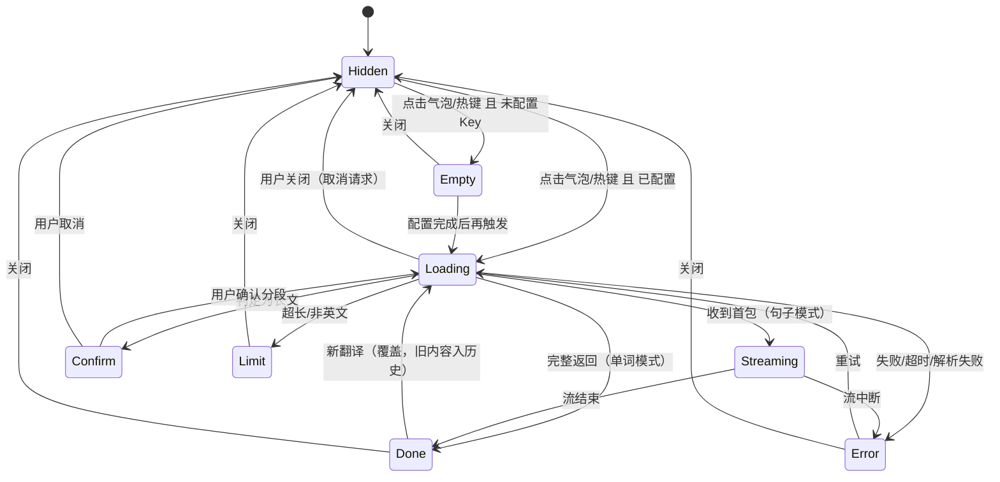

# 划词翻译 · 交互规格说明书 v1.0

> 配套文档：`划词翻译桌面应用-PRD-v1.0.md`（PRD v1.1）
> 本文档解决：PRD 说"做什么"，本文档说"每一毫秒发生什么、出问题时变成什么"。
>
> 所有时长、阈值均为**建议值**，集中登记在第 8 节参数表中，开发时全部走配置，不硬编码。

---

## 一、细化方法：四层拆解法

交互细化不是画界面，是**穷举**。四层逐级下钻，每一层都有可交付的产物：

| 层 | 要回答的问题 | 产物 | 本文档对应章节 |
|---|---|---|---|
| L1 场景 | 用户在什么情境下触发 | 场景清单 | 第 3 节 |
| L2 状态 | 这个场景有几种状态 | 状态机 | 第 4 节 |
| L3 时序 | 状态切换时每一毫秒发生什么 | 时序表（带预算） | 第 3 节各小节 |
| L4 边界 | 被打断 / 失败 / 重复时变成什么 | 边界三问表 | 第 6 节 |

### 三条铁律

| 铁律 | 含义 | 反例 |
|---|---|---|
| **先定全局，再定局部** | 焦点、层级、消失规则、动效时长必须先统一，否则每个页面都要重新吵一遍 | 气泡 120ms 淡入、侧边栏 200ms 滑入、按钮 300ms——三个时长各不相同且无理由 |
| **每条交互必须能回答三问** | 中断了怎么办、失败了怎么办、重复了怎么办。答不上来的交互不许进开发 | "点收藏就存进去"——连点两次会存两条吗？存的时候网络断了呢？ |
| **负面交互优先于正面交互** | 用户记住的往往不是成功路径，而是出错时你有没有说人话 | 只设计"翻译成功"的界面，失败时白屏 |

---

## 二、全局交互约定（先锁这些）

### 2.1 焦点规则

| 元素 | 出现时是否获焦 | 能否被点击获焦 | 说明 |
|---|---|---|---|
| 气泡 | **否**（`focusable: false`） | 否 | 纯点击目标，不接受任何键盘输入 |
| 侧边栏 | **否**（`showInactive()`） | 是 | 出现时你还能继续在原窗口打字；点进来才能用键盘操作 |
| 设置页 | 是 | — | 常规窗口 |

> 推论：侧边栏未获焦时，**ESC、方向键、Ctrl+C 全部无效**。所以关闭按钮必须是鼠标可点的实体按钮（PRD FR-30 已约束）。

### 2.2 窗口层级

| 元素 | `setAlwaysOnTop` 级别 | 全屏应用时 |
|---|---|---|
| 气泡 | `screen-saver` | 检测到全屏 → 不显示（PRD FR-09） |
| 侧边栏 | `floating` | 保持显示，用户主动触发的才显示 |
| 托盘提示 | 系统原生 | — |

### 2.3 消失与关闭规则（全局速查）

| 元素 | 出现条件 | 自动消失条件 | 手动关闭 | 关掉后能否恢复 |
|---|---|---|---|---|
| 气泡 | UIA 取词命中 | 点击气泡外 / 选区被清除 / 鼠标移出 800ms / 页面滚动 / 切换窗口 | — | 否，需重新选词 |
| 侧边栏 | 点击气泡 或 按 Alt+D | **不自动消失**（除非开启"失焦自动隐藏"选项） | 点 ✕ / 获焦时按 ESC | 是，从会话历史点回 |
| 托盘提示 | 热键未取到文本 | 3s | — | — |

**关键区分**：选区消失 → **气泡**消失，但**侧边栏不消失**。因为用户点完气泡后可能顺手点了页面空白处，此时不该把他正在看的译文关掉。

### 2.4 动效规范

| 动作 | 时长 | 曲线 | 属性 |
|---|---|---|---|
| 气泡淡入 | 120ms | ease-out | opacity 0→1，scale 0.92→1 |
| 气泡淡出 | 80ms | ease-in | opacity 1→0 |
| 气泡悬停 | 100ms | ease-out | scale 1→1.06 |
| 侧边栏滑入 | 200ms | cubic-bezier(.2,.8,.2,1) | translateX(24px→0)，opacity 0→1 |
| 侧边栏滑出 | 160ms | ease-in | translateX(0→24px) |
| 内容替换 | 120ms | ease-out | 交叉淡入，不做位移动画 |
| 按钮按压 | 60ms | linear | scale 0.96 |

**禁止**：骨架屏 shimmer 动画（常驻工具长期运行动画等于持续耗电）、超过 300ms 的任何动画、弹跳曲线（bounce）。

### 2.5 文案规范

| 规则 | 正确 | 错误 |
|---|---|---|
| 错误文案三段式：发生了什么 + 为什么 + 怎么办 | 「无法连接接口 · 检查网络或 Base URL · [诊断]」 | 「请求失败，请稍后重试」 |
| 动词开头，不用"请" | 「检查网络」 | 「请您检查一下网络」 |
| 给出具体数字，不给模糊形容词 | 「已选 6,240 字，将分 4 次请求」 | 「内容较长」 |
| 不确定的事要说明不确定 | 「本句含义 · 由 AI 结合上下文判断」 | 直接把 AI 推断当词典释义呈现 |

### 2.6 快捷键

| 键 | 作用 | 生效条件 |
|---|---|---|
| `Alt+D` | 翻译当前选中文本 | 全局（可自定义） |
| `Esc` | 关闭侧边栏 | **仅侧边栏已获焦时**；未获焦时无效（技术限制，见 PRD Q-3） |
| `Enter` | 展开/折叠原文 | 仅侧边栏已获焦时 |

> **不做**：为 ESC 单独装全局键盘钩子。理由：全局键盘钩子是杀软高危特征，为一个小功能付出信任成本不值得。

---

## 三、核心链路逐帧交互

### 3.1 气泡链路（这才是产品的手感所在）

#### 3.1.1 出现时序（预算表）

| 相对时间 | 环节 | 具体动作 | 预算 | 失败时 |
|---|---|---|---|---|
| T+0 | 鼠标抬起 | 宿主进程收到 `WM_LBUTTONUP` | — | — |
| T+5 | 白名单判定 | `GetForegroundWindow` → 取进程名 → 比对列表 | ≤5ms | 不匹配 → **静默终止** |
| T+10 | UIA 取词 | `FocusedElement` → `TextPattern.GetSelection()` | ≤30ms | 无 provider → 终止 |
| T+40 | 密码框检查 | `UIA_IsPasswordPropertyId` | ≤2ms | 为真 → 终止，**不写日志** |
| T+42 | 结果校验 | trim 后非空、含字母 | ≤1ms | 空 → 终止 |
| T+45 | 上报主进程 | named pipe 发送 {text, rect, pid} | ≤5ms | 超时 200ms → 丢弃 |
| T+55 | 定位与显示 | 复用**预创建的隐藏窗口** → `setPosition` → `showInactive` | ≤40ms | — |
| T+95 | 首帧 | 透明窗口开始绘制 | — | — |
| T+120 | 完成 | 动画结束，完全可见 | — | — |

**两条实现级约束（影响手感，写进开发要求）**：

1. **气泡窗口必须预创建并常驻隐藏**。每次 `new BrowserWindow` 需要 100ms 以上，会直接击穿 120ms 指标。
2. **位置必须基于选区 bounding rect，不是鼠标坐标**。用户拖选后鼠标往往在选区末尾甚至选区外。

#### 3.1.2 位置算法（按优先级尝试）

```
1. 选区右下： (rect.right + 8, rect.bottom + 8)     ← 默认
2. 选区左上： (rect.left - 8 - w, rect.top - 8 - h) ← 右下越界时
3. 选区右侧： (rect.right + 8, rect.verticalCenter) ← 上下都放不下、水平有空间时
4. 鼠标右下： (mouse + 8, mouse + 8)                ← 选区 rect 无效时兜底
5. 屏幕中央： 最后兜底，保证一定能看到
```

**为什么默认放右下**：Chrome 的选区浮动菜单（复制/搜索）出现在选区**上方**，默认放右下可以避开它。这是 PRD RK-03 风险的实现级解法。

#### 3.1.3 气泡自身状态

| 状态 | 进入条件 | 视觉 | 退出 |
|---|---|---|---|
| Hidden | 初始 / 已消失 | 不可见 | 取词命中 |
| Appearing | 取词命中 | 120ms 淡入 | 动画结束 → Idle |
| Idle | 动画结束 | 静态，`译` 字按钮 | 悬停 / 点击 / 超时 |
| Hovered | 鼠标进入 | scale 1.06 + tooltip「点击翻译 · Alt+D」 | 鼠标移出 |
| Pressing | 鼠标按下 | scale 0.96 | 松开 → 触发翻译 |
| Fading | 触发消失 | 80ms 淡出 | 结束 → Hidden |

**消失计时器规则**：
- 鼠标移出气泡后启动 800ms 计时
- 鼠标**重新进入**则清零（不是暂停）
- 鼠标移出后若用户在 800ms 内又选中了别的词 → 旧气泡立即消失，新气泡出现在新位置（**禁止**两个气泡同时存在）

#### 3.1.4 气泡形态约束

| 项 | 值 | 理由 |
|---|---|---|
| 尺寸 | 96 × 32 px | 足够点中，又不遮挡文字 |
| 内容 | 只有「译」字 | 多按钮会导致误点，且没人会在气泡上做二次决策 |
| 圆角 | 8px | 与侧边栏保持体系 |
| 阴影 | 0 2px 8px rgba(0,0,0,.12) | 保证任何背景上都能识别边界 |
| 不透明度 | 96% | 轻微透出背景，减少"贴纸感" |

### 3.2 气泡 → 侧边栏的过渡

**核心原则：不让用户等两个动画串行。**气泡淡出与侧边栏滑入并行。

| 相对时间 | 事件 |
|---|---|
| T+0 | 用户点击气泡 |
| T+0 | 气泡开始 80ms 淡出（并行） |
| T+8 | 主进程收到点击事件，启动请求，创建/显示侧边栏 |
| T+10 | 侧边栏 `showInactive()` + 骨架屏渲染 |
| T+200 | 侧边栏滑入完成 |
| T+≥160 | 内容开始渲染（**不早于滑入 80% 进度**，避免滑入途中闪烁） |

**如果请求在 200ms 内就返回了**：内容等到 T+160 再淡入，不抢跑。

### 3.3 单词结果呈现

#### 3.3.1 加载中

```
┌───────────────────────────┐
│ ▓▓▓▓▓▓                    │  ← 词头骨架（约 1 行高）
│ ▓▓▓▓▓▓▓▓▓▓                │  ← 音标骨架
│ ─────────────────────     │
│ ▓▓▓▓▓▓▓▓▓▓▓▓▓▓            │
│ ▓▓▓▓▓▓▓▓▓                  │
│ ▓▓▓▓▓▓▓▓▓▓▓▓▓              │
└───────────────────────────┘
```

静态灰条，无 shimmer。超时 3s 未收到任何字节 → 骨架上方出现一行小字「接口响应较慢，仍在请求中…」。

#### 3.3.2 到达

| 顺序 | 内容 | 呈现方式 |
|---|---|---|
| 1 | 词 + 音标 + 朗读按钮 | 整体 120ms 淡入（**不逐行错峰**，错峰动画在常驻工具里显廉价） |
| 2 | 语境义块 | 若存在：左侧 3px 强调线 + 浅底色；若不存在：灰字一行「未结合语境」 |
| 3 | 义项列表 | 最多显示 5 条，超出折叠为「展开剩余 N 条」 |
| 4 | 底部操作栏 | 始终可见，不随滚动 |

#### 3.3.3 视觉层级（决定用户先看到什么）

```
线程 1：词 + 音标          ← 24px / 16px
线程 2：语境义             ← 15px + 底色块，最醒目的内容区
线程 3：义项列表           ← 14px，正文色
线程 4：例句               ← 13px，60% 透明度
线程 5：操作栏             ← 图标 + 文字
```

**关键决策**：语境义在视觉权重上**高于**义项列表。因为用户查词的真正问题是"这句话里它是什么意思"，而不是"这个词有几个意思"。

#### 3.3.4 朗读按钮交互

| 状态 | 视觉 | 转换 |
|---|---|---|
| Idle | 喇叭图标 | 点击 → Playing |
| Playing | 图标替换为 3 帧波形动画（300ms 循环） | 播放结束 / 再点 → Idle |
| Unavailable | 图标置灰 + tooltip「系统未安装语音」 | 不可点 |

再点一次 = **停止**（toggle），不是重播。

### 3.4 句子流式渲染

#### 3.4.1 布局

```
┌─────────────────────────────────┐
│ 原文  ▸（默认折叠 3 行）          │
│ 译文                             │
│ 译文内容…▌                       │  ← 光标随流式移动
└─────────────────────────────────┘
```

#### 3.4.2 滚动跟随（最容易做错的交互）

| 用户行为 | 期望表现 |
|---|---|
| 没碰过滚动条 | 新内容到达时**自动跟随**到底部 |
| 用户手动向上滚动 | **立即停止跟随**，右下角出现「↓ 回到最新」浮动按钮 |
| 点击「回到最新」 | 滚到底部，恢复自动跟随 |
| 用户滚回底部 | 自动恢复跟随（无需点按钮） |

> 判据：内容追加后，检测 `scrollTop + clientHeight >= scrollHeight - 24px` 视为"在底部"，否则视为"用户主动离开"。

#### 3.4.3 流式结束

光标消失，底部操作栏（复制/朗读/收藏）从 0.6 透明度点亮为 1。**流式过程中操作栏半透明但可点**（用户可能只想复制前半段）。

### 3.5 分段翻译

#### 3.5.1 前置确认层（侧边栏内部弹出，不是系统对话框）

```
┌─────────────────────────────────┐
│  这段内容共 6,240 字              │
│  将分 4 次请求，预估消耗约         │
│  1,560 tokens（估算）             │
│                                 │
│  ☐ 本次会话不再提示              │
│                                 │
│        [取消]      [继续]        │
└─────────────────────────────────┘
```

- 遮罩：侧边栏内部半透明黑 30%，**不遮挡外部窗口**
- 「不再提示」仅在本次会话内有效（**禁止**跨会话记住，避免用户忘了自己在烧钱）
- 取消 = 无任何请求发出

#### 3.5.2 执行期

| 段状态 | 视觉 |
|---|---|
| 等待中 | 仅显示段头「第 N 段」+ 灰色占位 |
| 请求中 | 骨架条 + 段头右侧小转圈 |
| 已完成 | 正常内容 |
| 失败 | 段内 `⚠ 本次失败` + `重试` 按钮；段头标红 |
| 已取消 | 保留已完成段，未开始的段灰字「已取消」 |

**顺序约束**：并发 3，但渲染严格按 index 顺序。第 2 段先返回也要等第 1 段占位完成后才能上移——**禁止**用"先到先排"导致段落错序。

### 3.6 收藏

| 时机 | 表现 |
|---|---|
| 点击瞬间 | 按钮变实心星 + 60ms 缩放反馈，**不做 toast** |
| 成功 | 按钮保持实心 |
| 失败 | 按钮回弹空心 + 按钮旁红字「收藏失败，点击重试」 |
| 已存在 | 按钮旁弹出内联小条：「已收藏 · [更新] [取消]」，3s 自动消失 |

**不做 toast 的理由**：漂在其他窗口上的 toast 会打断阅读，而收藏成功本身是低信息量事件，按钮状态变化已足够。

### 3.7 空态与错误态

| 场景 | 界面 | 主操作 |
|---|---|---|
| 未配置 Key | 图标 + 「还没有配置翻译接口」+ 一句解释 | `[去配置]` `[看说明]` |
| Key 无效 | 「认证失败 · Key 可能已失效」+ 错误码 | `[改 Key]` `[诊断]` |
| 网络不可达 | 「无法连接接口 · 检查网络或 Base URL」 | `[诊断]` `[重试]` |
| 超时 | 「请求超时（30s）· 接口未响应」 | `[重试]` |
| 非英文 | 「当前仅支持英文翻译」+ 显示识别到的语言 | `[关闭]` |
| 超长 | 「已选 24,000 字，超过 20,000 上限」+ 当前值 | `[重新选择]` |

所有错误态**必须**同时提供「复制原文」入口——用户可能只是想快速把内容粘到别处。

---

## 四、状态机

### 4.1 侧边栏主状态机



**迁移禁令**：
- `Done → Streaming`：**禁止**（新请求必须先清空，防串台）
- `Streaming → Confirm`：**禁止**（确认只能在请求发出前）
- 任何状态 → `Hidden` 时，若存在进行中请求 → **必须** abort（省 token）

### 4.2 请求与侧边栏的生命周期绑定

这条是很多工具做错的地方：

| 事件 | 请求 | 侧边栏 | 会话历史 |
|---|---|---|---|
| 用户关闭侧边栏（请求进行中） | **中止** | 隐藏 | 不记录（无结果） |
| 用户关闭侧边栏（已完成） | — | 隐藏 | 保留 |
| 用户关闭后重新按 Alt+D | 新请求 | 显示新内容 | 追加 |
| 用户连续触发 3 次 | 只保留最后一次 | 显示最后一次 | 前两次若有结果则记录 |

> 结论：**请求属于侧边栏的一次"展示会话"**，关闭即取消。理由是用户的 Key 是他自己的钱，不该为已经关掉的界面继续付费。

---

## 五、关键页面的交互细化（设置 / 引导）

### 5.1 首启引导（3 步，可跳过）

| 步骤 | 内容 | 关键交互 |
|---|---|---|
| 1 | 一句话介绍 + 数据流向声明 | 底部「跳过」始终可见，不藏起来 |
| 2 | 填 Base URL / Key / 模型 → 测试连接 | 测试按钮点击后进入 3s 加载态；成功打勾并**自动**进入下一步；失败原地显示错误码，不跳转 |
| 3 | 自检：UIA 可用性 + 白名单 + 热键 | 三项各一个状态点（成功/失败/未知）；提供「在 Chrome 里试一次」跳转 |

**关键**：第 2 步「跳过」**不清空已填内容**；用户下次进设置能看到自己填了一半的东西。

### 5.2 设置页交互要点

| 控件 | 交互细节 |
|---|---|
| API Key 输入框 | 默认掩码显示；点击「眼睛」显示明文 3s 后自动回落掩码 |
| 测试连接 | 独立按钮，不复用保存动作；测试结果与保存状态无关，避免"测试失败但已保存"的困惑 |
| 热键录制 | 点击进入录制态，按下组合键即生效；若被占用，输入框变红并提示，**不自动换一个键** |
| 白名单进程 | 列表 + 「从运行中的进程添加」；添加后非浏览器进程带 ⚠「未验证」角标 |
| 术语表 | 表格内联编辑；每行保存即生效，无需整体保存 |
| 清空生词本 | 二次确认，且要求输入「delete」而非点"确定"（不可逆操作） |

---

## 六、边界三问（每条核心交互必须答）

| 交互 | 中断了怎么办 | 失败了怎么办 | 重复了怎么办 |
|---|---|---|---|
| **选中弹气泡** | 选区被程序清除 → 气泡立即淡出（无 800ms 延迟） | UIA 取不到 → 静默不弹 | 连续选中 → 旧气泡立即消失，只保留最新一个 |
| **点击气泡** | 气泡已超时消失 → 点击落在页面上，不响应 | 侧边栏创建失败 → 托盘提示「面板打开失败」 | 300ms 内连点 → 只处理第一次 |
| **Alt+D 热键** | 选中文本在按键前已变化 → 以按键时刻的选中为准 | 未取到文本 → 托盘提示，**不发送请求** | 长按连续触发 → 300ms 内去重 |
| **触发翻译** | 请求中用户又选了别的词 → 前一个请求 abort | 见 3.7 错误态 | 同一文本在 5s 内重复触发 → 直接复用上次结果，不发请求（省 token） |
| **流式输出中关闭** | 关闭即 abort | — | — |
| **长文分段** | 中途关闭 → 已完成段入会话历史 | 单段失败 → 仅该段可重试 | 再次触发同类长文 → 重新确认消耗 |
| **收藏** | 收藏中关闭侧边栏 → 后台完成并落库 | DB 失败 → 内联红字 + 可重试 | 重复收藏 → 「已收藏 · 更新/取消」 |
| **朗读** | 播放中触发新翻译 → 停止前一条 | 无语音包 → 置灰 | 连点 → toggle（停止/播放） |
| **复制译文** | — | 剪贴板被占用 → 提示「复制失败，请重试」 | 连点 → 每次都给「已复制」反馈，不叠加 |
| **关闭侧边栏** | — | — | 已关闭时再触发关闭 → 无操作 |

---

## 七、交互验收清单（可直接转测试用例）

| 编号 | 场景 | 期望 |
|---|---|---|
| IA-01 | 在 Chrome 中连续快速选中 5 个不同词 | 侧边栏最终显示第 5 个词；会话历史含 5 条；任一时刻气泡最多 1 个 |
| IA-02 | 选中后 1 秒内点击页面空白处 | 气泡消失；侧边栏（若已打开）**不关闭** |
| IA-03 | 选中文本后向下滚动页面 | 气泡消失，不出现位置错乱的气泡 |
| IA-04 | 请求进行中关闭侧边栏，再按 Alt+D 翻译同一文本 | 第一次请求已被中止（抓包验证无多余请求）；第二次正常发出 |
| IA-05 | 侧边栏显示中选中新词并点气泡 | 内容整体替换，旧内容可在「最近」找到，无两条内容串叠 |
| IA-06 | 流式输出时手动向上滚动 | 停止跟随并出现「回到最新」；点击后回到底部并恢复跟随 |
| IA-07 | 连续点击收藏按钮 3 次 | 生词本只新增 1 条，第二次起显示「已收藏」 |
| IA-08 | 长文分段中第 2 段失败 | 第 1、3、4 段正常显示，第 2 段显示重试；点击重试只重发第 2 段 |
| IA-09 | 侧边栏未获焦时按 ESC | 无反应（符合技术约束）；点击 ✕ 可正常关闭 |
| IA-10 | 在 125% 缩放的副屏选中文本 | 气泡位置与选区偏移 ≤4px |
| IA-11 | 气泡出现后鼠标停在其上 3 秒 | 气泡保持不消失；移出后 800ms 消失 |
| IA-12 | 键盘 Tab 遍历侧边栏 | 能依次聚焦到关闭、朗读、收藏、复制，每项有可读标签 |

---

## 八、参数表（全部走配置）

| 参数 | 建议值 | 含义 |
|---|---|---|
| `bubble.fadeIn` | 120ms | 气泡淡入 |
| `bubble.fadeOut` | 80ms | 气泡淡出 |
| `bubble.lingerAfterLeave` | 800ms | 鼠标移出后的存活时间 |
| `bubble.width` / `height` | 96 / 32 px | 气泡尺寸 |
| `bubble.offset` | 8px | 相对选区的偏移 |
| `panel.slideIn` | 200ms | 侧边栏滑入 |
| `panel.widthMin` | 320px | 宽度下限 |
| `panel.widthMax` | 屏宽 40% | 宽度上限 |
| `panel.widthJitter` | 60px | 同类内容允许的宽度变化 |
| `panel.heightRatio` | 60% | 默认高度占可用高度比例 |
| `fetch.timeout` | 30s | 单请求超时 |
| `fetch.slowWarn` | 3s | 无首包时提示"较慢" |
| `fetch.dedupeWindow` | 5s | 同文本去重窗口 |
| `trigger.debounce` | 300ms | 重复触发去重 |
| `segment.concurrency` | 3 | 分段并发 |
| `segment.maxChars` | 20000 | 总字符上限 |
| `segment.maxCount` | 15 | 段数上限 |
| `segment.chunkChars` | 1500 | 单段目标长度 |
| `context.readLimit` | 2000 | 段落读取上限 |
| `context.maxChars` | 300 | 语境界送模型上限 |
| `history.size` | 20 | 会话历史条数 |
| `snippet.maxChars` | 300 | 收藏时保留的语境片段上限 |

---

## 九、反模式清单（明确不做什么）

| 不做 | 理由 |
|---|---|
| 悬停自动翻译 | 鼠标路过就发请求，烧钱且不可控；必须显式点击或按键 |
| 气泡上放多个按钮 | 目标太小易误点，且没人会在 96×32 里做二次决策 |
| 骨架屏 shimmer | 常驻工具持续动画 = 持续耗电与 GPU |
| 成功 toast 提示 | 遮挡阅读；按钮状态变化已足够表达 |
| 模态遮罩盖住原窗口 | 打断阅读；分段确认只在侧边栏内部做 |
| 自动播放朗读 | 突然出声是灾难性体验 |
| 「智能」猜用户想翻译什么 | 所有翻译都必须由用户显式发起 |
| 关闭确认弹窗（"确认关闭？"） | 侧边栏关掉毫无损失，加确认是骚扰 |
| 记住「不再提示」跨会话 | 用户会忘记自己在花钱 |

---

## 十、还没定的交互（诚实标注）

| 编号 | 待定项 | 我的建议 | 需要谁定 |
|---|---|---|---|
| UX-1 | 双屏时侧边栏跟随哪块屏 | 跟随**选区所在屏**（用户注意力在那），不跟随主屏 | 你 |
| UX-2 | 全屏视频/演示时侧边栏是否也隐藏 | 气泡隐藏（已有），侧边栏保持——因为是用户主动触发的 | 你 |
| UX-3 | 单词与句子的判定边界：`e.g.`、`U.S.`、`don't`、`state-of-the-art` | 按 PRD FR-11 正则，但需补 4 个特例白名单 | 你 + 实测 |
| UX-4 | 侧边栏「最近」入口的交互形式（底部抽屉 / 独立小窗 / 下拉浮层） | 底部抽屉，高度 40%，不切换主内容 | 你 |
| UX-5 | 收藏时是否自动带上来源网页标题与 URL | 建议带标题不带完整 URL（隐私） | 你 |
| UX-6 | 侧边栏获焦后，用户切回浏览器，侧边栏是否失焦变暗 | 建议不变暗（视觉噪音） | 你 |

---

## 十一、这份文档怎么用

| 角色 | 用法 |
|---|---|
| 开发 | 第 3、4、8 节直接转实现；第 8 节参数全部进配置文件 |
| 测试 | 第 6、7 节转测试用例；第 6 节每条都要有对应用例 |
| 设计 | 第 2、3 节的时序与视觉权重转视觉稿 |
| 你自己 | 第 9、10 节是"做什么"的边界；第 10 节需要你拍板后才能进开发 |

> 本方案为产品设计参考，具体实施请结合公司合规与法务要求确认。
