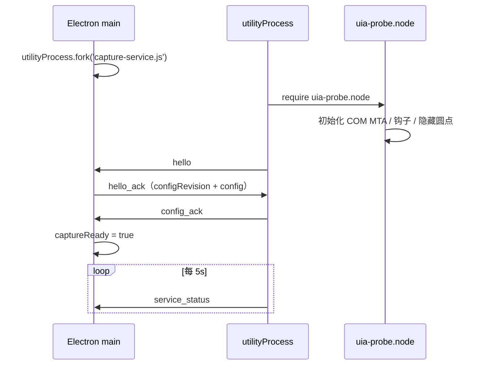

# Snapword IPC 契约 v1.1（B-02，utilityProcess + MessagePort）

> 文档状态：**已定稿，可直接据此实现主进程与取词服务**
> 变更：v1.1 按 2026-11-03 决策，从「命名管道 + 长度前缀 JSON」改为 **Electron `utilityProcess` + MessagePort**。
> 适用范围：Electron 主进程 ↔ 取词 utilityProcess；不覆盖渲染进程 ↔ 主进程的 Electron IPC
> 上游依据：`docs/architecture.md`（B-01）、`docs/PRD.md` 5.2 / FR-01~FR-10、`docs/PRD-v2.md` RD/RC 章节
> 本契约解决：传输、消息目录、字段类型/单位/坐标系、握手、错误码、超时/重试、顺序与背压、安全校验。

---

## 1. 传输与消息格式

| 项 | 约定 |
|---|---|
| 传输 | Electron `utilityProcess` 的父子消息通道 |
| 创建 | 主进程 `utilityProcess.fork('capture-service.js', [], { serviceName: 'snapword-capture' })` |
| 发送 | 主进程 `child.postMessage(message)`；取词服务 `process.parentPort.postMessage(message)` |
| 接收 | 主进程 `child.on('message', ...)`；取词服务 `process.parentPort.on('message', ...)` |
| 序列化 | Electron structured clone；直接传 JS 对象，**不传 JSON 字符串** |
| 最大消息 | 1 MiB（序列化后）；超限主进程拒绝并记 `PayloadTooLarge` |
| 协议版本 | `protocolVersion: 1`；每条消息必带 |
| 心跳 | 取词服务每 5s 发 `service_status`；主进程 12s 未收到视为服务死亡 |
| 连接超时 | `fork` 后 5s 内必须 `hello`；否则 `kill()` 并重启 |
| 请求超时 | 主进程→取词服务的请求默认 1s；`capture_current` 用 500ms；`diagnose` 2s |
| 关闭 | 主进程发 `shutdown`，取词服务回 `shutdown_ack` 后退出；1s 未回则 `kill()` |

**为什么用 utilityProcess 消息通道**：

- 不需要自建命名管道、长度前缀、ACL；Electron 已处理父子进程生命周期与消息序列化。
- `utilityProcess` 是独立 OS 进程，原生崩溃不会带走主进程；主进程可通过 `exit` 事件重启。
- structured clone 直接传对象，避免 JSON 字符串的二次编解码；1 MiB 上限足够（最大文本 20k 字符 ≈ 80KB）。

**为什么不用 stdio**：stdout/stderr 要混日志；单流、重连、背压都不如 MessagePort 清晰。**为什么不用 Electron `ipcMain`/`ipcRenderer`**：那是主进程↔渲染进程的通道；取词服务是 utilityProcess，用 `parentPort` 与主进程通信。

---

## 2. 通用约定

### 2.1 消息信封

所有消息至少包含：

```js
{
  type: 'dot_clicked',
  protocolVersion: 1,
  sentAt: '2026-11-03T12:00:00.000Z'
}
```

- `type`：消息名，见第 4 节。
- `protocolVersion`：整数；不匹配时主进程 `kill()` 取词服务并提示诊断。
- `sentAt`：ISO 8601 UTC，毫秒精度。

请求/响应额外字段：

- `requestId`：UUID v4；取词服务必须原样回传。
- 事件额外字段：`seq`：`uint64`，取词服务内单调递增；主进程按 `seq` 去重。

### 2.2 坐标系（强制）

**所有 rect / point 使用屏幕 DIP（device-independent pixel）**：

- 原点：虚拟屏幕左上角；x 向右，y 向下。
- 1 DIP = 1/96 英寸；Electron `BrowserWindow.setBounds` / `screen` API 使用同一空间。
- Native Addon 负责把 UIA 原始 rect 归一化为 DIP；事件中带 `coordinateSpace: "dip"` 与 `dpiScale` 供诊断。
- 多显示器第二屏暂不支持；只保证主显示器坐标正确。
- `rects` 按从上到下、从左到右排序；每行一个矩形；过滤宽度 ≤1 DIP 的退化矩形。
- `anchor`：最后一个 rect 的左下角向下 8 DIP；`pointer`：鼠标释放点（DIP）。

> 2026-11-03 D-1 实测：UIA rect 在 175% DPI 下多数为 screen CSS 像素，少数为物理像素。Addon 必须检测/归一化，**禁止**把原始值直接当 DIP 或物理像素透传。

### 2.3 文本与长度上限

| 字段 | 上限 | 处理 |
|---|---:|---|
| `text` | 20,000 字符 | 超出截断，`textTruncated=true` |
| `paragraph` | 2,000 字符 | 超出截断，`paragraphTruncated=true` |
| `windowTitle` | 200 字符 | 超出截断 |
| `processName` | 64 字符 | 超出截断 |
| `message`（错误） | 500 字符 | 不得包含选中原文 |

- `text` 必须 `trim()` 后非空；内部换行保留。
- 禁止在 `message` / 日志中携带 `text` / `paragraph`。

### 2.4 配置快照

```js
{
  whitelist: ['chrome.exe', 'msedge.exe'],
  dotEnabled: true,
  fullscreenSuppress: true,
  captureTimeoutMs: 500,
  dedupeWindowMs: 300,
  minEnglishRatio: 0.3,
  maxTextChars: 20000,
  paragraphReadLimit: 2000,
  contextMaxChars: 300
}
```

- `revision`：主进程单调递增整数；取词服务只接受 `revision` 大于当前值的快照。
- 配置变更原子应用；无效配置返回 `config_error`，取词服务保持旧配置。

---

## 3. 握手



### 3.1 `hello`（取词服务 → 主进程）

```js
{
  type: 'hello',
  protocolVersion: 1,
  sentAt: '2026-11-03T12:00:00.000Z',
  serviceVersion: '1.0.0',
  addonVersion: '1.0.0',
  pid: 12345,
  startedAt: '2026-11-03T11:59:59.000Z',
  capabilities: {
    uia: true,
    dot: true,
    rangeFromPoint: true,
    fullscreenDetection: true
  }
}
```

### 3.2 `hello_ack`（主进程 → 取词服务）

```js
{
  type: 'hello_ack',
  protocolVersion: 1,
  sentAt: '2026-11-03T12:00:00.100Z',
  appVersion: '1.0.0',
  configRevision: 7,
  config: { /* 见 2.4 */ }
}
```

### 3.3 `config_ack` / `config_error`（取词服务 → 主进程）

```js
{
  type: 'config_ack',
  protocolVersion: 1,
  sentAt: '2026-11-03T12:00:00.120Z',
  requestId: '6f1c...',
  revision: 7,
  appliedAt: '2026-11-03T12:00:00.119Z'
}
```

```js
{
  type: 'config_error',
  protocolVersion: 1,
  sentAt: '2026-11-03T12:00:00.120Z',
  requestId: '6f1c...',
  revision: 8,
  code: 'InvalidConfig',
  message: 'whitelist must be an array of process names'
}
```

---

## 4. 消息目录

| 消息 | 方向 | 类型 | 触发 | 失败处理 |
|---|---|---|---|---|
| `hello` | 服务→主 | 事件 | 服务加载 addon 后 | 5s 未收到 → kill 重启 |
| `hello_ack` | 主→服务 | 响应 | 收到 hello | 服务 5s 未收到 → 退出 |
| `config_update` | 主→服务 | 请求 | 设置变更 | 超时 1s → 保留旧配置并提示 |
| `config_ack` | 服务→主 | 响应 | 配置应用成功 | — |
| `config_error` | 服务→主 | 响应 | 配置无效 | 设置页内联错误；旧配置继续 |
| `capture_current` | 主→服务 | 请求 | Alt+D / 诊断 | 500ms 超时 → 卡片错误 |
| `capture_result` | 服务→主 | 响应 | 取词成功 | 主进程校验后打开卡片 |
| `capture_error` | 服务→主 | 响应/事件 | 取词失败 | 卡片错误态 / 托盘提示 |
| `dot_clicked` | 服务→主 | 事件 | 点击圆点 | 主进程校验后打开卡片 |
| `dot_hidden` | 服务→主 | 事件 | 圆点消失 | 仅诊断/状态同步 |
| `foreground_changed` | 服务→主 | 事件 | 前台窗口变化 | 主进程关闭普通卡片 |
| `service_status` | 服务→主 | 事件 | 每 5s / 状态变化 | 12s 缺失 → 判定服务死亡 |
| `diagnose` | 主→服务 | 请求 | 诊断页 | 2s 超时 → 显示未知 |
| `diagnose_result` | 服务→主 | 响应 | 诊断完成 | — |
| `hide_dot` | 主→服务 | 命令 | 卡片打开 / 应用切换 | 失败忽略（服务会自行隐藏） |
| `shutdown` | 主→服务 | 命令 | 退出应用 | 1s 未回 → `kill()` |
| `shutdown_ack` | 服务→主 | 响应 | 收到 shutdown | — |
| `error` | 双向 | 事件 | 协议/内部错误 | 记录并断开/降级 |

---

## 5. 消息定义

### 5.1 `capture_current`（主 → 服务）

```js
{
  type: 'capture_current',
  protocolVersion: 1,
  sentAt: '2026-11-03T12:00:01.000Z',
  requestId: '2b7e...',
  reason: 'hotkey',
  timeoutMs: 500
}
```

- `reason`：`"hotkey" | "diagnose"`。
- 服务读取**当前前台窗口**的实时选区；不依赖圆点候选。
- 若服务正忙，返回 `capture_error` / `Busy`；不排队。

### 5.2 `capture_result`（服务 → 主）

```js
{
  type: 'capture_result',
  protocolVersion: 1,
  sentAt: '2026-11-03T12:00:01.018Z',
  requestId: '2b7e...',
  payload: {
    source: 'hotkey',
    seq: 42,
    text: 'thread',
    textTruncated: false,
    rects: [
      { x: 512.0, y: 320.0, width: 48.0, height: 22.0 }
    ],
    anchor: { x: 512.0, y: 350.0 },
    pointer: { x: 530.0, y: 330.0 },
    processName: 'chrome.exe',
    processId: 12345,
    windowTitle: 'Example — Google Chrome',
    paragraph: 'A long thread about distributed systems.',
    paragraphError: null,
    paragraphTruncated: false,
    capturedAt: '2026-11-03T12:00:01.015Z',
    elapsedMs: 18.3,
    dpiScale: 1.75,
    coordinateSpace: 'dip',
    selectionRanges: 1,
    warnings: []
  }
}
```

### 5.3 `dot_clicked`（服务 → 主）

```js
{
  type: 'dot_clicked',
  protocolVersion: 1,
  sentAt: '2026-11-03T12:00:02.000Z',
  seq: 43,
  payload: {
    source: 'dot',
    seq: 43,
    text: 'thread',
    textTruncated: false,
    rects: [
      { x: 512.0, y: 320.0, width: 48.0, height: 22.0 }
    ],
    anchor: { x: 512.0, y: 350.0 },
    pointer: { x: 530.0, y: 330.0 },
    processName: 'chrome.exe',
    processId: 12345,
    windowTitle: 'Example — Google Chrome',
    paragraph: 'A long thread about distributed systems.',
    paragraphError: null,
    paragraphTruncated: false,
    capturedAt: '2026-11-03T12:00:01.990Z',
    elapsedMs: 21.7,
    dpiScale: 1.75,
    coordinateSpace: 'dip',
    selectionRanges: 1,
    warnings: []
  }
}
```

**点击时选区已失效**：服务返回 `capture_error`（`EmptySelection` / `SelectionChanged`），主进程显示「未获取到选中文本」，不发请求。

> 顶层 `seq` 与 `payload.seq` 必须一致；主进程以顶层 `seq` 去重，并在处理前校验两者相等。

### 5.4 `capture_error`（服务 → 主）

```js
{
  type: 'capture_error',
  protocolVersion: 1,
  sentAt: '2026-11-03T12:00:03.000Z',
  requestId: '2b7e...',
  seq: 44,
  code: 'EmptySelection',
  message: 'GetSelection returned 0 ranges',
  processName: 'chrome.exe',
  processId: 12345,
  windowTitle: 'Example — Google Chrome',
  elapsedMs: 2.8,
  retryable: false
}
```

- `requestId` 可为 `null`（事件型错误，如圆点候选失败）。
- `message` 不得包含原文。

### 5.5 `dot_hidden`（服务 → 主）

```js
{
  type: 'dot_hidden',
  protocolVersion: 1,
  sentAt: '2026-11-03T12:00:04.000Z',
  seq: 44,
  reason: 'outside_click'
}
```

`reason` 枚举：

`outside_click` / `selection_cleared` / `scroll` / `app_switch` / `new_selection` / `card_opened` / `disabled` / `fullscreen` / `shutdown`。

### 5.6 `foreground_changed`（服务 → 主）

```js
{
  type: 'foreground_changed',
  protocolVersion: 1,
  sentAt: '2026-11-03T12:00:05.000Z',
  processName: 'msedge.exe',
  processId: 54321,
  windowTitle: 'Docs — Microsoft Edge',
  isFullscreen: false,
  at: '2026-11-03T12:00:05.000Z'
}
```

- 主进程用它执行「切换到其他应用 → 关闭卡片（保持打开也关闭）」。
- `isFullscreen` 仅诊断；全屏卡片置顶暂不支持。

### 5.7 `service_status`（服务 → 主，心跳）

```js
{
  type: 'service_status',
  protocolVersion: 1,
  sentAt: '2026-11-03T12:00:05.000Z',
  state: 'ready',
  uiaAvailable: true,
  hookInstalled: true,
  dotVisible: false,
  serviceVersion: '1.0.0',
  addonVersion: '1.0.0',
  uptimeMs: 12345,
  lastErrorCode: null
}
```

`state`：`starting` / `ready` / `degraded` / `stopping`。

### 5.8 `diagnose` / `diagnose_result`

```js
{
  type: 'diagnose',
  protocolVersion: 1,
  sentAt: '2026-11-03T12:00:06.000Z',
  requestId: '9a3c...',
  timeoutMs: 2000
}
```

```js
{
  type: 'diagnose_result',
  protocolVersion: 1,
  sentAt: '2026-11-03T12:00:06.050Z',
  requestId: '9a3c...',
  uiaAvailable: true,
  hookInstalled: true,
  dotVisible: false,
  foreground: {
    processName: 'chrome.exe',
    processId: 12345,
    windowTitle: 'Example — Google Chrome',
    isFullscreen: false
  },
  serviceVersion: '1.0.0',
  addonVersion: '1.0.0',
  osVersion: 'Windows 11 26100',
  dpiScale: 1.75,
  warnings: []
}
```

### 5.9 `hide_dot` / `shutdown`

```js
{ type: 'hide_dot', protocolVersion: 1, sentAt: '...', reason: 'card_opened' }
```

```js
{ type: 'shutdown', protocolVersion: 1, sentAt: '...', requestId: 'c1d2...', reason: 'app_quit' }
```

```js
{ type: 'shutdown_ack', protocolVersion: 1, sentAt: '...', requestId: 'c1d2...' }
```

---

## 6. 错误码

| code | 来源 | 含义 | 用户可见行为 | 可重试 |
|---|---|---|---|---|
| `NoForegroundWindow` | Addon | `GetForegroundWindow` 返回 NULL | 热键：托盘提示；圆点：静默 | 是（手动） |
| `NotWhitelisted` | Addon | 前台进程不在白名单 | 圆点/热键均静默（诊断可见） | 否 |
| `PasswordField` | Addon | 焦点/选区在密码框 | 完全静默，不记录文本 | 否 |
| `EmptySelection` | Addon | 无选区 / 选区被清除 | 热键：卡片「未获取到选中文本」；圆点：静默 | 是（手动） |
| `TextPatternNotSupported` | Addon | 目标无 TextPattern | 热键：托盘提示「当前应用不支持取词」 | 否 |
| `Timeout` | Addon | UIA 500ms 未返回 | 卡片「取词超时」+ 重试 | 是（手动） |
| `Busy` | Addon | 上一次探测未结束 | 热键：托盘提示「正在取词，请稍后」 | 是（手动） |
| `ComError` | Addon | COM/UIA 调用异常 | 卡片错误 + 诊断 | 是（手动） |
| `SelectionChanged` | Addon | 点击圆点时选区已变化 | 卡片「选区已变化」+ 关闭/重试 | 是（手动） |
| `NoBoundingRects` | Addon | 文本成功但 rects 为空 | 卡片用 `pointer` 定位；圆点不显示 | 否（降级） |
| `AddonLoadFailed` | 服务 | `.node` 路径/ABI/依赖加载失败 | 托盘提示 + 诊断；不无限重试 | 否（需修复安装） |
| `PayloadTooLarge` | 双方 | 消息超过 1 MiB | 拒绝；主进程提示 | 否 |
| `InvalidConfig` | 服务 | 配置字段无效 | 设置页内联错误；旧配置继续 | 是（改配置） |
| `ProtocolError` | 双方 | 未知 type/版本/结构非法 | 终止服务；诊断提示 | 否（重启） |
| `ServiceNotReady` | 主进程 | 服务未握手/已停止 | 卡片错误；主窗口翻译页仍可用 | 是（重启服务） |
| `ServiceExited` | 主进程 | utilityProcess 退出 | 触发重启 | 自动 |
| `Internal` | 双方 | 未分类内部错误 | 卡片错误 + 诊断 | 是（手动） |

**静默规则**：`NotWhitelisted` / `PasswordField` / 非白名单取词不得产生任何可见 UI 或日志正文。

---

## 7. 顺序、去重与背压

1. 服务 `seq` 单调递增；主进程忽略 `seq <= lastSeq` 的重复事件。
2. 同一时刻 Addon 只保留一个圆点候选；新选区覆盖旧候选，旧 `seq` 作废。
3. `dot_clicked` 必须对应最近的候选；主进程校验 `payload.seq === lastDotSeq`，否则忽略。
4. 服务 `capture_current` 在飞时，新的 `capture_current` 返回 `Busy`；主进程不排队。
5. 主进程收到 `dot_clicked` 后立即发 `hide_dot`，不等卡片创建完成。
6. 主进程处理 `foreground_changed` 时，先关闭普通卡片，再更新状态；保持打开卡片也关闭（应用切换）。
7. 事件处理不得阻塞 utilityProcess 的 Node 事件循环；Addon 的耗时工作在自己的线程。

---

## 8. 超时与重试矩阵

| 操作 | 超时 | 自动重试 | 失败表现 |
|---|---:|---|---|
| 握手 `hello` | 5s | 重启服务，最多 3 次 | 托盘「取词服务未启动」 |
| `config_update` | 1s | 1 次 | 设置页内联错误；旧配置继续 |
| `capture_current` | 500ms | 0（用户手动） | 卡片错误/托盘提示 |
| `diagnose` | 2s | 0 | 诊断页显示「未知」 |
| `shutdown` | 1s | 0 | `kill()` |
| 心跳 | 5s 间隔 / 12s 缺失 | 重启服务 | 托盘提示（第 3 次） |
| 翻译请求 | 30s | 0（用户手动） | 卡片错误 + 重试 |

---

## 9. 安全与校验

- 取词服务是主进程的子进程；不接收 Key/Base URL；不引入网络模块。
- 双方解析消息后必须校验：
  - `type` 在白名单；
  - `protocolVersion === 1`；
  - 必填字段类型/长度；
  - `rects` 数量 ≤ 4,096；
  - `text` ≤ 20,000 字符；
  - 拒绝未知顶层字段（可选，记录 warning）。
- 主进程对 `processName` 再做一次白名单校验（防御 Addon 被替换）。
- 服务错误消息不得包含 `text` / `paragraph`；主进程日志同样脱敏。
- `windowTitle` 只用于内存中的诊断/界面提示，**禁止**写入持久日志。
- 主进程 `kill()` 服务后必须等待 `exit`，再 fork 新实例；禁止同时存在两个取词服务。

---

## 10. 验收

- [ ] 主进程 `utilityProcess.fork` 后 5s 内完成 hello/hello_ack/config_ack。
- [ ] `dot_clicked` 能在 200ms 内驱动卡片骨架出现（首次创建除外）。
- [ ] `capture_current` 在 500ms 内返回或超时。
- [ ] 服务忙时第二次热键返回 `Busy`，不排队。
- [ ] `kill()` 取词服务后 3s 内重启并恢复 `captureReady`。
- [ ] 配置 revision 乱序时服务拒绝旧快照。
- [ ] 超过 1 MiB 的消息被拒绝，服务被重启。
- [ ] 密码框/非白名单路径无可见 UI、无日志正文。
- [ ] `rects` 全部为 DIP；`coordinateSpace` 字段存在。
- [ ] 取词服务代码无网络请求；消息/日志中无 API Key、原文、译文。
- [ ] Addon 加载失败返回 `AddonLoadFailed`，不无限重启。
