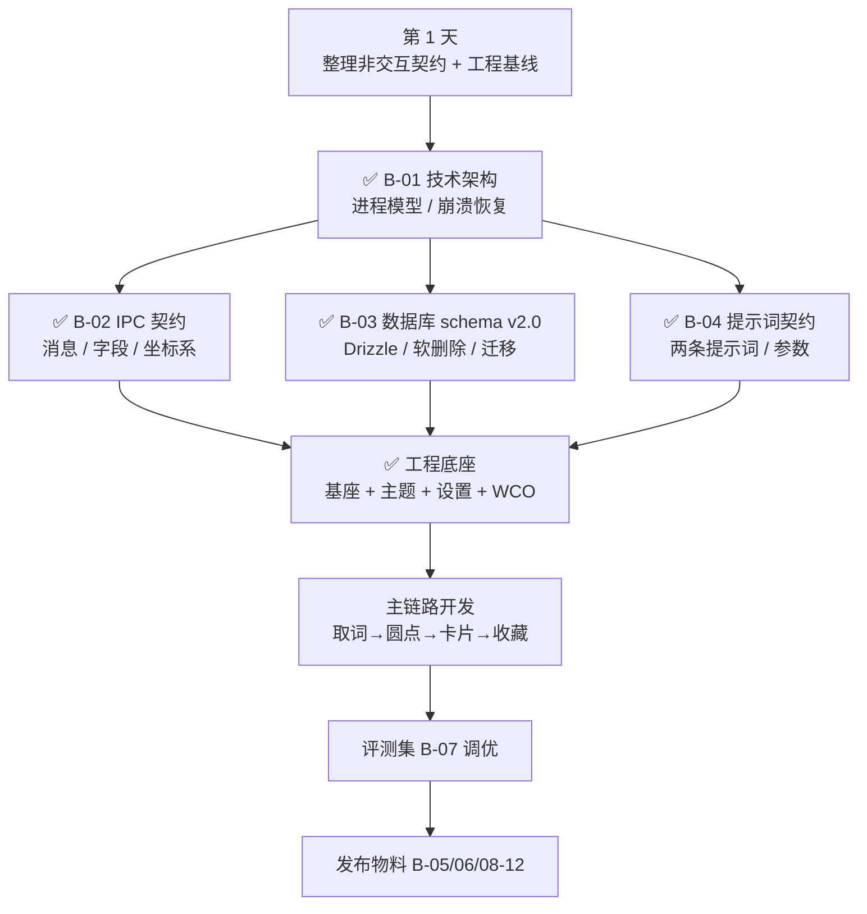

# Snapword · 开发进度与待办总清单 v1.0

> **2026-11-04 更新**：当前需求基线为 [PRD.md](specs/PRD.md)（v3.0，原 PRD-v2 已收敛）与 [interaction-spec-v2.md](specs/interaction-spec-v2.md)，本清单按已确认决策同步；MVP 验收清单为连续唯一的 IA-01～IA-44（PRD 第十五章），云盘同步（v1.1）另用 SY-01～SY-06。暂不支持项见 PRD 第 17.2 节。
>
> 对照基线：`docs/specs/PRD.md`（v3.0）、`docs/research/uia-validation-2026-11.md`
> **2026-11-13 更新**：工程底座已同步 **temp5@9077d18**（#93 IPC 归一化 / #94/#96 pr-review 引擎 / #95 OCR 触发限制 / #97 Fuses + ASAR 完整性 / #98 冷启动耗时分解与卸载清理 / #103 规则文档按需路由）并按干净基座重建：temp5 基座 + Snapword 身份 + paseo 双主题（token / behavior 注入，data-theme + cssVar 机制）+ 设置页主题与语言切换 + WCO 与窗口底色对齐。取词链路 / DB / 六个业务域**尚未迁移**，将在 P5 按契约从零实现（main 历史中的旧 P4 移植代码仅作参考，不作起点）。
> **2026-11-11 更新**：清理 v1.0 交互规格与开发前审计（均已被 v2 交互规格与四份契约取代）；本轮交互整改已落回 PRD、interaction-spec-v2、ipc-contract、architecture、data-model；原 PRD-v2 摘要并入 PRD v3.0，完整条目迁至 spec 第十三章。
> 生成日期：2026-10-19
> 用途：单页跟踪。所有「还差什么」都已编号，可直接当 issue 拆解依据。

---

## 0. 一句话现状

**契约与工程底座已就绪，主链路实现从零开始。**

三窗口交互（v2.0）与 4 份阻塞契约（架构 / IPC / DB / 提示词）均已完成；UIA 技术验证 D-1 30/30、Q-6 93.3%、同源 iframe 10/10；暂不支持项见 PRD 第 17.2 节。工程侧已按干净 temp5 基座重建（2026-11-10）：基座 / 身份 / paseo 双主题 / 设置页 / WCO 配色就绪；**取词链路、DB、六个业务域尚未迁移**。当前卡点为 **P5 主链路实现**：取词 addon → capture 服务 → DB 接线 → 翻译链路 → 三窗口 → 收藏。

---

## 1. 阶段定位

| 阶段             | 状态            | 完成度     | 证据                                                                                        | 进入下一阶段的条件                            |
| ---------------- | --------------- | ---------- | ------------------------------------------------------------------------------------------- | --------------------------------------------- |
| P0 需求定义      | ✅ 完成         | 100%       | PRD 44 条现行 FR（另 9 条已废止），全部带 GWT 验收                                          | —                                             |
| P1 主链路交互    | ✅ 决策已确认   | 100%       | PRD + interaction-spec-v2：三窗口、逐帧时序、44 条 IA 验收用例（+ v1.1 同步 6 条）          | 全屏置顶暂不支持；视觉稿待完成                |
| P1b 次级页面交互 | ✅ 并入 v2      | 100%       | 生词本 / 翻译历史 / 诊断 / 术语表已写入 spec 13.4 主窗口章节                                | —                                             |
| P2 契约层        | ✅ 完成         | 100%       | B-01 架构 / B-02 IPC / B-03 DB schema / B-04 提示词，均可直接实现                           | —                                             |
| P3 技术验证      | ✅ 支持范围完成 | 100%       | D-1 通过：Chrome/Edge 156 均 30/30，P95 16.2/24.2ms；Q-6 93.3%；同源 iframe 10/10；Q-1 完成 | Q-2/Q-7/第二屏/跨域 iframe 暂不支持，不再验证 |
| P4 工程底座      | ✅ 完成         | 100%       | 干净 temp5 基座 + paseo 双主题 + 设置页主题/语言切换 + WCO/窗口底色对齐；e2e 基建 6 spec    | 主链路功能实现                                |
| P5 主链路开发    | 🔄 进行中       | 0%（功能） | 工程底座就绪；取词/DB/六域在 main 有旧实现，本分支按契约从零实现                            | 选中 → 圆点 → 卡片 → 收藏 全通                |
| P6 发布          | ⬜ 未开始       | 0%         | —                                                                                           | Releases 有安装包 + 便携版                    |

**两个口径的进度**：
- **开发前准备**：100%（文档、D-1、4 份契约、工程底座全部就绪）
- **全项目**：约 20%（按单人工作量粗估，主链路功能为零）

> 判断依据是「换一个人接手，能不能直接开工」，不是行数。按这个标准，P0~P4 已完成，P5 是当前空白。

---

## 2. 已完成清单（16 项）

| 编号    | 产物                           | 文件                                                                                | 状态                                                                 |
| ------- | ------------------------------ | ----------------------------------------------------------------------------------- | -------------------------------------------------------------------- |
| ✅ D-01 | 需求澄清（7 轮）               | —                                                                                   | 53 条 FR（其中 FR-24~32 已随旧交互废止）                             |
| ✅ D-02 | PRD v1.1.1                     | `docs/specs/PRD.md`（v3.0）                                                         | 原 15 段结构，已并入 v3.0，含 RTM                                    |
| ✅ D-03 | 交互规格 v1.0                  | —（已被 v2 取代，原文已清理）                                                       | 11 节，含反模式 9 条                                                 |
| ✅ D-04 | 技术事实核实                   | PRD 5.1.1                                                                           | Chrome 138+ 默认启用 UIA 等 6 条                                     |
| ✅ D-05 | 兜底路径评估                   | PRD 5.1.2                                                                           | 模拟复制 9 项问题，判定永久不做                                      |
| ✅ D-06 | 开发前审计                     | —（结论已并入四份契约，原文已清理）                                                 | 22 冲突 + 12 缺口 + 8 空洞                                           |
| ✅ D-07 | 项目改名 Lingo Lens → Snapword | 全仓 + 资料库                                                                       | 本地与云端已同步                                                     |
| ✅ D-08 | 仓库基础文件                   | `README.md` / `LICENSE` / `.gitignore`                                              | MIT，Key 与 DB 已排除                                                |
| ✅ D-09 | 三窗口交互需求 v2.0            | `docs/specs/PRD.md` 7.4（摘要）+ `docs/specs/interaction-spec-v2.md` 13（完整条目） | 圆点 / 翻译卡片 / 主窗口，含跨窗口与验收                             |
| ✅ D-10 | 三窗口交互规格 v2.0            | `docs/specs/interaction-spec-v2.md`                                                 | 逐帧时序、位置算法、状态机、交互参数；验收见 PRD 十五                |
| ✅ D-11 | 沉浸式翻译本地版调研           | `docs/research/immersive-translate-interaction-2026-11.md`                          | 1.34.4 三层界面与关键数值                                            |
| ✅ D-12 | D-1 / Q-6 / iframe 自动化验证  | UIA-demo `scripts/d1-feasibility.mjs`                                               | Chrome/Edge 156 均 30/30；Q-6 93.3%；iframe 10/10                    |
| ✅ D-13 | B-01 技术架构                  | `docs/contracts/architecture.md`                                                    | 进程拓扑、职责、线程、崩溃恢复、窗口/数据所有权                      |
| ✅ D-14 | B-02 IPC 契约                  | `docs/contracts/ipc-contract.md`                                                    | 消息目录、字段/单位/DIP 坐标系、错误码、超时/背压                    |
| ✅ D-15 | B-03 数据库 schema v2.0        | `docs/contracts/data-model.md`                                                      | Drizzle schema-as-code、软删除/撤销、同步预留、迁移/备份/损坏恢复    |
| ✅ D-16 | B-04 提示词契约                | `docs/contracts/prompt-contract.md`                                                 | v1.1（2026-11-04 对齐）：两条提示词、JSON schema、占位符、重试、参数 |

### P4 工程底座（本分支，2026-11-10）

| 编号     | 产物                | 证据                                                                                                               |
| -------- | ------------------- | ------------------------------------------------------------------------------------------------------------------ |
| ✅ P4-01 | 干净 temp5 基座     | temp5@9077d18（IPC 归一化 / Fuses / pr-review 重构 / 启动门禁简化 / 卸载清理 / 规则路由）+ 身份 + 剥 docs 与演示域 |
| ✅ P4-02 | paseo 主题链        | token / behavior 注入（`PaseoThemeProvider`），沿用 temp5 的 data-theme + cssVar 机制；单测钉住色值                |
| ✅ P4-03 | 设置页主题/语言切换 | 模板 SettingsCard 恢复（`#theme-select`），词条已回填                                                              |
| ✅ P4-04 | WCO / 窗口底色对齐  | `titlebar-overlay` 改用 paseo `colorBgLayout` / `colorBgContainer` / `colorText` + 单测哨兵                        |

---

## 3. 还差什么：工程与验证欠账

| 类别        | 当前状态                                                  | 性质                             | 下一步             |
| ----------- | --------------------------------------------------------- | -------------------------------- | ------------------ |
| A. 交互决策 | 本轮已按最终确认同步，不再作为待拍板项                    | 已收敛；若未来变化需正式变更记录 | 仅处理后续正式变更 |
| B. 缺失文档 | 4 份阻塞契约已完成；B-05~B-12 共 8 份质量/发布文档仍缺    | 影响质量/发布                    | 按第 5 节补齐      |
| C. 规格空洞 | 部分技术/质量规格仍待补                                   | 开发时可能需自由发挥             | 与契约层并行核实   |
| D. 验证欠账 | 无阻塞项；Q-2/Q-7/第二屏/跨域 iframe 等暂不支持、不再验证 | 已关闭                           | —                  |
| E. 工程基础 | ✅ 工程底座已完成（本分支按干净基座重新实现）             | 已关闭                           | —                  |

---

## 4. 已确认的非交互契约决策（P0 已落实到 B-03/B-04）

以下 P0 已在契约文档中落地；4.2/4.3 仍作为后续细化/变更记录：

### 4.1 五项 P0（已在契约中落实）

| 编号 | 问题                              | 我的建议                                                                                                                            | 定错的后果                                  |
| ---- | --------------------------------- | ----------------------------------------------------------------------------------------------------------------------------------- | ------------------------------------------- |
| A-01 | 单词输出缺 `context_snippet` 字段 | 补：`string \| null`，≤50 字符                                                                                                      | 前端无句可显示，收藏存不进去                |
| A-02 | 「OpenAI 兼容」没有基线           | 以 `chat/completions` + `stream` + prompt 约束 JSON 为基线；可选 `response_format: json_schema`，不支持时降级；`usage` 缺失则不计费 | 联调被 DeepSeek / Ollama / 中转服务逐个打脸 |
| A-03 | 生词本按什么去重                  | 按 `word` 小写归一唯一，来源只做覆盖写入                                                                                            | 收藏按钮是「更新」还是「新增」说不清        |
| A-04 | 术语表存 config 还是 SQLite       | 存 SQLite，独立表                                                                                                                   | config.json 承担两份数据，损坏风险叠加      |
| A-05 | `senses` 条数谁截断               | 提示词限 5 条，前端只兜底                                                                                                           | token 成本与展示逻辑双重漂移                |

> 落实位置：A-01 / A-02 / A-05 → `docs/contracts/prompt-contract.md`；A-03 / A-04 → `docs/contracts/data-model.md`。

### 4.2 两项方向性（影响范围，不影响结构）

| 编号 | 问题                                | 我的建议                                                               | 代价                       |
| ---- | ----------------------------------- | ---------------------------------------------------------------------- | -------------------------- |
| A-12 | 深色主题留不留                      | v2 当前交互规格沿用浅/深/跟随系统主题要求；PRD v1.1.1 的旧建议仅作历史 | 与 v2 当前界面行为保持一致 |
| A-14 | 界面语言中英双语是 Must 还是 Should | 沿用既有 PRD 范围；本轮未修改                                          | 按原产品范围处理           |

### 4.3 六项 UX 待细化

| 编号 | 问题                                            | 当前处理                                                                                     | 状态        |
| ---- | ----------------------------------------------- | -------------------------------------------------------------------------------------------- | ----------- |
| UX-1 | 双屏时卡片跟哪块屏                              | 跟选区所在屏（spec 13.3 RC-02）                                                              | ✅ 已定     |
| UX-2 | 全屏应用时卡片是否显示                          | 暂不支持卡片置顶；失败则托盘提示（spec 13.3 RC-17 / Q-2）                                    | ⛔ 暂不支持 |
| UX-3 | `e.g.` / `U.S.` / `state-of-the-art` 算词还是句 | 按 PRD FR-11 判定，列入契约/测试样例核实                                                     | ⬜ 待细化   |
| UX-4 | 「最近」入口形式                                | 翻译页直接显示共享历史前 5 条；不做独立抽屉                                                  | ✅ 已定     |
| UX-5 | 收藏是否带来源 URL                              | 不存完整 URL；只存 source_title / source_domain（data-model v2.0）                           | ✅ 已定     |
| UX-6 | 卡片失焦视觉                                    | 不新增失焦变暗规则；关闭按「防误关」决策处理                                                 | ✅ 已定     |
| UX-7 | 圆点与浏览器原生浮动菜单是否重叠                | 实测 Chrome/Edge × 选区方向 × 100%/150%/175%，每组合 20 次，重叠率必须为 0；不达标调默认偏移 | ⬜ 待实测   |
| UX-8 | 静默失败与圆点首次引导                          | 2026-11-11 裁决不修：圆点路径保持静默，不做首次出现引导                                      | ⛔ 不修     |

> UX 项仅用于追踪待细化细节；已由 v2 明确的交互决策不得回退为开放问题。

### 4.4 2026-11-04 B-03 v2.0 决策

| 编号 | 问题         | 决策                                                                | 影响                                       |
| ---- | ------------ | ------------------------------------------------------------------- | ------------------------------------------ |
| DB-1 | 是否引入 ORM | 是：`drizzle-orm@1.0.0-rc.5` + `drizzle-kit@1.0.0-rc.5`，精确锁版本 | schema-as-code 单一事实源；迁移生成物提交  |
| DB-2 | 驱动         | Node 内置 `node:sqlite`；已实测可用；项目内复现后锁 Electron 42/45  | 少一个原生依赖；rc.5 缺陷规避见 B-03 §17.3 |
| DB-3 | 删除撤销     | 软删除 + 墓碑；5 秒 toast；清空全部数据不撤销                       | 查询/导出排除墓碑；墓碑两阶段清理          |
| DB-4 | 云盘同步     | 每设备快照 JSON + 自然键 + 按记录 LWW；v1.1 实现                    | 不把 DB 放云盘；schema 已预留              |
| DB-5 | 设置存储     | 可同步设置进 `setting` 表；`config.json` 留密钥/设备本地            | 生词本、术语、设置共用合并路径             |
| DB-6 | 迁移版本守卫 | 迁移名集合校验；删除 `schema_version` / `user_version`              | 库比代码新则拒绝写入                       |

> 撤销进 MVP；云盘同步为 v1.1，但 `deleted_at` / `deleted_batch` / `rev` / `origin_device` / `setting` 表已在 v2 schema 落地，避免二次迁移。

---

## 5. 文档：4 份阻塞契约已完成，8 份仍缺

### 5.1 已完成（4 份，阻塞项）

| 编号 | 文档                 | 产出路径                            | 状态                                                                   |
| ---- | -------------------- | ----------------------------------- | ---------------------------------------------------------------------- |
| B-01 | 技术架构（进程模型） | `docs/contracts/architecture.md`    | ✅ 完成                                                                |
| B-02 | IPC 契约             | `docs/contracts/ipc-contract.md`    | ✅ 完成                                                                |
| B-03 | 数据库 schema        | `docs/contracts/data-model.md`      | ✅ 完成（v2.0，2026-11-04：Drizzle + node:sqlite + 软删除 + 同步预留） |
| B-04 | 提示词契约           | `docs/contracts/prompt-contract.md` | ✅ 完成（v1.1，2026-11-04 对齐）                                       |

### 5.2 开发前应有（4 份）

| 编号 | 文档           | 缺失后果                                           |
| ---- | -------------- | -------------------------------------------------- |
| B-05 | 测试用例集     | 44 条现行 FR 只有 12 条有用例，其余等于没验收      |
| B-06 | 错误码表       | E-01~E-26 是场景不是码，日志对不上、诊断页输出不了 |
| B-07 | 评测集 50 条   | G-4「准确率 85%」目前是目标不是实测值              |
| B-08 | 发布与构建说明 | 版本号、SHA256 公布方式、发布 checklist 全无       |

### 5.3 上线前补齐（4 份）

| 编号 | 文档                        | 对应风险                                           |
| ---- | --------------------------- | -------------------------------------------------- |
| B-09 | `PRIVACY.md`                | 处理用户阅读内容，可信度基础设施                   |
| B-10 | `FAQ / TROUBLESHOOTING`     | RK-01 取不到词、RK-11 杀软误杀、E-12               |
| B-11 | `CHANGELOG.md`              | 首个版本即需要                                     |
| B-12 | issue 模板（bug / feature） | RK-10 范围蔓延；模板带两个必填项可挡一半无效 issue |

---

## 6. 规格空洞 8 项

| 编号 | 缺口           | 现状                                                                                                                                                                                                         | 影响                                                                                                                        |
| ---- | -------------- | ------------------------------------------------------------------------------------------------------------------------------------------------------------------------------------------------------------ | --------------------------------------------------------------------------------------------------------------------------- |
| C-01 | **生词本页面** | ✅ v2 已定义列表/空态/批量/导出/二次确认（spec 13.4 RM-05）                                                                                                                                                  | 已关闭；待视觉稿                                                                                                            |
| C-02 | 「最近」入口   | ✅ v2 已定：翻译页显示共享历史前 5 条（RM-03）                                                                                                                                                               | 已关闭                                                                                                                      |
| C-03 | 诊断页         | ✅ v2 已定义 8 项检查与操作（RM-08）                                                                                                                                                                         | 已关闭；待视觉稿                                                                                                            |
| C-04 | 术语表管理     | ✅ v2 已定义表格/导入导出/校验（RM-06）                                                                                                                                                                      | 已关闭；待视觉稿                                                                                                            |
| C-05 | 视觉规范       | ✅ 已落地（P4 骨架，视觉稿以令牌表替代）：语义色/字阶/间距取自 paseo-antd-themes（Claude Light + Paseo Dark），见 packages/renderer/docs/DESIGN.md                                                           | 4.5:1 对比度已实测入档（`node scripts/contrast-check.mjs`，无正文组合低于 4.5:1；唯一低门槛项为深色主色前景，已定禁用规则） |
| C-06 | i18n 布局规则  | ✅ 已落地（C06，2026-11-05）：lingui locales 仅 `zh-CN` / `en`，缺译回落 `zh-CN`；UI 外壳文案全量走 i18n；9 条硬规则见 spec 13.5 RX-11；`pnpm i18n:check` 含英文 40 字符门禁                                 | 决策不变；本分支基座暂用模板 `en-US`，P5 迁 locales 时落地 `en`                                                             |
| C-07 | 代理与网络     | ✅ 已落地（P4 骨架）：C07 拍板跟随系统代理，翻译/TTS 统一走 Electron net.fetch（Chromium 网络栈）；不提供应用内代理设置，中转用户改 Base URL（architecture.md §5.2/§15；本分支 net-fetch 尚未迁移，P5 实现） | 已关闭                                                                                                                      |
| C-08 | 深色主题       | ✅ v2 已覆盖浅/深/跟随系统（RC-16 / RM-13）                                                                                                                                                                  | 已关闭；待视觉稿                                                                                                            |

---

## 7. 验证欠账（D-1 / Q-1 / Q-6 已完成）

| 编号    | 验证内容                                        | 不验的后果                          | 建议时机      | 状态                       |
| ------- | ----------------------------------------------- | ----------------------------------- | ------------- | -------------------------- |
| **D-1** | Chrome/Edge 的 UIA 取选中文本成功率             | 整个产品方案成不成立                | **最先**      | ✅ 通过（Chrome/Edge 156） |
| Q-1     | `ExpandToEnclosingUnit(Paragraph)` 的实际颗粒度 | 语境义准确率无从谈起                | 与 D-1 同批   | ✅ 完成                    |
| Q-6     | `RangeFromPoint` 可用率（单词兜底）             | 影响后续是否纳入单词取词兜底        | 与 D-1 同批   | ✅ 28/30（93.3%）          |
| Q-2     | 全屏应用下卡片置顶是否生效                      | 原为 RC-17 待实测项；已决定暂不支持 | —             | ⛔ 暂不支持（不再验证）    |
| Q-7     | Chrome <138 / 受管设备的表现                    | 用户装了没反应，诊断页说不清        | 开发第 3 周前 | ⛔ 暂不支持（不再验证）    |

> 2026-11-03：D-1 已在 Chrome/Edge 156 上按 3 类页面 × 10 次跑完（Wikipedia / GitHub README / 同源 iframe）：两种浏览器均 30/30，P95 16.2/24.2ms，max 30.1/26.3ms，零剪贴板写入；Q-6 28/30（93.3%，重复运行 28–29/30）；iframe 10/10。同日决定：Q-2、Q-7、多显示器第二屏、跨域 iframe、canvas/PDF、管理员权限窗口**暂不支持，不再验证**。报告见 [research/uia-validation-2026-11.md](research/uia-validation-2026-11.md)。

---

## 8. 下一步路线

### 第一批：第 1~5 天（不写业务代码）

| #   | 动作                                         | 产出                                | 完成判据                                                          |
| --- | -------------------------------------------- | ----------------------------------- | ----------------------------------------------------------------- |
| 1   | 落实已确认决策并核实非交互契约               | PRD / 交互规格 / 契约草案           | 交互按 v2 最终决策同步；非交互字段/协议按产品所有者确认           |
| 2   | 工程基线（按项目实际状态维护，不重复初始化） | 可回滚的基线                        | `git status` 与提交记录可检查                                     |
| 3   | B-01 技术架构                                | `docs/contracts/architecture.md`    | 进程拓扑、职责边界、崩溃恢复时序可执行                            |
| 4   | B-02 IPC 契约                                | `docs/contracts/ipc-contract.md`    | 每个字段有类型、单位、坐标系；失败分支有处理                      |
| 5   | B-03 数据库 schema                           | `docs/contracts/data-model.md`      | `schema.ts` 可生成迁移；索引、软删除/撤销、同步预留、迁移约定完整 |
| 6   | B-04 提示词契约                              | `docs/contracts/prompt-contract.md` | 两条提示词全文 + 版本 + 参数；字段与展示约束一致                  |

**门槛**：这 4 份契约没做完，不写界面。理由：它们都会反向修改界面（`context_snippet` 有没有，直接决定语境义块长什么样）。

**P4 验证门（2026-11-04 已核对，剩项目内复现）**：

已实测：Electron 42.11.18 / 45.2.2 可用（Node 24.19/24.22，SQLite 3.53.3/3.53.4，无 experimental warning）；`node:sqlite` 在主进程与 utilityProcess 可用；`migrate()` 同步、整批一个事务、按目录名匹配、不校验 hash、未知迁移被忽略；`db.$client === client`；`RETURNING`/`json_type`/部分索引/WAL/只读连接均通过。详见 `docs/contracts/data-model.md` §17.1。

P4 仍需在本项目做：

1. 锁 Electron 42.11.18 或 45.2.2；禁止 37.2.0–37.2.2。
2. ✅ 已完成（2026-11-05）：用真实 `schema.ts` 跑 generate + migrate，首个迁移 `20261105060133_motionless_nextwave`；已按 §10.1 唯一例外补 `setting.key` 的 `NOT NULL`（rc.5 #6165），冒烟断言 `PRAGMA table_info(setting).notnull=1`。
3. ✅ 已完成（2026-11-05）：迁移连接 `enableForeignKeyConstraints: false`（`packages/main/src/db/client.ts`），规避 rc.5 表重建 + CASCADE 静默删子表（#5782/#6621）。
4. 选 bundler，确认 `node:sqlite` external；rspack/webpack 需处理 #5387。

> 数据库第一片（只建表）冒烟：`pnpm exec tsx scripts/db-smoke.ts` → `DB_SMOKE_OK migrations=20261105060133_motionless_nextwave tables=__drizzle_migrations,setting,sqlite_sequence,term,vocabulary`。
>
> 注：本节 DB 第一片为 main 分支旧 P4 实现；本分支 DB 尚未迁移，P5 从零实现时沿用相同契约与规避结论。

### 第二批：第 6~10 天

| #   | 动作                       | 产出                                                                        |
| --- | -------------------------- | --------------------------------------------------------------------------- |
| 7   | 工程骨架                   | main / renderer / capture utilityProcess 跑通空 MessagePort 链路 + 构建脚本 |
| 8   | 补齐剩余规格与视觉稿       | C-01~C-04 页面线框 + C-05~C-07 视觉/i18n/代理规格                           |
| 9   | 维护契约层与既有非交互范围 | 根据确认项更新契约，不将历史建议视作新决策                                  |
| 10  | 评测集 50 条               | `docs/eval-set.md`                                                          |
| 11  | 错误码表                   | 内部码 ↔ 用户文案 ↔ 诊断页，三列对齐                                        |

### 第三批：第 11 天起

主链路开发 → 联调 → 打包 → 发布物料（B-05/06/08~12）。

---

## 9. 接下来 72 小时（按顺序执行，日期以实际开工日为准）

| 顺序 | 动作                                                   | 判据                                        |
| ---- | ------------------------------------------------------ | ------------------------------------------- |
| 1    | 契约先行：capture-protocol 三件套 + `ElectronApi` 扩展 | 类型/校验与 B-02 一致                       |
| 2    | 原生 addon：uia-probe 接入 capture-service             | 选中英文 → `capture_current` 返回 selection |
| 3    | DB：schema/client + 迁移 + 启动/退出接线               | `pnpm db:smoke` 绿                          |
| 4    | 翻译链路（B-04）：shared → preload → main → 页面流式   | 手输英文 → 流式中文译文                     |
| 5    | 三窗口与收藏闭环                                       | 选中 → 圆点 → 卡片 → 收藏 全通              |

---

## 10. 三条要记住的判断

1. **P0 五项全在单词链路**——单词模式是唯一「模型输出直接决定界面结构」的地方，风险集中，加固也应集中。
2. **空白已从文档转移到主链路实现**——契约与工程底座完成；下一步风险集中在原生 addon 取词、流式翻译与三窗口协同。
3. **现在最该防的不是想不清，是过早写界面**。v2 交互决策里任何一个改口，都会让已写的界面返工。

---

## 附：勾选状态图例

- ✅ 已完成，有产物可查
- ⬜ 未开始
- 🔶 部分完成 / 有默认值待确认
- ⛔ 阻塞中，等外部输入
