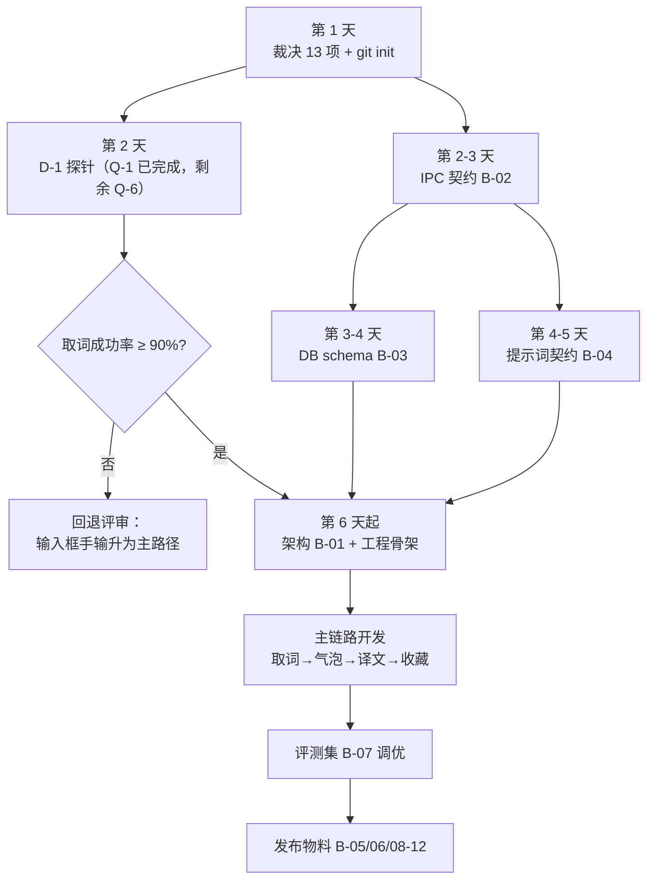

# Snapword · 开发进度与待办总清单 v1.0

> 对照基线：`docs/PRD.md`（v1.1.1）、`docs/interaction-spec.md`（v1.0）、`docs/pre-dev-audit.md`（v1.0）、`docs/research/uia-validation-2026-11.md`
> 生成日期：2026-10-19
> 用途：单页跟踪。所有「还差什么」都已编号，可直接当 issue 拆解依据。

---

## 0. 一句话现状

**纸上已经画完，地上开始动土。**

产品定义与主链路交互已经到可开工水准；契约层（进程怎么说话、数据怎么存、模型返回什么）一份都没有；产品代码 0 行。UIA 技术验证已完成 Q-1（Paragraph 颗粒度），D-1 还差成功率统计与 iframe。当前真正的卡点仍是 **13 个决策悬空 + 4 份契约文档缺失**，外加 D-1 的统计闭环。

---

## 1. 阶段定位

| 阶段 | 状态 | 完成度 | 证据 | 进入下一阶段的条件 |
|---|---|---|---|---|
| P0 需求定义 | ✅ 完成 | 100% | PRD 53 条 FR，全部带 GWT 验收 | — |
| P1 主链路交互 | ✅ 完成 | 100% | 逐帧时序 + 状态机 + 23 项参数 + 12 条 IA 用例 | — |
| P1b 次级页面交互 | ⬜ 未开始 | 0% | 生词本 / 最近 / 诊断 / 术语表 四页空白 | 4 页各有线框 + 状态清单 |
| P2 契约层 | ⬜ 未开始 | 0% | 4 份文档全缺 | IPC / 数据 / 提示词三份可执行 |
| P3 技术验证 | 🟡 部分完成 | 30% | Q-1 完成；D-1 单点取词通过，30 次统计 / iframe / Q-6 未跑 | 取词成功率 ≥ 90% |
| P4 工程骨架 | ⬜ 未开始 | 0% | 无 git、无 package.json、无进程骨架 | 三段进程能跑空链路 |
| P5 主链路开发 | ⬜ 未开始 | 0% | — | 选中 → 气泡 → 译文 → 收藏 全通 |
| P6 发布 | ⬜ 未开始 | 0% | — | Releases 有安装包 + 便携版 |

**两个口径的进度**：
- **开发前准备**：约 55%（文档 3 类齐 / 7 类齐）
- **全项目**：约 10%（按单人工作量粗估，代码为零）

> 判断依据是「换一个人接手，能不能直接开工」，不是行数。按这个标准，P0/P1 是真完成了，P2 是真空的。

---

## 2. 已完成清单（8 项）

| 编号 | 产物 | 文件 | 状态 |
|---|---|---|---|
| ✅ D-01 | 需求澄清（7 轮） | — | 53 条 FR 全部落定 |
| ✅ D-02 | PRD v1.1.1 | `docs/PRD.md` | 15 段结构，含 RTM |
| ✅ D-03 | 交互规格 v1.0 | `docs/interaction-spec.md` | 11 节，含反模式 9 条 |
| ✅ D-04 | 技术事实核实 | PRD 5.1.1 | Chrome 138+ 默认启用 UIA 等 6 条 |
| ✅ D-05 | 兜底路径评估 | PRD 5.1.2 | 模拟复制 9 项问题，判定永久不做 |
| ✅ D-06 | 开发前审计 | `docs/pre-dev-audit.md` | 22 冲突 + 12 缺口 + 8 空洞 |
| ✅ D-07 | 项目改名 Lingo Lens → Snapword | 全仓 + 资料库 | 本地与云端已同步 |
| ✅ D-08 | 仓库基础文件 | `README.md` / `LICENSE` / `.gitignore` | MIT，Key 与 DB 已排除 |

---

## 3. 还差什么：42 项 + 5 类验证欠账

| 类别 | 数量 | 性质 | 谁来定 |
|---|---|---|---|
| A. 决策裁决 | 13 项待拍板（另 15 项机械修改） | 会改需求或改界面 | **你** |
| B. 缺失文档 | 12 份 | 阻塞或影响质量 | 我写 |
| C. 规格空洞 | 4 个页面 + 4 项规范 | 开发时只能自由发挥 | 我写 |
| D. 验证欠账 | D-1 + Q-1/2/6/7 | 只能用代码回答 | 我写 PoC |
| E. 工程基础 | git 初始化、进程骨架、构建脚本 | 从零开始 | 我写 |

---

## 4. 待你拍板的 13 项

### 4.1 五项 P0（今天必须定，不定就返工）

| 编号 | 问题 | 我的建议 | 定错的后果 |
|---|---|---|---|
| A-01 | 单词输出缺 `context_snippet` 字段 | 补：`string \| null`，≤50 字符 | 前端无句可显示，收藏存不进去 |
| A-02 | 「OpenAI 兼容」没有基线 | 只依赖 `chat/completions` + `stream` + prompt 约束 JSON；`usage` 缺失则不计费 | 联调被 DeepSeek / Ollama / 中转服务逐个打脸 |
| A-03 | 生词本按什么去重 | 按 `word` 小写归一唯一，来源只做覆盖写入 | 收藏按钮是「更新」还是「新增」说不清 |
| A-04 | 术语表存 config 还是 SQLite | 存 SQLite，独立表 | config.json 承担两份数据，损坏风险叠加 |
| A-05 | `senses` 条数谁截断 | 提示词限 5 条，前端只兜底 | token 成本与展示逻辑双重漂移 |

### 4.2 两项方向性（影响范围，不影响结构）

| 编号 | 问题 | 我的建议 | 代价 |
|---|---|---|---|
| A-12 | 深色主题留不留 | **MVP 砍掉**，进 v1.1 | 砍：少一套色板 + 对比度验收；留：交互规格要补一整节 |
| A-14 | 双语界面是 Must 还是 Should | **降为 Should**，移出 S-14 | 升 Must：要多做 i18n 资源 + 文案长度规则；降级：非中文用户流失 |

### 4.3 六项 UX 待定

| 编号 | 问题 | 我的建议 |
|---|---|---|
| UX-1 | 双屏时侧边栏跟哪块屏 | 跟选区所在屏 |
| UX-2 | 全屏应用时侧边栏是否隐藏 | 气泡隐藏，侧边栏保留 |
| UX-3 | `e.g.` / `U.S.` / `state-of-the-art` 算词还是句 | 正则加 4 条白名单 |
| UX-4 | 「最近」入口做成什么 | 底部抽屉，高度 40% |
| UX-5 | 收藏是否带来源 URL | 带标题 + 域名，不带完整 URL |
| UX-6 | 侧边栏失焦是否变暗 | 不变暗 |

> UX-1~UX-6 都有默认值，**你不表态我就按建议写**，不阻塞。

---

## 5. 缺失文档 12 份

### 5.1 阻塞开工（4 份，必须先有）

| 编号 | 文档 | 产出路径 | 完成判据 |
|---|---|---|---|
| B-01 | 技术架构（进程模型） | `docs/architecture.md` | 进程拓扑图 + 职责边界 + 崩溃恢复时要重建什么 |
| B-02 | IPC 契约 | `docs/ipc-contract.md` | 每个字段有类型/单位/坐标系；每个失败分支有处理 |
| B-03 | 数据库 schema | `docs/data-model.md` | DDL 可直接执行 + 索引 + 迁移约定 |
| B-04 | 提示词契约 | `docs/prompt-contract.md` | 两条提示词全文 + 版本号 + 温度/max_tokens |

### 5.2 开发前应有（4 份）

| 编号 | 文档 | 缺失后果 |
|---|---|---|
| B-05 | 测试用例集 | 53 条 FR 只有 12 条有用例，其余等于没验收 |
| B-06 | 错误码表 | E-01~E-26 是场景不是码，日志对不上、诊断页输出不了 |
| B-07 | 评测集 50 条 | G-4「准确率 85%」目前是目标不是实测值 |
| B-08 | 发布与构建说明 | 版本号、SHA256 公布方式、发布 checklist 全无 |

### 5.3 上线前补齐（4 份）

| 编号 | 文档 | 对应风险 |
|---|---|---|
| B-09 | `PRIVACY.md` | 处理用户阅读内容，可信度基础设施 |
| B-10 | `FAQ / TROUBLESHOOTING` | RK-01 取不到词、RK-11 杀软误杀、E-12 |
| B-11 | `CHANGELOG.md` | 首个版本即需要 |
| B-12 | issue 模板（bug / feature） | RK-10 范围蔓延；模板带两个必填项可挡一半无效 issue |

---

## 6. 规格空洞 8 项

| 编号 | 缺口 | 现状 | 影响 |
|---|---|---|---|
| C-01 | **生词本页面** | 4 条 FR 无任何页面定义 | **最大单点空白**：列表/空态/批量/导出/二次确认全空 |
| C-02 | 「最近」入口 | UX-4 待定 | 待定项没有默认值 → 必然返工 |
| C-03 | 诊断页 | 只有 8 个检查项 | RK-01 的止血能力全靠它 |
| C-04 | 术语表管理 | 仅「表格内联编辑」一行 | 导入导出/匹配方式/正则校验全无 |
| C-05 | 视觉规范 | 要求 4.5:1 对比度，零色值 | **这条要求目前不可验收** |
| C-06 | i18n 布局规则 | 只有中文示例 | 英文字符串长 30~50%，96px 气泡必溢出 |
| C-07 | 代理与网络 | 无配置入口，只能靠系统代理 | 国内直连大概率失败 → 高频 issue |
| C-08 | 深色主题 | FR-32 要求，交互零覆盖 | 与 A-12 绑定，砍了即消解 |

---

## 7. 验证欠账 5 项（1 项已完成）

| 编号 | 验证内容 | 不验的后果 | 建议时机 | 状态 |
|---|---|---|---|---|
| **D-1** | Chrome/Edge 的 UIA 取选中文本成功率 | 整个产品方案成不成立 | **最先** | 🟡 部分完成 |
| Q-1 | `ExpandToEnclosingUnit(Paragraph)` 的实际颗粒度 | 语境义准确率无从谈起 | 与 D-1 同批 | ✅ 完成 |
| Q-6 | `RangeFromPoint` 可用率（单词兜底） | v1.1 兜底方案没法设计 | 与 D-1 同批 | ⬜ 未开始 |
| Q-2 | 全屏应用下 `alwaysOnTop` 是否生效 | 决定 FR-09 的实现方式 | 开发第 2 周前 | ⬜ 未开始 |
| Q-7 | Chrome <138 / 受管设备的表现 | 用户装了没反应，诊断页说不清 | 开发第 3 周前 | ⬜ 未开始 |

> 2026-11-02：Q-1 已完成（Chrome/Edge 156，报告见 [research/uia-validation-2026-11.md](research/uia-validation-2026-11.md)）；D-1 已完成单点取词与段落扩展验证，但 3 类页面 × 10 次、成功率、耗时统计与 iframe 未完成；Q-6/Q-2/Q-7 未开始。D-1 / Q-6 仍可在同一个探针程序里跑完。

---

## 8. 下一步路线

### 第一批：第 1~5 天（不写业务代码）

| # | 动作 | 产出 | 完成判据 |
|---|---|---|---|
| 1 | 裁决 13 项 | PRD / 交互规格改到位 | 无「或」字、无「待定」 |
| 2 | `git init` + 首次提交 | 可回滚的基线 | `git log` 有一条记录 |
| 3 | D-1 探针 | `uia-probe`（UIA-demo）+ 本仓验证报告 | 输出成功率数字，回填 PRD 13.1；Q-1 已完成，剩余 30 次统计与 Q-6 |
| 4 | IPC 契约 | `docs/ipc-contract.md` | 坐标系写明是否 DPI 归一 |
| 5 | DB schema | `docs/data-model.md` | 能直接执行建表 |
| 6 | 提示词契约 | `docs/prompt-contract.md` | 与 A-01/A-05 一致 |

**门槛**：这 6 件没做完，不写界面。理由：它们都会反向修改界面（`context_snippet` 有没有，直接决定语境义块长什么样）。

### 第二批：第 6~10 天

| # | 动作 | 产出 |
|---|---|---|
| 7 | 技术架构 + 进程骨架 | `docs/architecture.md` + 三段进程跑通空链路 |
| 8 | 补 4 个页面交互 | C-01~C-04 线框 + 状态清单 |
| 9 | 修 A-06~A-22 | 一次性改完 15 项 |
| 10 | 评测集 50 条 | `docs/eval-set.md` |
| 11 | 错误码表 | 内部码 ↔ 用户文案 ↔ 诊断页，三列对齐 |

### 第三批：第 11 天起

主链路开发 → 联调 → 打包 → 发布物料（B-05/06/08~12）。

---

## 9. 接下来 72 小时（可直接照做）

| 时段 | 动作 | 判据 |
|---|---|---|
| **今天下午** | 你逐条批 4.1 的 5 项 P0 | 5 条各有一个答案 |
| **今天傍晚** | 我按裁决改 PRD，并 `git init` 打基线 | 改动可 diff |
| **明天上午** | 我出 D-1 探针（C# 单文件控制台） | 你机器上能编译 |
| **明天下午** | 你跑 3 类页面 × 10 次，回传结果 | 拿到成功率数字 |
| **后天** | 按结果决定：继续 or 回退评审 | 有明确结论 |

---

## 10. 三条要记住的判断

1. **P0 五项全在单词链路**——单词模式是唯一「模型输出直接决定界面结构」的地方，风险集中，加固也应集中。
2. **最大的空白不在清单里，在文档缝隙里**——生词本整个页面 4 条需求、零交互定义。两份文档都以为对方写了。
3. **现在最该防的不是想不清，是过早写界面**。13 个决策里任何一个改口，都会让已写的界面返工。

---

## 附：勾选状态图例

- ✅ 已完成，有产物可查
- ⬜ 未开始
- 🔶 部分完成 / 有默认值待确认
- ⛔ 阻塞中，等外部输入
