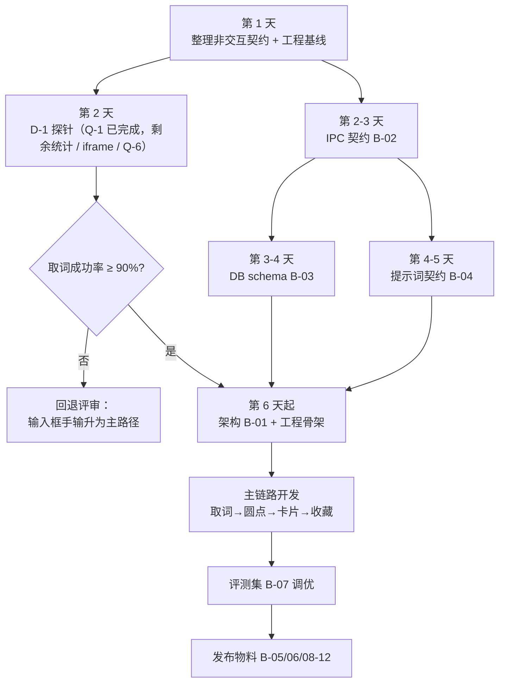

# Snapword · 开发进度与待办总清单 v1.0

> **2026-11-03 更新**：当前交互基线为 [PRD-v2.md](PRD-v2.md) 与 [interaction-spec-v2.md](interaction-spec-v2.md)，本清单按已确认决策同步；两份 v2 文档的验收清单均为连续唯一的 IA-01～IA-36。P1 待实测项见 PRD-v2 第 12 节。
>
> 对照基线：`docs/PRD.md`（v1.1.1）、`docs/interaction-spec.md`（v1.0）、`docs/pre-dev-audit.md`（v1.0）、`docs/research/uia-validation-2026-11.md`
> 生成日期：2026-10-19
> 用途：单页跟踪。所有「还差什么」都已编号，可直接当 issue 拆解依据。

---

## 0. 一句话现状

**交互规则已收敛，技术验证与工程准备仍在进行。**

三窗口交互（v2.0）已按确认决策形成基线；契约层（进程怎么说话、数据怎么存、模型返回什么）仍未开始；产品代码 0 行。UIA 技术验证已完成 Q-1（Paragraph 颗粒度），D-1 还差成功率统计与 iframe；全屏应用下卡片置顶仍待实测。当前卡点为 **4 份契约文档缺失、D-1 验证闭环及全屏置顶实测**。

---

## 1. 阶段定位

| 阶段 | 状态 | 完成度 | 证据 | 进入下一阶段的条件 |
|---|---|---|---|---|
| P0 需求定义 | ✅ 完成 | 100% | PRD 53 条 FR，全部带 GWT 验收 | — |
| P1 主链路交互 | ✅ 决策已确认 | 100% | PRD-v2 + interaction-spec-v2：三窗口、逐帧时序、36 条 IA 验收用例 | 全屏置顶等待实测；视觉稿待完成 |
| P1b 次级页面交互 | ✅ 并入 v2 | 100% | 生词本 / 翻译历史 / 诊断 / 术语表已写入 PRD-v2 主窗口章节 | — |
| P2 契约层 | ⬜ 未开始 | 0% | 4 份文档全缺 | IPC / 数据 / 提示词三份可执行 |
| P3 技术验证 | 🟡 部分完成 | 30% | Q-1 完成；D-1 单点取词通过，30 次统计 / iframe / Q-6 未跑 | 取词成功率 ≥ 90% |
| P4 工程骨架 | ⬜ 未开始 | 0% | 无 package.json、无进程骨架；git 仓库已初始化 | 三段进程能跑空链路 |
| P5 主链路开发 | ⬜ 未开始 | 0% | — | 选中 → 圆点 → 卡片 → 收藏 全通 |
| P6 发布 | ⬜ 未开始 | 0% | — | Releases 有安装包 + 便携版 |

**两个口径的进度**：
- **开发前准备**：约 55%（文档 3 类齐 / 7 类齐）
- **全项目**：约 10%（按单人工作量粗估，代码为零）

> 判断依据是「换一个人接手，能不能直接开工」，不是行数。按这个标准，P0/P1 是真完成了，P2 是真空的。

---

## 2. 已完成清单（11 项）

| 编号 | 产物 | 文件 | 状态 |
|---|---|---|---|
| ✅ D-01 | 需求澄清（7 轮） | — | 53 条 FR 全部落定 |
| ✅ D-02 | PRD v1.1.1 | `docs/PRD.md` | 15 段结构，含 RTM |
| ✅ D-03 | 交互规格 v1.0 | `docs/interaction-spec.md` | 11 节，含反模式 9 条 |
| ✅ D-04 | 技术事实核实 | PRD 5.1.1 | Chrome 138+ 默认启用 UIA 等 6 条 |
| ✅ D-05 | 兜底路径评估 | PRD 5.1.2 | 模拟复制 9 项问题，判定永久不做 |
| ✅ D-06 | 开发前审计 | `docs/pre-dev-audit.md` | 22 冲突 + 12 缺口 + 8 空洞 |
| ✅ D-07 | 项目改名 Lingo Lens → Snapword | 全仓 + 资料库 | 本地与云端已同步 |
| ✅ D-08 | 仓库基础文件 | `README.md` / `LICENSE` / `.gitignore` | MIT，Key 与 DB 已排除 |
| ✅ D-09 | 三窗口交互需求 v2.0 | `docs/PRD-v2.md` | 圆点 / 翻译卡片 / 主窗口，含跨窗口与验收 |
| ✅ D-10 | 三窗口交互规格 v2.0 | `docs/interaction-spec-v2.md` | 逐帧时序、位置算法、状态机、36 条 IA 用例 |
| ✅ D-11 | 沉浸式翻译本地版调研 | `docs/research/immersive-translate-interaction-2026-11.md` | 1.34.4 三层界面与关键数值 |

---

## 3. 还差什么：工程与验证欠账

| 类别 | 当前状态 | 性质 | 下一步 |
|---|---|---|---|
| A. 交互决策 | 本轮已按最终确认同步，不再作为待拍板项 | 已收敛；若未来变化需正式变更记录 | 仅处理后续正式变更 |
| B. 缺失文档 | 12 份契约/质量/发布文档仍缺 | 阻塞或影响质量 | 按第 5 节补齐 |
| C. 规格空洞 | 部分技术/质量规格仍待补 | 开发时可能需自由发挥 | 与契约层并行核实 |
| D. 验证欠账 | D-1 闭环、Q-2、Q-6、Q-7 未完成；Q-1 已完成 | 只能实测 | 完成 UIA 与全屏窗口验证 |
| E. 工程基础 | 工程骨架与构建脚本未开始 | 从零开始 | 技术验证与契约满足门槛后启动 |

---

## 4. 已确认的非交互契约决策（保留待契约文档落地）

以下仍是非 UI 交互层待细化事项；本次文档统一不代替对这些契约内容的确认：

### 4.1 五项 P0（落实到契约文档前仍需核实）

| 编号 | 问题 | 我的建议 | 定错的后果 |
|---|---|---|---|
| A-01 | 单词输出缺 `context_snippet` 字段 | 补：`string \| null`，≤50 字符 | 前端无句可显示，收藏存不进去 |
| A-02 | 「OpenAI 兼容」没有基线 | 只依赖 `chat/completions` + `stream` + prompt 约束 JSON；`usage` 缺失则不计费 | 联调被 DeepSeek / Ollama / 中转服务逐个打脸 |
| A-03 | 生词本按什么去重 | 按 `word` 小写归一唯一，来源只做覆盖写入 | 收藏按钮是「更新」还是「新增」说不清 |
| A-04 | 术语表存 config 还是 SQLite | 存 SQLite，独立表 | config.json 承担两份数据，损坏风险叠加 |
| A-05 | `senses` 条数谁截断 | 提示词限 5 条，前端只兜底 | token 成本与展示逻辑双重漂移 |

### 4.2 两项方向性（影响范围，不影响结构）

| 编号 | 问题 | 我的建议 | 代价 |
|---|---|---|---|
| A-12 | 深色主题留不留 | v2 当前交互规格沿用浅/深/跟随系统主题要求；PRD v1.1.1 的旧建议仅作历史 | 与 v2 当前界面行为保持一致 |
| A-14 | 界面语言中英双语是 Must 还是 Should | 沿用既有 PRD 范围；本轮未修改 | 按原产品范围处理 |

### 4.3 六项 UX 待细化

| 编号 | 问题 | 当前处理 | 状态 |
|---|---|---|---|
| UX-1 | 双屏时卡片跟哪块屏 | 跟选区所在屏（PRD-v2 RC-02） | ✅ 已定 |
| UX-2 | 全屏应用时卡片是否显示 | 尝试置顶，失败则托盘提示；待实测（PRD-v2 RC-17 / Q-2） | ⬜ 待实测 |
| UX-3 | `e.g.` / `U.S.` / `state-of-the-art` 算词还是句 | 按 PRD FR-11 判定，列入契约/测试样例核实 | ⬜ 待细化 |
| UX-4 | 「最近」入口形式 | 翻译页直接显示共享历史前 5 条；不做独立抽屉 | ✅ 已定 |
| UX-5 | 收藏是否带来源 URL | 沿用 PRD 原定来源字段边界，非本轮调整 | ⬜ 待契约 |
| UX-6 | 卡片失焦视觉 | 不新增失焦变暗规则；关闭按「保持打开」决策处理 | ✅ 已定 |

> UX 项仅用于追踪待细化细节；已由 v2 明确的交互决策不得回退为开放问题。

---

## 5. 缺失文档 12 份

### 5.1 阻塞开工（4 份，必须先有）

| 编号 | 文档 | 产出路径 | 完成判据 |
|---|---|---|---|
| B-01 | 技术架构（进程模型） | `docs/architecture.md` | 进程拓扑图 + 职责边界 + 崩溃恢复时要重建什么 |
| B-02 | IPC 契约 | `docs/ipc-contract.md` | 每个字段有类型/单位/坐标系；每个失败分支有处理 |
| B-03 | 数据库 schema | `docs/data-model.md` | DDL 可直接执行 + 索引 + 迁移约定 |
| B-04 | 提示词契约 | `docs/prompt-contract.md` | 两条提示词全文 + 版本号 + 温度/max_tokens |

### 5.2 开发前应有（4 份）

| 编号 | 文档 | 缺失后果 |
|---|---|---|
| B-05 | 测试用例集 | 53 条 FR 只有 12 条有用例，其余等于没验收 |
| B-06 | 错误码表 | E-01~E-26 是场景不是码，日志对不上、诊断页输出不了 |
| B-07 | 评测集 50 条 | G-4「准确率 85%」目前是目标不是实测值 |
| B-08 | 发布与构建说明 | 版本号、SHA256 公布方式、发布 checklist 全无 |

### 5.3 上线前补齐（4 份）

| 编号 | 文档 | 对应风险 |
|---|---|---|
| B-09 | `PRIVACY.md` | 处理用户阅读内容，可信度基础设施 |
| B-10 | `FAQ / TROUBLESHOOTING` | RK-01 取不到词、RK-11 杀软误杀、E-12 |
| B-11 | `CHANGELOG.md` | 首个版本即需要 |
| B-12 | issue 模板（bug / feature） | RK-10 范围蔓延；模板带两个必填项可挡一半无效 issue |

---

## 6. 规格空洞 8 项

| 编号 | 缺口 | 现状 | 影响 |
|---|---|---|---|
| C-01 | **生词本页面** | ✅ v2 已定义列表/空态/批量/导出/二次确认（PRD-v2 RM-05） | 已关闭；待视觉稿 |
| C-02 | 「最近」入口 | ✅ v2 已定：翻译页显示共享历史前 5 条（RM-03） | 已关闭 |
| C-03 | 诊断页 | ✅ v2 已定义 8 项检查与操作（RM-08） | 已关闭；待视觉稿 |
| C-04 | 术语表管理 | ✅ v2 已定义表格/导入导出/校验（RM-06） | 已关闭；待视觉稿 |
| C-05 | 视觉规范 | 仍缺颜色令牌与视觉稿 | **4.5:1 对比度目前不可验收** |
| C-06 | i18n 布局规则 | 仍缺英文字符串长度规则；96px 气泡已废止，按 420px 卡片与主窗口重估 | 英文界面可能溢出 |
| C-07 | 代理与网络 | 仍无配置入口，只能靠系统代理 | 国内直连大概率失败 → 高频 issue |
| C-08 | 深色主题 | ✅ v2 已覆盖浅/深/跟随系统（RC-16 / RM-13） | 已关闭；待视觉稿 |

---

## 7. 验证欠账（Q-1 已完成，其余待验证）

| 编号 | 验证内容 | 不验的后果 | 建议时机 | 状态 |
|---|---|---|---|---|
| **D-1** | Chrome/Edge 的 UIA 取选中文本成功率 | 整个产品方案成不成立 | **最先** | 🟡 部分完成 |
| Q-1 | `ExpandToEnclosingUnit(Paragraph)` 的实际颗粒度 | 语境义准确率无从谈起 | 与 D-1 同批 | ✅ 完成 |
| Q-6 | `RangeFromPoint` 可用率（单词兜底） | 影响后续是否纳入单词取词兜底 | 与 D-1 同批 | ⬜ 未开始 |
| Q-2 | 全屏应用下卡片置顶是否生效 | PRD-v2 RC-17 的待实测项 | 开发前验证 | ⬜ 未开始 |
| Q-7 | Chrome <138 / 受管设备的表现 | 用户装了没反应，诊断页说不清 | 开发第 3 周前 | ⬜ 未开始 |

> 2026-11-02：Q-1 已完成（Chrome/Edge 156，报告见 [research/uia-validation-2026-11.md](research/uia-validation-2026-11.md)）；D-1 已完成单点取词与段落扩展验证，但 3 类页面 × 10 次、成功率、耗时统计与 iframe 未完成；Q-6/Q-2/Q-7 未开始。D-1 / Q-6 仍可在同一个探针程序里跑完。

---

## 8. 下一步路线

### 第一批：第 1~5 天（不写业务代码）

| # | 动作 | 产出 | 完成判据 |
|---|---|---|---|
| 1 | 落实已确认决策并核实非交互契约 | PRD / 交互规格 / 契约草案 | 交互按 v2 最终决策同步；非交互字段/协议按产品所有者确认 |
| 2 | 工程基线（按项目实际状态维护，不重复初始化） | 可回滚的基线 | `git status` 与提交记录可检查 |
| 3 | D-1 探针 | `uia-probe`（UIA-demo）+ 本仓验证报告 | 输出成功率数字，回填 PRD；Q-1 已完成，剩余 30 次统计、iframe 与 Q-6 |
| 4 | IPC 契约 | `docs/ipc-contract.md` | 坐标系写明是否 DPI 归一 |
| 5 | DB schema | `docs/data-model.md` | 能直接执行建表 |
| 6 | 提示词契约 | `docs/prompt-contract.md` | 字段与展示约束一致 |

**门槛**：这 6 件没做完，不写界面。理由：它们都会反向修改界面（`context_snippet` 有没有，直接决定语境义块长什么样）。

### 第二批：第 6~10 天

| # | 动作 | 产出 |
|---|---|---|
| 7 | 技术架构 + 进程骨架 | `docs/architecture.md` + 三段进程跑通空链路 |
| 8 | 补齐剩余规格与视觉稿 | C-01~C-04 页面线框 + C-05~C-07 视觉/i18n/代理规格 |
| 9 | 维护契约层与既有非交互范围 | 根据确认项更新契约，不将历史建议视作新决策 |
| 10 | 评测集 50 条 | `docs/eval-set.md` |
| 11 | 错误码表 | 内部码 ↔ 用户文案 ↔ 诊断页，三列对齐 |

### 第三批：第 11 天起

主链路开发 → 联调 → 打包 → 发布物料（B-05/06/08~12）。

---

## 9. 接下来 72 小时（按顺序执行，日期以实际开工日为准）

| 顺序 | 动作 | 判据 |
|---|---|---|
| 1 | 逐条批 4.1 的 5 项 P0 | 5 条各有一个答案 |
| 2 | 按裁决改契约文档并打基线 | 改动可 diff |
| 3 | 出 D-1 探针（C# 单文件控制台） | 你机器上能编译 |
| 4 | 跑 3 类页面 × 10 次，回传结果 | 拿到成功率数字 |
| 5 | 按结果决定：继续 or 回退评审 | 有明确结论 |

---

## 10. 三条要记住的判断

1. **P0 五项全在单词链路**——单词模式是唯一「模型输出直接决定界面结构」的地方，风险集中，加固也应集中。
2. **最大的空白已经从交互清单转移到契约层**——v2 已补全生词本、术语表、诊断与设置页面行为；IPC、数据、提示词三份契约仍是 0。
3. **现在最该防的不是想不清，是过早写界面**。v2 交互决策里任何一个改口，都会让已写的界面返工。

---

## 附：勾选状态图例

- ✅ 已完成，有产物可查
- ⬜ 未开始
- 🔶 部分完成 / 有默认值待确认
- ⛔ 阻塞中，等外部输入
